# Sakshya — Software Requirements Specification (SRS)

**AICTE Security Deposit & FDR Management Portal** · Smart India Hackathon problem statement · Regulation Bureau, AICTE, Ministry of Education

| Field | Value |
|---|---|
| Document ID | SRS-SAK-001 |
| Version | 1.0 (build baseline) |
| Date | 24 October 2026 |
| Product codename | **Sakshya** (साक्ष्य, "evidence / witness"); repository name `sakshya` (the name is changeable) |
| Status | Approved for build. Items marked **VALIDATE** in §2.5 need confirmation from AICTE / mentors but are handled through configuration so they never block development |
| Audience | Developers, designers, ML engineers, QA, reviewers/judges, future maintainers |
| Scope of this release | Complete, production-grade, full-stack system (not a minimal prototype) |

---

## How to read this document

1. **§1–2** explain the problem, the vision, the users, the assumptions and every use case.
2. **§3–6** define architecture, data model, state machines, functional and non-functional requirements, rules and catalogues.
3. **§7** contains end-to-end flow diagrams (sequence diagrams) and algorithms.
4. **§8** is the **task breakdown**: every unit of work, written so it can be picked up **asynchronously**. Each task lists dependencies, requirements, edge cases, **test cases** and a **push gate** (the checklist that tells you the work is perfect to push to GitHub).
5. **§9** is traceability (requirement → task → test), the end-to-end scenario catalogue, the risk register and appendices.

> **Async-first rule.** Nobody should ever wait for a person. Tasks depend on **contracts** (OpenAPI, DB schema, event catalogue, adapter interfaces), and every contract ships with a mock or fake so dependent work can start on day one. See §8.1.

### Table of contents

- [1. Introduction](#1-introduction)
- [2. Overall Description](#2-overall-description)
- [3. System Architecture](#3-system-architecture)
- [4. Data Model](#4-data-model)
- [5. State Machines](#5-state-machines)
- [6. Specific Requirements](#6-specific-requirements)
- [7. Flows and Algorithms](#7-flows-and-algorithms)
- [8. Task Breakdown](#8-task-breakdown)
- [9. Traceability, Scenarios, Risks, Appendices](#9-traceability-scenarios-risks-appendices)

---

# 1. Introduction

## 1.1 Purpose

This SRS specifies **Sakshya**, a secure, centralized portal that manages the full lifecycle of **security deposits and Fixed Deposit Receipts (FDRs)** that technical institutions submit to AICTE as part of approval and compliance processes: submission, verification, lien confirmation, monitoring, renewal/replacement, release/refund, closure, audit.

## 1.2 Scope

**In scope**

- Institution-wise and instrument-wise repository of deposits (FDR and direct cash deposit) with versioned history.
- Digital document management with automated Layer-1 document checks.
- A **hybrid lien workflow**: the institute gives the mandate, the **bank confirms directly to AICTE** through a verified channel.
- **Trust levels per field**: Institute-claimed → Officer-attested → Bank-confirmed.
- Automated maturity/validity tracking, reminders, escalation, renewal/replacement tracking.
- Risk-based **periodic bank reconciliation** (bank-wise bulk confirmations).
- Release/refund workflow with a rules-driven eligibility engine, maker-checker approval, **digitally signed, verifiable release letters** (hash + QR, 14-day validity, single use, revocable), a public verification page, bank execution acknowledgement and finance settlement (principal vs AICTE share).
- Dashboards, reports, search, evidence packs, tamper-evident audit trail, role-based and scope-based access control, configurable rules.
- Bank Console (maker-checker), Officer Console, Institute Portal, Public Verifier page, Admin Console.

**Out of scope (documented interfaces only, no real integration in this release)**

- Real bank core-banking/SFMS connectivity, real Parichay/MeriPehchaan, real eSign/DSC provider, real SMS gateway. Each has an adapter interface and a simulator (§3.6, T-140–T-144).
- Payments or fund movement. The platform records and verifies; the bank moves money.
- Legal adjudication of disputes.

## 1.3 Problem recap and root causes

AICTE has **no single, trustworthy, time-aware system** for institute deposits. Records are scattered; verification is manual and slow; deadlines depend on human memory; release is opaque; accountability is weak.

| ID | Root cause | What the system must do about it |
|---|---|---|
| RC-1 | Data fragmentation (files, mails, registers) | One versioned repository, single source of truth |
| RC-2 | Trust gap: what an institute submits is a *claim*, not a *fact*. Forged or already-discharged FDRs are a real risk (publicly reported forged-FDR fraud against government accounts motivates this) | Field-level trust levels; bank-direct confirmation; document checks only raise flags |
| RC-3 | Time-based tracking depends on human memory | Scheduler, reminders, escalation, lapse detection |
| RC-4 | No formal workflow state for release/refund | State machines, queues, SLAs, visible ownership |
| RC-5 | No accountability trail | Append-only hash-chained audit, evidence packs |
| RC-6 | Reactive, not proactive | Risk-based prioritisation, periodic reconciliation, exception-first dashboards |

## 1.4 Product vision and USPs

**Why "Sakshya".** *Sakshya* (साक्ष्य) means evidence or witness. The product turns every claim an institute makes into something backed by evidence: a bank-confirmed fact, a signed letter, a hash-chained audit entry.

| ID | USP | One-line explanation |
|---|---|---|
| U1 | **Trust chain** | Every field carries a trust level and evidence; "Active" requires bank confirmation |
| U2 | **Hybrid lien** | Institute authorises, bank confirms **directly to AICTE** via a verified nodal directory (never via contacts printed on submitted documents) |
| U3 | **Verifiable release letter** | Signed, hash-bound, QR, 14-day, single-use, revocable; banks verify on a public page |
| U4 | **Forgery-resistant intake** | OCR, QR, consistency, tamper heuristics and cross-institute duplicate detection raise flags; they never approve |
| U5 | **Continuous assurance** | Risk-based bank-wise bulk reconciliation catches silent lien removal, loans, encashment |
| U6 | **Rules as configuration** | Versioned, effective-dated policy (term, multipliers, penalties, interest destination, SLAs); no hard-coded regulation |
| U7 | **Explainable priority queue** | Officers see *why* a case ranks high |
| U8 | **Tamper-evident audit** | Hash chain, daily anchor, one-click evidence pack |

## 1.5 Definitions and acronyms

| Term | Meaning |
|---|---|
| AICTE | All India Council for Technical Education |
| APH | AICTE Approval Process Handbook |
| FDR | Fixed Deposit Receipt |
| Obligation | The requirement that a Trust/institute maintain a deposit of a given amount for a given term |
| Instrument | A concrete deposit that satisfies (part of) an obligation: an FDR or a cash deposit |
| Version | An immutable snapshot of an instrument's data (renewal/correction creates a new version) |
| Lien | A bank-side restriction recording AICTE's right over the FDR |
| Trust level | L0 `CLAIMED`, L1 `ATTESTED` (officer), L2 `BANK_CONFIRMED` |
| Nodal officer | Bank official enrolled in AICTE's verified directory to confirm FDRs and execute releases |
| Maker-checker | Two different people must perform prepare and authorise steps |
| Step-up | Re-authentication (MFA + signing) required for sensitive actions |
| Time travel | Admin-only simulated clock used for demos and tests; disabled in production |
| SO / AO / RA / FO / RGO / CO | Scrutiny / Approving / Release Authority / Finance / Regional / Compliance Officer |
| BMK / BCK | Bank Maker / Bank Checker |

## 1.6 References and source register

| Ref | Source | Use | Currency |
|---|---|---|---|
| R1 | SIH problem statement: Security Deposit/FDR Management Portal (AICTE Regulation Bureau) | Primary requirements and expected solution (10 capabilities) | Authoritative |
| R2 | AICTE Approval Process Handbook 2024-25 to 2026-27 (security deposit provisions: term, refund, penalty, lien, special cases) | Business rules BR-xxx | **VALIDATE** exact clauses and tables |
| R3 | AICTE letters of intent / circulars on FDR format and release procedure (public copies, some older) | Workflow details (favouring Member Secretary, original FDR custody, bank instruction) | **VALIDATE** currency |
| R4 | Public media and court-reported cases of forged FDRs against government accounts | Motivation for bank-direct confirmation | Context only |
| R5 | Bank Guarantee confirmation over SFMS (IFN 760) precedent | Design inspiration for a standard bank channel | Informational |
| R6 | Account Aggregator framework | Future consent-based data path; constraints noted | Informational |
| R7 | NIC Parichay / Jan Parichay / MeriPehchaan; CCA eSign and DSC | Identity and signing options | Informational |
| R8 | Stock-exchange FDR lien-letter formats | Precedent for bank lien confirmation checklist | Informational |

---

# 2. Overall Description

## 2.1 Product perspective

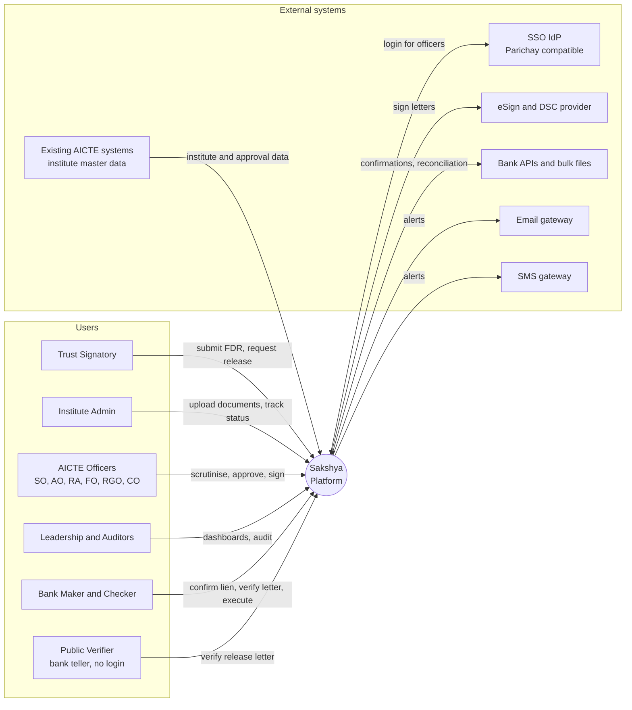

## 2.2 Users and roles

| Role code | Who (real-world equivalent) | Authority summary |
|---|---|---|
| `INS_SIGNATORY` | Trust / Society / Company authorised signatory | Redeem token, submit FDR, request release, receive letter. The legal depositor is the Trust |
| `INS_ADMIN` | Principal / Registrar / accounts clerk | Prepare drafts, upload documents, view status. Cannot submit finally or request release |
| `SCRUTINY_OFFICER` | Assistant / Deputy Director level, Regulation Bureau or Regional Office | Review documents, observations, flag discrepancies, initiate bank confirmation, prepare eligibility report |
| `APPROVING_OFFICER` | Director / senior Deputy Director | Activate bank-confirmed instruments, resolve discrepancies, accept renewals, recommend release. Never on a case they scrutinised |
| `RELEASE_AUTHORITY` | Member Secretary (delegable to Adviser; configurable) | Sign (step-up) and revoke release letters, special cases |
| `FINANCE_OFFICER` | Finance Bureau | Compute AICTE share (interest + penalty), confirm credit, reconcile, close |
| `REGIONAL_OFFICER` | Regional Office officer / coordinator | Region-scoped view, log physical originals and custody |
| `COMPLIANCE_OFFICER` | Cell holding complaints / proceedings | Place and lift holds |
| `LEADERSHIP` | Chairman / Vice Chairman / Member Secretary dashboards | Read-only analytics and drill-down |
| `AUDITOR` | Internal audit / vigilance / external auditor | Read-only incl. audit trail, evidence packs, chain verification |
| `POLICY_ADMIN` | Policy owner | Edit rules; changes need second approver |
| `SYSTEM_ADMIN` | e-Governance / IT | Users, infra, jobs, backups. **No business-data approvals** |
| `BANK_MAKER` (BMK) | Bank nodal officer | Prepare lien/reconciliation/execution responses for own bank |
| `BANK_CHECKER` (BCK) | Bank supervisor | Authorise the maker's response (configurable) |
| `PUBLIC_VERIFIER` | Anyone with a letter (typically a bank teller) | Verify a letter by ID + FDR number + IFSC; no browsing |
| `UNIVERSITY_CERTIFIER` (P3) | Affiliating University/Board | Upload/verify certificates (closure, no students) |

Permission matrix: §6.1.

## 2.3 Operating environment

- Browser-based SPA (evergreen Chrome, Edge, Firefox, Safari; responsive down to 360 px width).
- Linux containers (Docker Compose for dev and single-node; Kubernetes/Helm manifests for production).
- PostgreSQL 16, Redis 7, S3-compatible object storage (MinIO in dev), SMTP.

## 2.4 Design and implementation constraints

1. Government-environment friendly: containerised, no mandatory SaaS dependency, secrets via environment/secret manager, data residency in India.
2. **No regulation hard-coded.** Amounts, tenure, multipliers, penalties, SLAs, interest destination are policy data (§6.4).
3. Bank connectivity is **not assumed**. Banks differ; the bank channel is an interface with several implementations.
4. The platform **never trusts a claim** to become a fact. Only the bank channel can create L2 data.
5. All state changes emit audit events and domain events.
6. Contract-first development (OpenAPI 3.1) with generated clients/mocks.

## 2.5 Assumptions, dependencies and validation register

| ID | Assumption | Impact if wrong | Handling | Status |
|---|---|---|---|---|
| ASM-01 | Deposit term is 10 years from the approval cycle, then principal returns to the depositing Trust/Society/Company | Release eligibility | `deposit_term_years` policy | **VALIDATE** |
| ASM-02 | Interest accrues to AICTE (not the institute) in the current handbook; older letters differed | Letter split | `interest_destination` policy, versioned | **VALIDATE** |
| ASM-03 | FDR is issued in favour of the Member Secretary, AICTE, with lien | Favouring check D-07 | `favouring_names` policy | **VALIDATE** |
| ASM-04 | Leased-premises institutions deposit a multiple of the standard amount | Amount computation | `leased_multiplier` policy | **VALIDATE** |
| ASM-05 | Category-wise amounts come from a handbook table | Required amount | `amount_table` policy imported by T-016 | **VALIDATE** (needs table) |
| ASM-06 | Penalty (percentage) may be deducted before release in specified cases | Settlement | `penalty_rules` policy | **VALIDATE** |
| ASM-07 | Closure, merger, conversion releases need a University/Board certificate and no pending complaints | Eligibility rules | `release_case_types` policy | **VALIDATE** |
| ASM-08 | Release letter signing authority is the Member Secretary (delegable) | Approval matrix | `approval_matrix` policy | **VALIDATE** |
| ASM-09 | Regional Offices may hold physical originals | Custody log | Optional module T-113 | **VALIDATE** |
| ASM-10 | Cash/transfer deposits to an AICTE account are an allowed instrument type | `CASH_DEPOSIT` flow | Feature-flagged `cash_deposit_enabled` | **VALIDATE** |
| ASM-11 | Most banks cannot offer an FDR-verification API | Channel design | Portal channel is default; API/bulk are adapters | Accepted |
| ASM-12 | Banks will accept confirming via a secure portal and letter formats prescribed by AICTE | Adoption | Standard lien checklist and letter format; roadmap for SFMS-like channel | **VALIDATE** |
| ASM-13 | Interim state between submission and bank confirmation is allowed ("provisional") for N days | Policy | `provisional_window_days` | **VALIDATE** |
| ASM-14 | Real AICTE data and bank APIs are unavailable; synthetic data and simulators are used | Test realism | T-120, T-140 | Accepted |
| ASM-15 | Officer designations vary and staff rotate (deputation/contract) | Authority model | Function-based roles, delegation with expiry | Accepted |

## 2.6 Use-case catalogue

Every use case below is covered by requirements (§6.2) and tasks (§8). "Alt/exception" lists the paths that must also work.

### Institute side

| ID | Actor | Use case | Alternate / exception paths |
|---|---|---|---|
| UC-01 | Trust signatory | Redeem token and onboard | Invalid / expired / used token; wrong trust; OTP failure; lockout; suspected token leak → revoke and re-issue |
| UC-02 | Trust signatory | Submit FDR as e-FDR | QR missing or mismatching; unreadable file; wrong format |
| UC-03 | Trust signatory | Submit FDR as physical scan | Low OCR confidence → manual entry; tamper flags; physical original to be logged |
| UC-04 | Trust signatory | Submit multiple FDRs for one obligation | Sum below required; split across banks; duplicate FDR number |
| UC-05 | Trust signatory | Submit direct cash/transfer deposit | Credit not found by Finance; amount mismatch |
| UC-06 | Institute admin / signatory | Save draft, resume, withdraw | Concurrent edit; draft expiry |
| UC-07 | Trust signatory | Respond to changes requested / discrepancy | Re-upload; dispute a flag with evidence |
| UC-08 | Trust signatory | Download pre-filled lien mandate pack; upload bank acknowledgement | Uploaded acknowledgement stays L0/L1 only |
| UC-09 | Institute users | Track status timeline and SLA | Multi-instrument view |
| UC-10 | Trust signatory | Renew: same number, new number, or replacement at another bank | Renewal after lapse; lien not re-marked on new number |
| UC-11 | Trust signatory | Top-up when obligation increases (new programme/intake) | Partial top-up; additional FDR |
| UC-12 | Trust signatory | Request release at term completion | Ineligible with reasons; hold present |
| UC-13 | Trust signatory | Request special release (closure, merger, conversion) | Missing certificate; pending complaint |
| UC-14 | Trust signatory | Request partial release (programme closed) | Remaining obligation recomputed |
| UC-15 | Trust signatory | Receive letter, track bank execution, request re-issue | Letter expired; revoked |
| UC-16 | Trust signatory | Change signatory / add admin | Authority letter upload, approval, old signatory revoked |
| UC-17 | Institute users | Raise query/grievance on a case | Threaded comments, attachments |

### AICTE side

| ID | Actor | Use case | Alternate / exception paths |
|---|---|---|---|
| UC-20 | SO | Scrutinise documents, add observations, request changes | Conflict of interest self-declared |
| UC-21 | SO / AO | Initiate bank confirmation; resend; change channel | Bank not enrolled; manual-attested fallback |
| UC-22 | SO / AO | Resolve discrepancy (clear, escalate, reject, refer to compliance) | Needs second reviewer for high severity |
| UC-23 | AO | Activate instrument (maker-checker) | Blocked if L2 missing; blocked if same person scrutinised |
| UC-24 | SO | Handle bank non-response | Alternate nodal contact; call-back verification record; escalation |
| UC-25 | AO / CO | Handle suspected forgery | Quarantine instrument, block releases, notify vigilance |
| UC-26 | AO | Accept renewal / replacement and reconcile history | Number changed; lien re-confirmation needed |
| UC-27 | AO | Handle lapse (maturity passed without renewal) | Breach case, escalation, institute notice |
| UC-28 | AO | Review eligibility report and recommend release | Manual override with reason (logged, needs RA) |
| UC-29 | RA | Sign release letter with step-up; revoke; re-issue | Key/credential failure; letter superseded |
| UC-30 | FO | Compute AICTE share, confirm credit, close case | Credit short/excess; reversal |
| UC-31 | RGO | Log physical original receipt, custody transfer | Lost original → indemnity workflow |
| UC-32 | CO | Place / lift holds | Hold blocks release; expiry review |
| UC-33 | LDR | Monitor KPIs, drill down exceptions, export | Region and bank filters |
| UC-34 | AUD | Trace a case, verify audit chain, export evidence pack | Chain break alarm |
| UC-35 | PA | Change rules with 2-person approval and effective dates | Rollback to previous version |
| UC-36 | SA | Manage users, banks, delegation, jobs, backups | Break-glass access logged |
| UC-37 | SA / AO | Delegation during leave, transfer, deputation end | Auto-expiry; case reassignment |
| UC-38 | Officers | Search, saved views, bulk actions | Scope-limited results |
| UC-39 | SA / SO | Import legacy FDR registers with validation and attestation | Row-level errors, dry-run, rollback |

### Bank side

| ID | Actor | Use case | Alternate / exception paths |
|---|---|---|---|
| UC-40 | SA / BMK | Bank nodal onboarding via AICTE directory | Domain check fails; key/MFA setup; nodal officer left bank |
| UC-41 | BMK / BCK | Confirm lien via checklist (maker prepares, checker authorises) | Single-person bank config |
| UC-42 | BMK | Respond with exceptions (not found, other lien, mismatch, closed) | Auto-raise discrepancy |
| UC-43 | BMK | Bulk periodic reconciliation response (CSV/XML) | Partial file, unknown FDRs, checksum failure |
| UC-44 | BMK / BCK | Verify release letter and acknowledge execution (UTR, amounts, dates) | Letter expired/revoked; amount mismatch |
| UC-45 | BMK | Report bank-initiated event (closure by order, lien released) | Immediate exception to AICTE |
| UC-46 | SA / BMK | Update on bank merger, IFSC change, branch closure | Directory versioning |

### Public and system

| ID | Actor | Use case | Alternate / exception paths |
|---|---|---|---|
| UC-50 | Public verifier | Verify a release letter by ID + FDR number + IFSC | Not found, expired, revoked, executed, rate-limited |
| UC-51 | Public verifier | Open QR landing page from printed letter | Hash mismatch warning |
| UC-60 | System | Maturity and renewal alerts | Multi-channel, retry, DLQ |
| UC-61 | System | SLA escalation ladder | Escalate by role, never by name |
| UC-62 | System | Plan and send periodic reconciliation | Risk-based cadence |
| UC-63 | System | Expire letters and tokens | Notify holder |
| UC-64 | System | Re-score risk and rebuild queues | Explainable factors stored |
| UC-65 | System | Anchor audit chain daily | Anchor failure alert |
| UC-66 | System | Retention sweeps, backups verification | Legal hold exemptions |
| UC-67 | System | Retry, dead-letter handling, idempotency | Poison messages |
| UC-68 | SA (demo mode) | Time travel | Disabled in production, audit-logged |

### Abuse cases (must be defended)

| ID | Attack | Required defence |
|---|---|---|
| UC-70 | Forged release letter (edited amount/account) | Hash + signature check, server-side AICTE account, status check |
| UC-71 | Replay of an executed letter | Single-use state, bank acknowledgement closes it |
| UC-72 | Token brute force / enumeration | High-entropy token, HMAC storage, rate limits, uniform errors |
| UC-73 | Officer approves own case | Maker-checker state guard |
| UC-74 | Fake bank contact injected via institute-supplied email | Route only to directory contacts; ignore contacts in documents |
| UC-75 | Concurrent conflicting release requests | Row locks, release lock state on instruments |
| UC-76 | Document altered after submission | Content hash immutability, versioned documents |
| UC-77 | Mass scraping of public verification page | Challenge inputs, rate limits, CAPTCHA, no data on failure |

---

# 3. System Architecture

## 3.1 Architecture principles

| # | Principle | Consequence |
|---|---|---|
| P1 | **Claim ≠ fact** | Only the bank channel can set trust level L2. Layer-1 checks only add flags |
| P2 | **Contract-first** | OpenAPI 3.1 is the source of truth; clients and mocks are generated |
| P3 | **Modular monolith + isolated workers** | One deployable API with strict module boundaries; heavy or risky work (OCR, jobs) runs outside the request path |
| P4 | **Event-driven decoupling** | Modules talk via domain events (transactional outbox), so audit, notifications and risk react without coupling |
| P5 | **Adapters at every boundary** | Bank, identity, signing, SMS/email, OCR are interfaces with real and simulated implementations |
| P6 | **Policy as data** | Regulation parameters are versioned, effective-dated records |
| P7 | **Everything is auditable** | Every state change = audit entry (hash-chained) + domain event |
| P8 | **Fail safe** | When a check cannot run, the case degrades to manual review, never to auto-approval |
| P9 | **Idempotent and replayable** | Jobs and consumers are idempotent; time is injected via the Clock service |

## 3.2 Container architecture

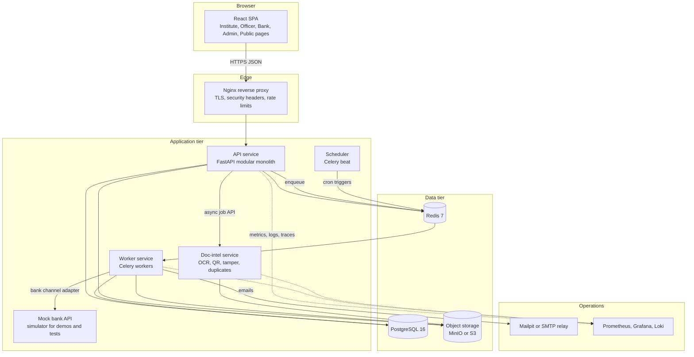

## 3.3 Backend module architecture

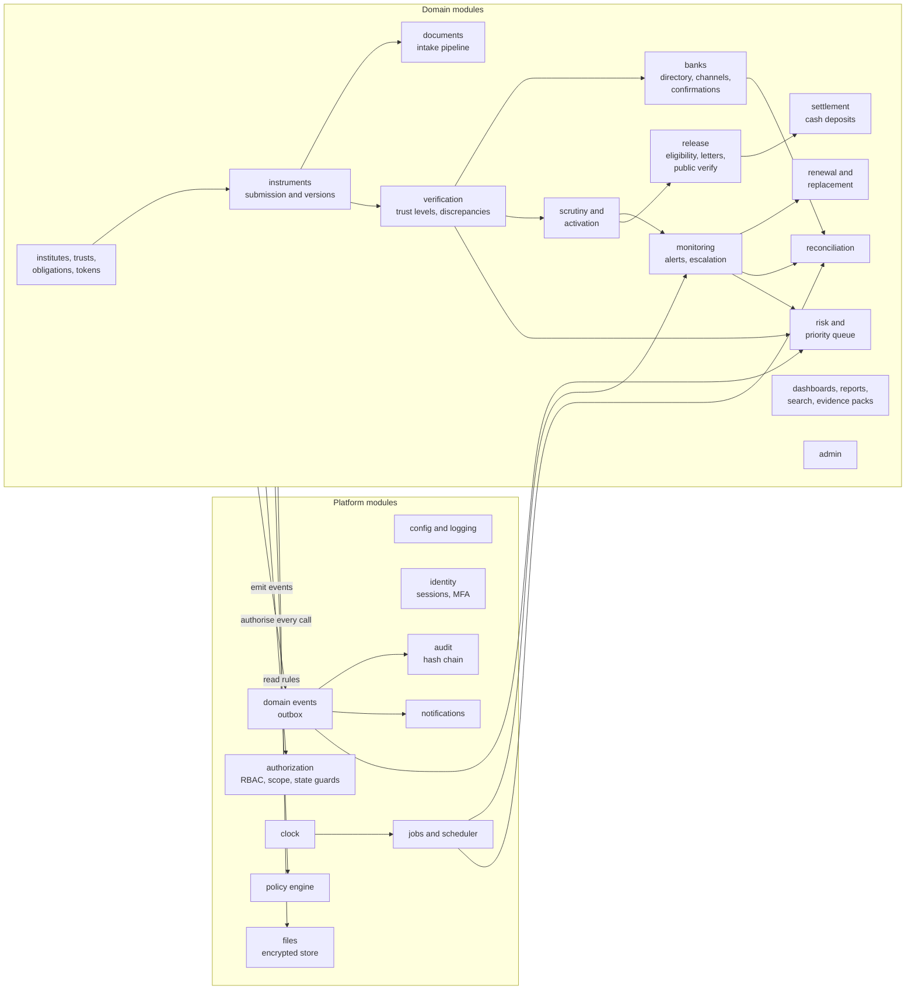

**Module rules.** A module may call another module only through its public service interface (`modules/<name>/api.py`). No module reads another module's tables directly. Cross-module reactions go through domain events. An import-linter rule in CI enforces this (T-001, T-005).

## 3.4 Production deployment

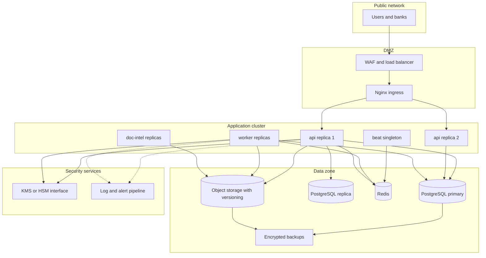

## 3.5 Technology stack (decided)

| Layer | Choice | Notes |
|---|---|---|
| Frontend | React 18, TypeScript, Vite, Tailwind CSS, Radix UI primitives, TanStack Query, React Router, React Hook Form + Zod, Recharts, i18next (en, hi), Storybook | One SPA, role-aware routes, accessible components |
| Frontend test | Vitest, React Testing Library, MSW, axe-core, Playwright | MSW consumes the OpenAPI mocks |
| Backend | Python 3.12, FastAPI, Pydantic v2, SQLAlchemy 2 (async), Alembic | Typed end to end |
| Auth | argon2-cffi, PyJWT, pyotp (TOTP), OIDC client interface | Local IdP for demo; Parichay-compatible OIDC adapter |
| Jobs | Celery 5 + Redis, Celery beat | Idempotent tasks, job-run table, dead-letter queue |
| Documents | WeasyPrint (letters, evidence packs), qrcode | PDFs generated server-side |
| Doc-intel | Tesseract (eng + hin), OpenCV, pdfplumber, pikepdf, pyzbar / zxing, rapidfuzz, imagehash, scikit-learn | Separate FastAPI service; async job API |
| Crypto | `cryptography` (AES-GCM envelope, Ed25519 or RSA-PSS), HMAC-SHA256 | KMS interface with local software KMS |
| Data | PostgreSQL 16 (JSONB, pg_trgm, partial indexes), Redis 7, MinIO / S3 | Optional Postgres RLS as defence-in-depth |
| Observability | structlog, OpenTelemetry, Prometheus, Grafana, Loki | Request-ID correlation |
| Quality | Ruff, mypy (strict), pytest, Hypothesis, Testcontainers, Schemathesis, Prism, k6, Bandit, pip-audit, Semgrep, Trivy, gitleaks, ESLint, Prettier, import-linter | Enforced in CI |
| Delivery | Docker, Docker Compose, Helm, GitHub Actions | Semantic versioning, SBOM |

## 3.6 Adapter interfaces (boundaries with outside systems)

| Adapter | Interface (summary) | Implementations in this release |
|---|---|---|
| `BankChannel` | `send_request(req)`, `fetch_status(ref)`, `ingest_response(payload)`, `send_bulk(batch)`, `ingest_bulk(file)` | **PortalChannel** (default, Bank Console), **BulkFileChannel** (CSV/XML), **ApiChannel** (HMAC-signed REST to mock/bank), **ManualAttestedChannel** (produces L1 only) |
| `Signer` | `sign(payload, signer_id, step_up_proof)`, `verify(payload, signature)`, `key_info(signer_id)` | **SimulatedSigner** (per-officer Ed25519 keys in software KMS), **EsignProviderAdapter** (interface + contract tests; real provider plugged in later) |
| `IdentityProvider` | `authorize_url()`, `exchange_code()`, `userinfo()` | **LocalIdP** (password + TOTP), **OidcAdapter** (Parichay-compatible) |
| `NotificationChannel` | `send(msg)`, `status(id)` | **SMTP**, **SimulatedSMS**, **InApp** |
| `DocIntelClient` | `submit(job)`, `get(job_id)` | HTTP client to the doc-intel service |
| `ObjectStore` | `put`, `get`, `presign`, `delete_version` | S3/MinIO |
| `Clock` | `now()`, `set_offset()` | System clock, Simulated clock (demo only) |
| `Kms` | `encrypt_dek`, `decrypt_dek`, `sign`, `rotate` | SoftwareKms (dev), KMS/HSM adapter interface |

## 3.7 Repository layout (monorepo)

```text
sakshya/
├─ apps/
│  └─ web/                       # React SPA (all portals)
├─ services/
│  ├─ api/                       # FastAPI modular monolith (+ worker entrypoints)
│  │  └─ app/modules/{identity,authorization,policy,audit,clock,files,notifications,
│  │                  jobs,events,institutes,instruments,documents,banks,verification,
│  │                  scrutiny,monitoring,renewal,reconciliation,release,settlement,
│  │                  risk,reporting,admin}/
│  ├─ doc-intel/                 # OCR / QR / tamper / duplicate service
│  └─ mock-bank/                 # multi-bank simulator
├─ packages/
│  └─ contracts/                 # openapi.yaml, JSON schemas, event catalogue, generated clients
├─ infra/
│  ├─ compose/                   # docker-compose.*.yml
│  └─ helm/                      # Helm charts
├─ scripts/                      # seed, synthetic data, time-travel scenarios
├─ tests/
│  ├─ e2e/                       # Playwright suites
│  └─ perf/                      # k6 scripts
├─ docs/                         # ADRs, runbooks, manuals, SRS
├─ .github/                      # workflows, PR template, CODEOWNERS
└─ Makefile
```

---

# 4. Data Model

## 4.1 Conventions

- Primary keys: UUID v7. Every table has `created_at`, `updated_at` (UTC `timestamptz`) and `row_version` (optimistic locking).
- Money: `numeric(18,2)` in INR. Dates: `date`; timestamps: `timestamptz`.
- Enumerations are text columns with check constraints (so they are migratable).
- **Immutable tables** (never updated): `instrument_version`, `document` (content), `audit_log`, `domain_event`, `bank_confirmation`, `release_letter` (payload), `verify_attempt`.
- PII/financial fields marked **(E)** use application-level envelope encryption; masked values are stored for display.
- Scope columns (`region_id`, `bank_id`, `institute_id`) are denormalised onto scoped tables for fast authorisation filters.

## 4.2 Entity-relationship diagram

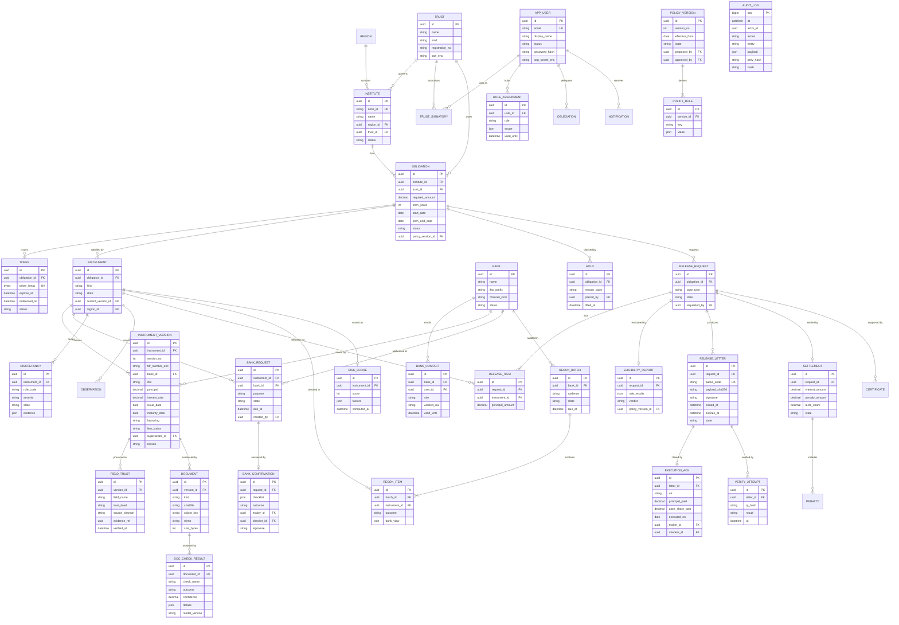

## 4.3 Further entities (not drawn)

| Entity | Purpose |
|---|---|
| `trust_signatory` | Links `app_user` ↔ `trust`, authority-letter document, validity window |
| `observation` | Officer notes on an instrument (visible internal/external flag) |
| `delegation` | Temporary transfer of a role/scope between users with expiry and reason |
| `certificate` | University/Board or other certificate attached to a release request |
| `notification` | In-app and outbound messages with channel, status, template, locale |
| `case_item` | Officer work-queue item (type, owner role, priority score, due date) |
| `domain_event` | Transactional outbox of events (§6.8) |
| `job_run` | History of scheduled jobs: status, duration, items processed, errors |
| `clock_state` | Simulated time offset (demo mode only) |
| `physical_custody` | Chain of custody of original paper instruments |
| `comment_thread` / `comment` | Institute ↔ AICTE query threads |
| `saved_view` | Officer saved filters |
| `anchor` | Daily signed audit-chain root hashes |
| `import_batch` / `import_row` | Legacy data import with row-level outcomes |

## 4.4 Key data rules

1. `instrument_version` rows are immutable; a correction or renewal inserts a new version that references `supersedes_id`.
2. `instrument.current_version_id` always points to the latest accepted version.
3. A `field_trust` row exists for every verifiable field of every version. L2 rows can be created only by the bank-confirmation service.
4. `fdr_number_enc` is unique per (`bank_id`, normalised number) across **all obligations** (duplicate detection index uses a blind index, an HMAC of the normalised number, so uniqueness checks never need decryption).
5. `release_letter.payload` is immutable and canonicalised (§7.2); `state` is the only mutable column.
6. `audit_log` rows carry `prev_hash` and `hash`; no update or delete privileges exist for the application role.

---

# 5. State Machines

## 5.1 Instrument

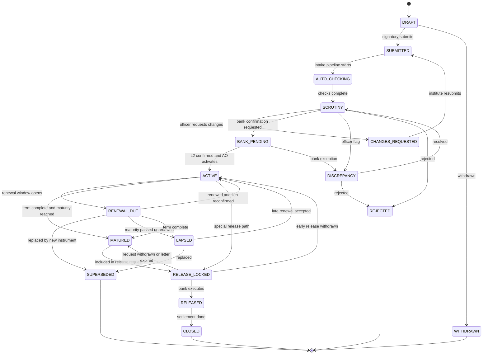

**Overlays (not states).** `ON_HOLD` (compliance hold) blocks release and renewal acceptance but not monitoring. `QUARANTINED` (suspected forgery) blocks all outward actions and notifies vigilance. Both are recorded in `hold` and visible on every screen.

**Guards.** `SCRUTINY → BANK_PENDING` requires a complete document set. `BANK_PENDING → ACTIVE` requires: a confirmed bank request (L2 on principal, maturity, favouring, lien), no open high-severity discrepancy, AO ≠ the SO who scrutinised, and step-up authentication.

## 5.2 Release request

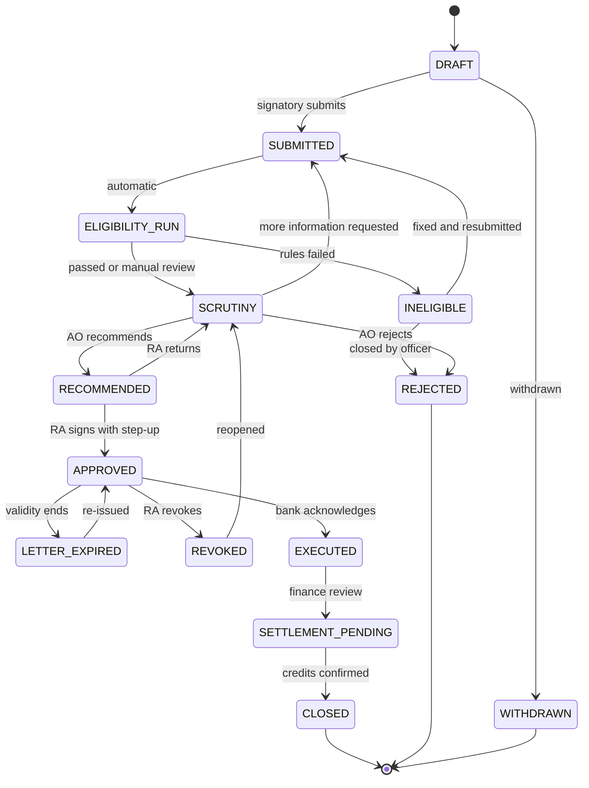

## 5.3 Release letter

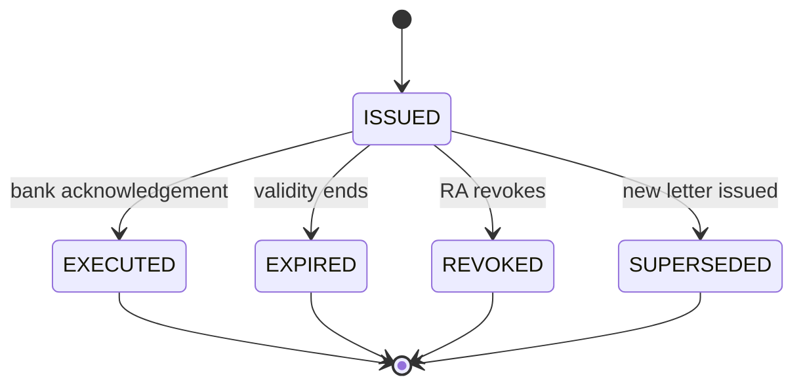

A letter is **single-use**: only `ISSUED` letters verify as valid. Viewing or verifying does not consume it; the bank's execution acknowledgement does.

## 5.4 Bank confirmation request

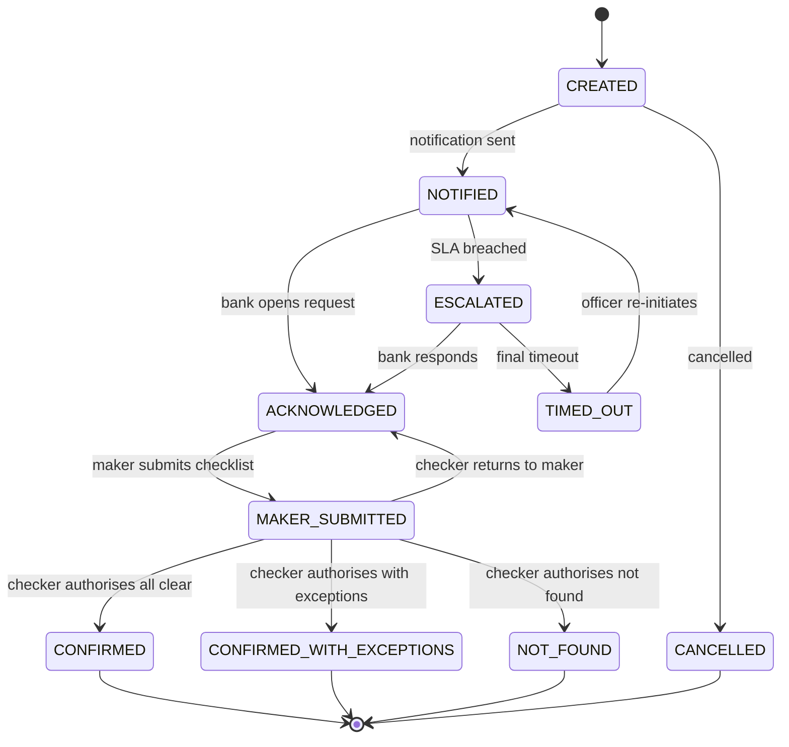

## 5.5 Reconciliation batch

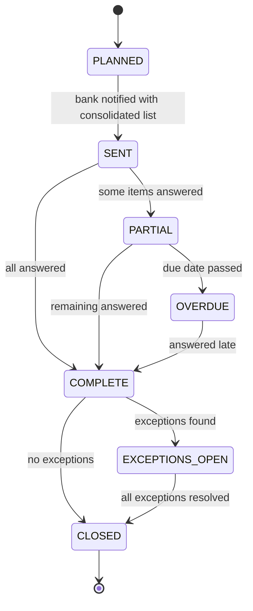

## 5.6 Obligation and token

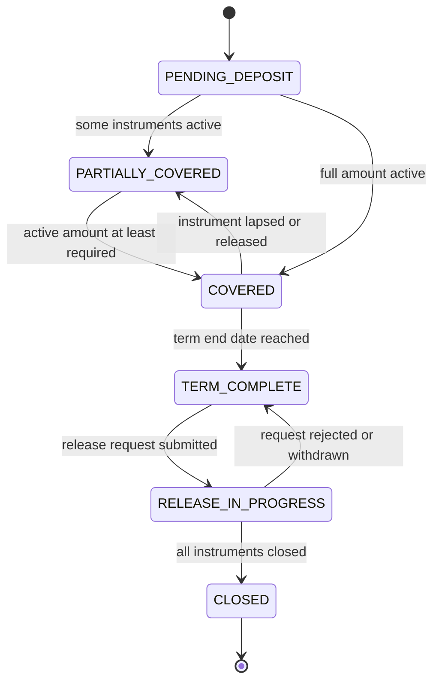

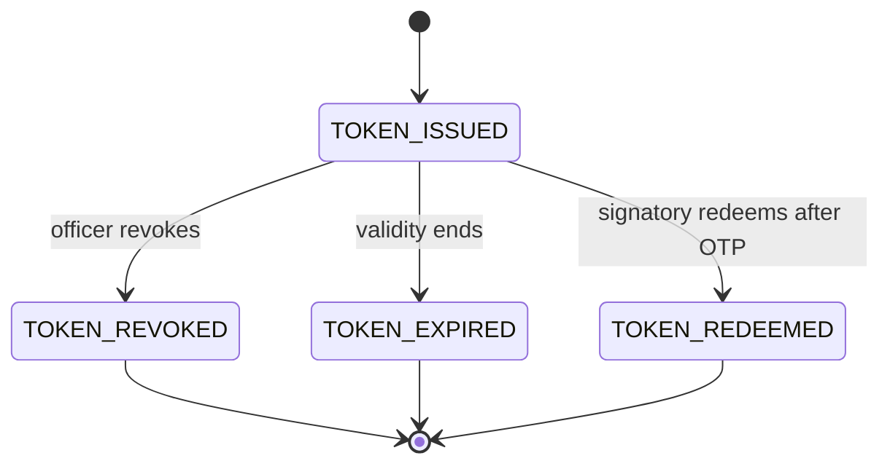

---

# 6. Specific Requirements

## 6.1 Roles, authentication and authorization

### 6.1.1 Permission matrix

Legend: ● allowed · ○ allowed with scope or condition (see notes) · — not allowed.
Columns: **IS** Inst. Signatory · **IA** Inst. Admin · **SO** · **AO** · **RA** · **FO** · **RGO** · **CO** · **LDR** · **AUD** · **PA** · **SA** · **BMK** · **BCK** · **PUB**

| Action | IS | IA | SO | AO | RA | FO | RGO | CO | LDR | AUD | PA | SA | BMK | BCK | PUB |
|---|---|---|---|---|---|---|---|---|---|---|---|---|---|---|---|
| Redeem token | ● | — | — | — | — | — | — | — | — | — | — | — | — | — | — |
| Create/edit draft instrument | ● | ○ | — | — | — | — | — | — | — | — | — | — | — | — | — |
| Submit instrument (final) | ● | — | — | — | — | — | — | — | — | — | — | — | — | — | — |
| Upload documents | ● | ● | — | — | — | — | ○ | — | — | — | — | — | — | — | — |
| View institute/instrument data | ○ | ○ | ○ | ○ | ○ | ○ | ○ | ○ | ○ | ● | — | — | ○ | ○ | — |
| Observe, flag, request changes | — | — | ● | ● | — | — | — | — | — | — | — | — | — | — | — |
| Initiate bank confirmation | — | — | ● | ● | — | — | — | — | — | — | — | — | — | — | — |
| Prepare/submit bank confirmation | — | — | — | — | — | — | — | — | — | — | — | — | ● | — | — |
| Authorise bank confirmation | — | — | — | — | — | — | — | — | — | — | — | — | ○ | ● | — |
| Resolve discrepancy (low/medium) | — | — | ○ | ● | — | — | — | — | — | — | — | — | — | — | — |
| Resolve discrepancy (high) | — | — | — | ○ | ○ | — | — | — | — | — | — | — | — | — | — |
| Activate instrument | — | — | — | ● | — | — | — | — | — | — | — | — | — | — | — |
| Accept renewal/replacement | — | — | — | ● | — | — | — | — | — | — | — | — | — | — | — |
| Log physical original/custody | — | — | ○ | — | — | — | ● | — | — | — | — | — | — | — | — |
| Place/lift hold | — | — | — | — | — | — | — | ● | — | — | — | — | — | — | — |
| Quarantine instrument | — | — | ○ | ● | ● | — | — | ● | — | — | — | — | — | — | — |
| Request release | ● | — | — | — | — | — | — | — | — | — | — | — | — | — | — |
| Prepare eligibility report | — | — | ● | ○ | — | — | — | — | — | — | — | — | — | — | — |
| Recommend release | — | — | — | ● | — | — | — | — | — | — | — | — | — | — | — |
| Sign/revoke release letter | — | — | — | — | ● | — | — | — | — | — | — | — | — | — | — |
| Verify release letter (public page) | — | — | — | — | — | — | — | — | — | — | — | — | ● | ● | ● |
| Acknowledge execution (maker) | — | — | — | — | — | — | — | — | — | — | — | — | ● | — | — |
| Authorise execution (checker) | — | — | — | — | — | — | — | — | — | — | — | — | — | ● | — |
| Compute/confirm settlement, close | — | — | — | — | — | ● | — | — | — | — | — | — | — | — | — |
| Respond to bulk reconciliation | — | — | — | — | — | — | — | — | — | — | — | — | ● | ○ | — |
| View dashboards | — | — | ○ | ○ | ○ | ○ | ○ | ○ | ● | ● | — | ○ | ○ | ○ | — |
| Read audit trail / verify chain | — | — | — | — | ○ | — | — | — | — | ● | — | ○ | — | — | — |
| Export evidence pack | — | — | — | ○ | ○ | — | — | — | — | ● | — | — | — | — | — |
| Propose policy change | — | — | — | — | — | — | — | — | — | — | ● | — | — | — | — |
| Approve policy change (second person) | — | — | — | — | ● | — | — | — | — | — | ○ | — | — | — | — |
| Manage users, roles, banks, delegation | — | — | — | ○ | — | — | — | — | — | — | — | ● | — | — | — |
| Time travel (demo mode only) | — | — | — | — | — | — | — | — | — | — | — | ○ | — | — | — |
| Import legacy data | — | — | ○ | — | — | — | — | — | — | — | — | ○ | — | — | — |
| Monitor jobs and system health | — | — | — | — | — | — | — | — | — | — | — | ● | — | — | — |

**Notes.** (1) *Scope*: officers see only their region/assignment; bank users only their own bank; institute users only their own institute/trust. (2) IA may create drafts but cannot submit; IS must submit. (3) BCK step is skipped when a bank is configured single-person (flagged as lower assurance on the confirmation). (4) High-severity discrepancies need AO plus a second approver (RA or another AO). (5) No role can edit bank-confirmed data; corrections are new versions. (6) SA cannot approve or edit business data. (7) PA cannot approve their own proposal.

### 6.1.2 Authentication design

| Population | Method | Details |
|---|---|---|
| Institute users | Email/mobile OTP + password (optional MFA); token redemption at onboarding | Production option: Jan Parichay / MeriPehchaan identity via OIDC adapter |
| AICTE staff | OIDC SSO (Parichay-compatible) with MFA; local fallback password + TOTP | Role mapping from IdP groups, scope from assignments |
| Bank users | Invite from AICTE-controlled directory + TOTP; DSC for signing optional | Contact changes require dual approval |
| Release Authority signing | Step-up (fresh TOTP ≤ 5 min) + Signer adapter (simulated eSign/DSC) | Signature recorded with signer key id |
| Public verifier | No login | CAPTCHA escalation, rate limits, three-factor lookup |
| System admin | Separate admin login, IP allow-list, break-glass flow | Break-glass access is audited and alerts security |

Session policy: access JWT 15 min; refresh 8 h absolute, rotating, reuse detection revokes the family; idle timeout 30 min for staff; concurrent session limit configurable; refresh in HttpOnly, Secure, SameSite=Strict cookie; CSRF double-submit for cookie-authenticated mutations; password policy ≥ 12 chars, breached-password check; lockout with exponential backoff, uniform errors (no user enumeration).

### 6.1.3 Authorization decision

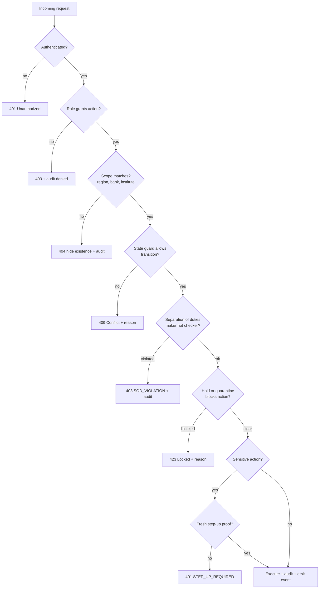

---

## 6.2 Functional requirements

Priority: **P0** must (core of the release) · **P1** should · **P2** could. "Tasks" lists the §8 tasks that implement it.

### Identity and access (FR-IDN)

| ID | Requirement | Pri | Tasks |
|---|---|---|---|
| FR-IDN-01 | Local authentication with Argon2id hashing and password policy | P0 | T-014 |
| FR-IDN-02 | TOTP MFA mandatory for staff and bank users, backup codes | P0 | T-014 |
| FR-IDN-03 | Short-lived access token, rotating refresh token with reuse detection | P0 | T-014 |
| FR-IDN-04 | Lockout/backoff and uniform error messages | P0 | T-014, T-162 |
| FR-IDN-05 | Step-up authentication for approve, sign, policy and release actions | P0 | T-014, T-100 |
| FR-IDN-06 | Session list, remote revoke, idle and absolute timeouts | P1 | T-014 |
| FR-IDN-07 | OIDC login with role mapping (Parichay-compatible) | P1 | T-143 |
| FR-IDN-08 | Role and scope assignment with validity windows | P0 | T-015 |
| FR-IDN-09 | Authorization = role ∧ scope ∧ state guard ∧ separation of duties ∧ holds | P0 | T-015 |
| FR-IDN-10 | Delegation with expiry, reason, audit | P0 | T-015, T-073 |
| FR-IDN-11 | Invite-based onboarding for staff and bank users | P0 | T-014, T-073 |
| FR-IDN-12 | Password and MFA reset with dual control for staff | P1 | T-014 |
| FR-IDN-13 | Anonymous access limited to public verify and health endpoints | P0 | T-063, T-162 |
| FR-IDN-14 | Login anomaly flags (new device, burst failures) | P2 | T-162 |

### Institutes, trusts, obligations, tokens (FR-INS)

| ID | Requirement | Pri | Tasks |
|---|---|---|---|
| FR-INS-01 | Maintain Institute, Trust, Region masters; import from AICTE data | P0 | T-030, T-076 |
| FR-INS-02 | Create obligation with required amount computed from policy | P0 | T-030, T-016 |
| FR-INS-03 | Multiple obligations per institute (programme levels, approval years) | P0 | T-030 |
| FR-INS-04 | Generate token bound to obligation + trust; show once; store HMAC only | P0 | T-031 |
| FR-INS-05 | Redeem token with OTP; single use; expiry; revoke and re-issue | P0 | T-031 |
| FR-INS-06 | Uniform failure responses and rate limiting on redemption | P0 | T-031, T-162 |
| FR-INS-07 | Signatory management with authority letter and validity | P0 | T-030 |
| FR-INS-08 | Institute admin invited by signatory with limited rights | P1 | T-030, T-073 |
| FR-INS-09 | Obligation status derived from instrument coverage (§5.6) | P0 | T-030 |
| FR-INS-10 | Obligation increase/top-up event creates an additional requirement | P1 | T-030 |
| FR-INS-11 | Trust or institute detail change workflow with approval | P1 | T-030 |
| FR-INS-12 | Region assignment and reassignment history | P1 | T-030 |

### Instrument submission (FR-SUB)

| ID | Requirement | Pri | Tasks |
|---|---|---|---|
| FR-SUB-01 | Instrument kinds: `FDR`, `CASH_DEPOSIT` (flagged) | P0 | T-032, T-066 |
| FR-SUB-02 | FDR fields: bank, branch, IFSC, number, account/customer ref (E), principal, rate, issue and maturity dates, favouring, auto-renew flag, holders | P0 | T-032 |
| FR-SUB-03 | Save draft, resume, withdraw | P0 | T-032 |
| FR-SUB-04 | Submit validations: required fields, per-bank number format, date logic | P0 | T-032, T-127 |
| FR-SUB-05 | Every submission or correction creates an immutable version | P0 | T-032 |
| FR-SUB-06 | Capture mode: e-FDR or physical | P0 | T-032 |
| FR-SUB-07 | Multiple instruments per obligation with live coverage computation | P0 | T-030, T-032 |
| FR-SUB-08 | Optimistic locking and idempotency key on submit | P0 | T-032 |
| FR-SUB-09 | Generate pre-filled lien mandate pack (PDF) for the bank | P0 | T-032, T-036 |
| FR-SUB-10 | Replacement instrument links to the one it supersedes | P0 | T-052 |
| FR-SUB-11 | Cash deposit capture with Finance credit confirmation | P1 | T-066 |
| FR-SUB-12 | Institute-facing status timeline with SLA hints | P0 | T-102 |
| FR-SUB-13 | Bulk legacy import with dry-run, row errors, attestation | P1 | T-076 |

### Documents and intelligence (FR-DOC)

| ID | Requirement | Pri | Tasks |
|---|---|---|---|
| FR-DOC-01 | Upload PDF/JPEG/PNG ≤ 15 MB, ≤ 20 files per instrument, type sniffing, AV hook | P0 | T-017 |
| FR-DOC-02 | SHA-256 content hash; documents immutable and versioned | P0 | T-017 |
| FR-DOC-03 | Encryption at rest; short-lived presigned access; access logged | P0 | T-017, T-161 |
| FR-DOC-04 | OCR (eng + hin) with field extraction and confidence | P0 | T-122, T-123 |
| FR-DOC-05 | QR decode for e-FDR with bank-specific parser plugins | P0 | T-124 |
| FR-DOC-06 | Consistency validator (IFSC vs bank, dates, amount vs obligation, number format) | P0 | T-127 |
| FR-DOC-07 | Tamper heuristics reported as **indicative flags** | P1 | T-125 |
| FR-DOC-08 | Duplicate detection across institutes (blind index, perceptual hash, fuzzy fields) | P0 | T-126 |
| FR-DOC-09 | Check results stored per check with model version; re-run on demand | P0 | T-033 |
| FR-DOC-10 | Low confidence → manual entry path; checks never approve | P0 | T-033, T-123 |
| FR-DOC-11 | Side-by-side view: document, extracted values, entered values | P0 | T-104 |
| FR-DOC-12 | Retention and legal-hold exemption | P1 | T-163 |
| FR-DOC-13 | Redaction of sensitive fields in previews for non-privileged roles | P1 | T-017, T-104 |
| FR-DOC-14 | Evaluation harness with metrics on synthetic corpora | P1 | T-128 |

### Banks and confirmation (FR-BNK)

| ID | Requirement | Pri | Tasks |
|---|---|---|---|
| FR-BNK-01 | Bank master, IFSC-prefix validation, merger/rename history | P0 | T-034 |
| FR-BNK-02 | Verified nodal directory; contact changes need dual approval | P0 | T-034, T-073 |
| FR-BNK-03 | Requests route only to directory contacts, never to contacts in documents | P0 | T-035 |
| FR-BNK-04 | Standard lien checklist (§7.5) | P0 | T-036 |
| FR-BNK-05 | Request lifecycle §5.4 with single-use secure link notifications | P0 | T-035, T-036 |
| FR-BNK-06 | Bank maker-checker configurable per bank | P0 | T-036 |
| FR-BNK-07 | Confirmation signed with bank user step-up; stored immutably | P0 | T-036 |
| FR-BNK-08 | Exceptions auto-create discrepancies | P0 | T-036, T-038 |
| FR-BNK-09 | Reminders and escalation to alternate contact or head-office desk | P0 | T-051 |
| FR-BNK-10 | Channel abstraction with Portal, BulkFile, Api, ManualAttested | P0 | T-035, T-141 |
| FR-BNK-11 | ManualAttested yields L1 only and is marked lower assurance | P0 | T-035, T-037 |
| FR-BNK-12 | Bank-initiated events (closure, lien release) | P1 | T-036 |
| FR-BNK-13 | Bank dashboard: pending, due soon, history | P1 | T-108 |
| FR-BNK-14 | Call-back verification record (officer calls a directory number) | P1 | T-036 |
| FR-BNK-15 | Bulk response templates and upload | P1 | T-053, T-141 |
| FR-BNK-16 | Bank onboarding checklist and test mode | P2 | T-034 |

### Verification and discrepancies (FR-VER)

| ID | Requirement | Pri | Tasks |
|---|---|---|---|
| FR-VER-01 | Field-level trust levels L0/L1/L2 with evidence | P0 | T-037 |
| FR-VER-02 | Only the bank-confirmation service can write L2 | P0 | T-037 |
| FR-VER-03 | Discrepancy rule engine (§6.11) with severity | P0 | T-038 |
| FR-VER-04 | Discrepancy lifecycle: OPEN, ACKNOWLEDGED, RESOLVED, ESCALATED, REJECTED | P0 | T-038 |
| FR-VER-05 | Institute can dispute a flag with evidence | P1 | T-038, T-103 |
| FR-VER-06 | High severity requires a second approver | P0 | T-038, T-015 |
| FR-VER-07 | Claimed vs extracted vs bank-confirmed comparison view | P0 | T-105 |
| FR-VER-08 | Quarantine overlay for suspected forgery | P0 | T-054, T-038, T-113 |
| FR-VER-09 | Rule results are explainable (inputs and thresholds) | P0 | T-038 |
| FR-VER-10 | Thresholds configurable through policy | P1 | T-016, T-038 |

### Scrutiny and activation (FR-ACT)

| ID | Requirement | Pri | Tasks |
|---|---|---|---|
| FR-ACT-01 | Case queue with filters and SLA timers | P0 | T-039, T-070 |
| FR-ACT-02 | Observations (internal or institute-visible) with attachments | P0 | T-039 |
| FR-ACT-03 | Request changes with structured reasons | P0 | T-039 |
| FR-ACT-04 | Activation with maker-checker and step-up | P0 | T-039 |
| FR-ACT-05 | Reject with reason and notification | P0 | T-039 |
| FR-ACT-06 | Conflict-of-interest declaration and reassignment | P1 | T-039 |
| FR-ACT-07 | Auto-assignment by region and load | P1 | T-039, T-070 |
| FR-ACT-08 | Provisional status window with auto-escalation | P1 | T-039, T-051 |

### Monitoring, alerts, escalation (FR-MON)

| ID | Requirement | Pri | Tasks |
|---|---|---|---|
| FR-MON-01 | Maturity/renewal alerts at configurable offsets | P0 | T-050 |
| FR-MON-02 | Automatic ACTIVE → RENEWAL_DUE → LAPSED transitions | P0 | T-050 |
| FR-MON-03 | Lapse breach workflow | P0 | T-050, T-052 |
| FR-MON-04 | SLA timers on every case type | P0 | T-051 |
| FR-MON-05 | Escalation ladder by role | P0 | T-051 |
| FR-MON-06 | Overdue digests to officers | P1 | T-051, T-018 |
| FR-MON-07 | Alert de-duplication and acknowledgement | P1 | T-018 |
| FR-MON-08 | Channel preferences and quiet hours for institute users | P2 | T-018 |
| FR-MON-09 | Maturity calendar view | P1 | T-110 |
| FR-MON-10 | Renewal-chain tracking for short-tenure FDRs toward the term | P0 | T-050 |
| FR-MON-11 | Term-complete detection and institute prompt | P0 | T-050 |
| FR-MON-12 | Stuck-case detector | P1 | T-051 |

### Renewal and replacement (FR-REN)

| ID | Requirement | Pri | Tasks |
|---|---|---|---|
| FR-REN-01 | Renew same number → new version | P0 | T-052 |
| FR-REN-02 | Renew with new number → new version + mandatory lien re-confirmation | P0 | T-052, T-036 |
| FR-REN-03 | Replace with different FDR/bank → new instrument, supersede old | P0 | T-052 |
| FR-REN-04 | Auto-renewal detection via reconciliation | P1 | T-053, T-052 |
| FR-REN-05 | Late renewal path after lapse with explanatory note | P0 | T-052 |
| FR-REN-06 | Full history timeline per obligation | P0 | T-072 |
| FR-REN-07 | Coverage-gap analysis between maturity and renewal | P1 | T-052, T-071 |

### Reconciliation (FR-REC)

| ID | Requirement | Pri | Tasks |
|---|---|---|---|
| FR-REC-01 | Cadence planner: quarterly default, monthly for high risk, event-driven on renewal | P0 | T-053 |
| FR-REC-02 | Bank-wise consolidated batch | P0 | T-053 |
| FR-REC-03 | Bulk response upload with per-item outcomes and checksum | P0 | T-053, T-141 |
| FR-REC-04 | Exceptions: missing lien, loan/OD, closed, amount change, unknown FDR | P0 | T-053, T-038 |
| FR-REC-05 | Non-response escalation | P0 | T-053, T-051 |
| FR-REC-06 | Random spot-check sampling with call-back verification | P1 | T-053 |
| FR-REC-07 | Reconciliation dashboard and coverage percentage | P1 | T-071 |
| FR-REC-08 | Auditor reports on reconciliation | P1 | T-071 |

### Release and letters (FR-REL)

| ID | Requirement | Pri | Tasks |
|---|---|---|---|
| FR-REL-01 | Case types: TERM_COMPLETE, PROGRAMME_CLOSURE, INSTITUTION_CLOSURE, MERGER, CONVERSION, OTHER | P0 | T-061 |
| FR-REL-02 | Eligibility engine with ordered rules and explainable results | P0 | T-060 |
| FR-REL-03 | Holds and open high discrepancies block release | P0 | T-060, T-054 |
| FR-REL-04 | Certificate upload and verification | P1 | T-075 |
| FR-REL-05 | Partial release with remaining obligation recompute | P0 | T-061, T-030 |
| FR-REL-06 | Request workflow per §5.2 | P0 | T-061, T-106 |
| FR-REL-07 | Configurable approval matrix | P0 | T-016, T-061 |
| FR-REL-08 | Letter canonical payload, SHA-256, signature, QR, validity (default 14 days) | P0 | T-062, T-106 |
| FR-REL-09 | Letter content: principal to Trust, AICTE share and AICTE account from policy, FDR identifiers, conditions | P0 | T-062, T-064 |
| FR-REL-10 | Revoke, re-issue, supersede | P0 | T-062 |
| FR-REL-11 | Public verification by code + FDR number + IFSC | P0 | T-063 |
| FR-REL-12 | Uniform responses for not-found and mismatch; distinct for expired, revoked, executed | P0 | T-063 |
| FR-REL-13 | Rate limits and CAPTCHA escalation | P0 | T-063, T-162 |
| FR-REL-14 | Bank execution acknowledgement with UTR, amounts, date (maker-checker) | P0 | T-064 |
| FR-REL-15 | Single use: acknowledgement closes the letter; amount reconciliation against expected | P0 | T-064 |
| FR-REL-16 | Letter PDF with printed hash and QR | P0 | T-062 |
| FR-REL-17 | QR landing page still requires inputs before showing details | P0 | T-063, T-109 |
| FR-REL-18 | Instrument release lock prevents concurrent requests | P0 | T-061 |
| FR-REL-19 | Penalty computation per policy | P0 | T-064 |
| FR-REL-20 | Manual override of an eligibility failure requires reason and RA approval | P1 | T-060, T-061 |

### Settlement and cash deposits (FR-FIN)

| ID | Requirement | Pri | Tasks |
|---|---|---|---|
| FR-FIN-01 | Settlement record: interest, penalty, AICTE share, net to Trust | P0 | T-064, T-107 |
| FR-FIN-02 | Finance confirms credit of AICTE share; mismatch raises exception | P0 | T-064, T-107 |
| FR-FIN-03 | Close case after settlement | P0 | T-064, T-107 |
| FR-FIN-04 | Cash deposit credit confirmation | P1 | T-066 |
| FR-FIN-05 | Reversal handling | P2 | T-064 |
| FR-FIN-06 | Finance reports | P1 | T-071 |

### Risk and priority (FR-RSK)

| ID | Requirement | Pri | Tasks |
|---|---|---|---|
| FR-RSK-01 | Risk score per instrument/case (§7.3) | P0 | T-070 |
| FR-RSK-02 | Explainable factor breakdown stored with score | P0 | T-070 |
| FR-RSK-03 | Priority queue ordering with SLA and risk | P0 | T-070, T-104 |
| FR-RSK-04 | Scheduled and event-triggered re-scoring | P0 | T-070 |
| FR-RSK-05 | Weights configurable via policy | P1 | T-070, T-016 |
| FR-RSK-06 | Backtest on synthetic data | P2 | T-128 |

### Dashboards, reports, search (FR-RPT)

| ID | Requirement | Pri | Tasks |
|---|---|---|---|
| FR-RPT-01 | Counters: active, expiring, matured, renewed, released, pending | P0 | T-071, T-110 |
| FR-RPT-02 | Drill-down by region, bank, aging | P0 | T-071, T-110 |
| FR-RPT-03 | Exceptions-first view | P0 | T-110 |
| FR-RPT-04 | Reports: pending verifications, upcoming maturities, missing documents, interventions | P0 | T-071 |
| FR-RPT-05 | Export CSV, XLSX, PDF | P1 | T-071 |
| FR-RPT-06 | Full-text and filtered search, scope aware | P0 | T-072 |
| FR-RPT-07 | Document history and version comparison | P0 | T-072 |
| FR-RPT-08 | Evidence pack PDF with chain-of-custody hashes | P1 | T-072 |
| FR-RPT-09 | KPI panel for measurable improvement | P0 | T-202 |
| FR-RPT-10 | Saved views | P2 | T-072 |
| FR-RPT-11 | Scheduled report emails | P2 | T-071 |

### Administration and policy (FR-ADM)

| ID | Requirement | Pri | Tasks |
|---|---|---|---|
| FR-ADM-01 | Policy editor with versions, effective dates, two-person approval, rollback | P0 | T-016, T-111 |
| FR-ADM-02 | User and role administration | P0 | T-073, T-111 |
| FR-ADM-03 | Bank directory administration | P0 | T-034, T-111 |
| FR-ADM-04 | Delegation administration | P0 | T-073 |
| FR-ADM-05 | Job monitor with safe manual trigger | P1 | T-019, T-111 |
| FR-ADM-06 | Clock control (demo mode only) | P0 | T-012, T-111 |
| FR-ADM-07 | Feature flags | P1 | T-073 |
| FR-ADM-08 | System health page | P1 | T-183 |
| FR-ADM-09 | Notification template management with locales | P1 | T-018, T-111 |

### Audit (FR-AUD)

| ID | Requirement | Pri | Tasks |
|---|---|---|---|
| FR-AUD-01 | Entry for every state change, auth event, denied attempt, sensitive document view | P0 | T-013 |
| FR-AUD-02 | Hash chain over canonical JSON | P0 | T-013 |
| FR-AUD-03 | Daily signed anchor | P1 | T-074 |
| FR-AUD-04 | Chain verification tool and UI | P0 | T-074, T-112 |
| FR-AUD-05 | No update/delete privileges for the application DB role | P0 | T-011, T-013 |
| FR-AUD-06 | Search and export | P0 | T-074 |
| FR-AUD-07 | Retention policy | P1 | T-163 |
| FR-AUD-08 | Reading the audit log is itself audited | P1 | T-013 |

### Notifications (FR-NOT)

| ID | Requirement | Pri | Tasks |
|---|---|---|---|
| FR-NOT-01 | Template-based multi-channel (email, simulated SMS, in-app), locales en/hi | P0 | T-018 |
| FR-NOT-02 | Transactional outbox with retry, backoff, dead-letter | P0 | T-018, T-019, T-020 |
| FR-NOT-03 | Preferences for non-mandatory messages | P2 | T-018 |
| FR-NOT-04 | Delivery status tracking | P1 | T-018, T-144 |
| FR-NOT-05 | Digest mode | P1 | T-018 |
| FR-NOT-06 | Mandatory legal notices cannot be disabled | P0 | T-018 |
| FR-NOT-07 | Throttling and de-duplication | P1 | T-018 |
| FR-NOT-08 | Single-use secure links for bank requests | P0 | T-035 |

### Integration (FR-INT)

| ID | Requirement | Pri | Tasks |
|---|---|---|---|
| FR-INT-01 | AICTE institute master import (CSV/API) | P1 | T-076 |
| FR-INT-02 | Outbound webhooks (HMAC-signed) for status changes | P2 | T-076 |
| FR-INT-03 | Published OpenAPI for approved integrators | P2 | T-002 |
| FR-INT-04 | Mock bank with configurable behaviours (slow, wrong, colluding, unavailable) | P0 | T-140 |
| FR-INT-05 | Signer adapter with simulated and provider-ready implementations | P0 | T-142 |
| FR-INT-06 | SMS and email gateway adapters | P0 | T-144 |

---

## 6.3 Business rules

| ID | Rule | Policy key / note |
|---|---|---|
| BR-01 | Required amount = Σ over programmes of `amount_table[category, level]`, multiplied by `leased_multiplier` if premises are leased | ASM-04/05 |
| BR-02 | Obligation term = `deposit_term_years` from start date | ASM-01 |
| BR-03 | Obligation is COVERED when Σ principal of ACTIVE (bank-confirmed) instruments ≥ required; provisional instruments count only if `count_provisional_towards_coverage` is true | default false |
| BR-04 | FDR must be in favour of an allowed name and carry AICTE's lien | `favouring_names`, ASM-03 |
| BR-05 | If FDR tenor is shorter than the remaining term, a renewal chain is tracked and a WARN is raised, not a discrepancy | `min_fdr_tenor_months` |
| BR-06 | Release is eligible when the term is complete, or a special case type applies with its required certificates | ASM-07 |
| BR-07 | Letter validity = `letter_validity_days` (default 14) | |
| BR-08 | Principal is released to the depositing Trust; AICTE share (interest, penalties) is directed to the AICTE account configured in policy | ASM-02, ASM-06 |
| BR-09 | Penalties follow `penalty_rules` (percentage by case type) | **VALIDATE** |
| BR-10 | An active hold blocks release and acceptance of renewals | |
| BR-11 | An open HIGH discrepancy blocks activation and release | |
| BR-12 | Maker ≠ checker for AICTE approvals and for bank confirmations (unless bank is single-person) | |
| BR-13 | An officer cannot activate a case they scrutinised, nor sign a release they recommended | |
| BR-14 | An instrument can be in at most one active release request | FR-REL-18 |
| BR-15 | Token validity = `token_ttl_days` (default 30); single redemption | |
| BR-16 | Renewal with a new number requires a new L2 confirmation before the new version counts as covered | |
| BR-17 | Maturity date passed, obligation not complete, no accepted renewal → LAPSED and breach escalation | |
| BR-18 | Reconciliation cadence: default quarterly; risk score ≥ `high_risk_threshold` monthly; also on renewal and on bank events | |
| BR-19 | Bank responses are accepted only from directory contacts over authenticated channels | |
| BR-20 | Letters or acknowledgements uploaded by an institute can never exceed L1 | |
| BR-21 | Public verification reveals details only when letter code, FDR number and IFSC all match | |
| BR-22 | Any amount change after signing requires a new letter that supersedes the old | |
| BR-23 | Policy changes are effective-dated; a case keeps the policy version bound at creation unless the change is flagged retroactive | |
| BR-24 | Withdrawal of institutional approval or closure triggers the special release path and an automatic hold until reviewed | |
| BR-25 | Financial records are retained `retention_years` after closure; legal holds suspend deletion | |
| BR-26 | Physical-mode instruments require a custody log entry within `custody_log_days` | |
| BR-27 | Joint holders are acceptable only if the Trust is a named holder | |
| BR-28 | All money is in INR with two decimals | |

## 6.4 Policy parameter catalogue

| Key | Default | Type | Meaning | Flag |
|---|---|---|---|---|
| `deposit_term_years` | 10 | int | Term of obligation | VALIDATE |
| `amount_table` | imported table | json | Required amount by category and level | VALIDATE |
| `leased_multiplier` | 2 | decimal | Multiplier for leased premises | VALIDATE |
| `favouring_names` | ["Member Secretary, AICTE"] | json | Accepted favouring names | VALIDATE |
| `min_fdr_tenor_months` | 12 | int | Minimum tenor warning | |
| `count_provisional_towards_coverage` | false | bool | Whether unconfirmed instruments count | |
| `provisional_window_days` | 30 | int | Time allowed before escalation | VALIDATE |
| `token_ttl_days` | 30 | int | Token validity | |
| `letter_validity_days` | 14 | int | Release letter validity | |
| `maturity_alert_days` | [180, 90, 30, 7] | json | Alert offsets | |
| `bank_reminder_days` | [3, 7, 14] | json | Reminder cadence for bank requests | |
| `escalation_days` | [14, 21] | json | Escalation checkpoints | |
| `bank_request_timeout_days` | 30 | int | Final timeout | |
| `recon_default_cadence` | QUARTERLY | enum | Default reconciliation | |
| `high_risk_threshold` | 70 | int | Score for monthly reconciliation | |
| `recon_spot_check_pct` | 2 | decimal | Random sample call-back percentage | |
| `recon_freshness_days` | 90 | int | Maximum age of last bank confirmation before release (eligibility E-08) | VALIDATE |
| `penalty_rules` | table | json | Penalty percentage by case type | VALIDATE |
| `interest_destination` | AICTE account | json | Beneficiary and account details for AICTE share | VALIDATE |
| `approval_matrix` | MS signs, AO recommends | json | Who recommends/signs by case type and amount | VALIDATE |
| `release_case_types` | table | json | Required certificates per case type | VALIDATE |
| `cash_deposit_enabled` | false | bool | Feature flag | VALIDATE |
| `custody_log_days` | 5 | int | Time to log a physical original | VALIDATE |
| `retention_years` | 10 | int | Record retention after closure | |
| `risk_weights` | see §7.3 | json | Risk score weights | |
| `upload_max_mb` | 15 | int | Per-file limit | |
| `otp_ttl_minutes` | 10 | int | OTP validity | |
| `step_up_ttl_minutes` | 5 | int | Step-up freshness | |

## 6.5 Non-functional requirements

| ID | Requirement | Target |
|---|---|---|
| NFR-PERF-01 | Read APIs p95 latency | ≤ 300 ms at 100 req/s on reference hardware |
| NFR-PERF-02 | Write APIs p95 latency | ≤ 600 ms (excluding async work) |
| NFR-PERF-03 | Dashboard summary p95 | ≤ 1.5 s over 250 000 instruments |
| NFR-PERF-04 | Document intake to checks complete | ≤ 60 s for a 10-page PDF (p95) |
| NFR-CAP-01 | Design capacity | 50 000 obligations, 250 000 instruments, 10 M audit rows, 1 M notifications per year |
| NFR-AVL-01 | Availability | 99.5 % monthly for staff and public verify |
| NFR-REL-01 | RPO / RTO | ≤ 15 min / ≤ 2 h |
| NFR-REL-02 | Jobs | At-least-once delivery with idempotent handlers; no duplicate user-visible effects |
| NFR-SEC-01 | Application security | OWASP ASVS Level 2 as the checklist |
| NFR-SEC-02 | Encryption | TLS 1.2+, AES-256-GCM at rest, field-level envelope encryption for financial identifiers |
| NFR-SEC-03 | Secrets | No secrets in repo; rotated; KMS interface |
| NFR-SEC-04 | Headers and browser | CSP, HSTS, frame-ancestors none, strict CORS |
| NFR-SEC-05 | Dependency hygiene | No known high/critical vulnerabilities at release |
| NFR-PRV-01 | Privacy | Data minimisation, masking, purpose-bound access, consent/notice text in UI (aligned to India's data-protection law; **VALIDATE** with legal) |
| NFR-ACC-01 | Accessibility | WCAG 2.1 AA; keyboard and screen-reader support; GIGW-style conformance as a target (**VALIDATE**) |
| NFR-I18N-01 | Languages | English and Hindi for institute portal, public page and notifications; others via resource files |
| NFR-USE-01 | Usability | Institute wizard completes an FDR submission in ≤ 8 steps; officer case actions ≤ 3 clicks from queue |
| NFR-MNT-01 | Maintainability | Module boundaries enforced; ≥ 85 % unit coverage on domain modules; ADRs for significant decisions |
| NFR-OBS-01 | Observability | Structured logs with request id, metrics, traces, alerts on job failure and audit-chain break |
| NFR-DAT-01 | Data integrity | Immutable versions, foreign keys, check constraints, daily backup verification |
| NFR-DEP-01 | Portability | Runs from `docker compose up`; Helm chart for cluster |
| NFR-TST-01 | Testability | Clock injection, deterministic seeds, simulators for every external dependency |

## 6.6 External interfaces

### 6.6.1 API conventions

- Base path `/api/v1`, JSON, UTF-8. Authentication by `Authorization: Bearer <access JWT>`; cookie refresh on `/auth/refresh`.
- Errors use RFC 9457 `application/problem+json` with extension fields: `code` (from §6.10), `request_id`, `details[]`.
- Pagination: cursor-based (`?limit=&cursor=`); sorting `?sort=field,-field`; filtering by explicit query params (no free-form query language).
- Idempotency: `Idempotency-Key` header required on every `POST` that creates or transitions state.
- Concurrency: `ETag` / `If-Match` on mutable resources (maps to `row_version`).
- Time: ISO 8601 UTC. Money: decimal strings (`"1250000.00"`).
- Every response carries `X-Request-ID`. Every mutating call emits an audit entry.
- The OpenAPI document in `packages/contracts/openapi.yaml` is authoritative (T-002); the tables below are the planned surface.

### 6.6.2 Endpoint catalogue

**Authentication and profile**

| Method | Path | Who | Notes |
|---|---|---|---|
| POST | `/auth/login`, `/auth/mfa/verify`, `/auth/refresh`, `/auth/logout` | all | Uniform errors |
| POST | `/auth/step-up` | staff, bank | Returns 5-minute scoped proof |
| GET/DELETE | `/auth/sessions`, `/auth/sessions/{id}` | self | Remote revoke |
| POST | `/auth/password/forgot`, `/auth/password/reset`, `/auth/invite/accept` | all | |
| GET | `/auth/oidc/login`, `/auth/oidc/callback` | staff | Parichay-compatible |
| GET/PATCH | `/me`, `/me/preferences` | self | Locale, channels |

**Institutes, obligations, tokens**

| Method | Path | Who | Notes |
|---|---|---|---|
| GET | `/institutes`, `/institutes/{id}`, `/trusts/{id}` | scoped | |
| POST/PATCH | `/institutes`, `/institutes/{id}` | SA, import | |
| POST | `/trusts/{id}/signatories`, `/trusts/{id}/signatories/{sid}/revoke` | IS, AO | Authority letter |
| GET/POST | `/obligations`, `/obligations/{id}` | scoped, SA | |
| POST | `/obligations/{id}/tokens`, `/tokens/redeem`, `/tokens/{id}/revoke` | SA/AO, IS | Redeem is rate-limited |

**Instruments and documents**

| Method | Path | Who | Notes |
|---|---|---|---|
| POST | `/obligations/{id}/instruments` | IS, IA | Creates draft |
| GET | `/instruments`, `/instruments/{id}`, `/instruments/{id}/versions`, `/instruments/{id}/timeline` | scoped | |
| PATCH | `/instruments/{id}/draft` | IS, IA | If-Match |
| POST | `/instruments/{id}/submit`, `/instruments/{id}/withdraw` | IS | Idempotent |
| POST | `/instruments/{id}/lien-pack` | IS, SO | Pre-filled PDF |
| POST | `/instruments/{id}/documents` (multipart) | IS, IA, RGO | |
| GET | `/documents/{id}/access-url`, `/documents/{id}/checks` | scoped | Short-lived URL, logged |
| POST | `/documents/{id}/rerun-checks` | SO, AO | |
| POST | `/instruments/{id}/renewals`, `/instruments/{id}/replacements` | IS | |
| POST | `/instruments/{id}/custody` | RGO | Physical original log |

**Scrutiny, discrepancies, holds**

| Method | Path | Who | Notes |
|---|---|---|---|
| GET | `/queue` | SO, AO, FO, RGO | Priority ordered |
| POST | `/instruments/{id}/observations`, `/instruments/{id}/request-changes` | SO, AO | |
| POST | `/instruments/{id}/activate`, `/instruments/{id}/reject` | AO | Step-up on activate |
| POST | `/instruments/{id}/quarantine`, `/instruments/{id}/quarantine/lift` | AO, RA, CO | |
| GET | `/instruments/{id}/discrepancies` | scoped | |
| POST | `/discrepancies/{id}/ack`, `/resolve`, `/escalate`, `/dispute` | SO, AO, IS | Rules per severity |
| POST | `/obligations/{id}/holds`, `/holds/{id}/lift` | CO | |

**Banks, confirmations, reconciliation**

| Method | Path | Who | Notes |
|---|---|---|---|
| GET/POST/PATCH | `/banks`, `/banks/{id}` | SA, AO read | |
| POST | `/banks/{id}/contacts`, `/banks/{id}/contacts/{cid}/approve` | SA, AO | Dual approval |
| POST | `/instruments/{id}/bank-requests` | SO, AO | Directory routing only |
| GET | `/bank-requests`, `/bank-requests/{id}` | SO, AO, BMK, BCK | Bank sees own bank |
| POST | `/bank-requests/{id}/acknowledge`, `/submit`, `/authorize`, `/return` | BMK, BCK | Maker then checker |
| POST | `/bank-requests/{id}/resend`, `/cancel`, `/manual-attest`, `/callback-record` | SO, AO | Manual attest = L1 only |
| GET | `/recon/batches`, `/recon/batches/{id}` | SO, AO, BMK, BCK | |
| POST | `/recon/batches/{id}/responses` (file), `/recon/items/{id}/respond` | BMK | |
| POST | `/recon/batches/{id}/authorize` | BCK | |
| POST | `/recon/plan` | SA, AO | Manual planning run |

**Release, letters, settlement**

| Method | Path | Who | Notes |
|---|---|---|---|
| POST | `/obligations/{id}/release-requests` | IS | Draft |
| GET | `/release-requests`, `/release-requests/{id}` | scoped | |
| POST | `/release-requests/{id}/submit`, `/eligibility`, `/recommend`, `/return`, `/reject` | IS, SO, AO | |
| POST | `/release-requests/{id}/approve`, `/revoke`, `/reissue` | RA | Step-up and signing |
| POST | `/release-requests/{id}/certificates` | IS, UCR | |
| GET | `/release-requests/{id}/letter` and `/letter.pdf` | IS, officers | |
| POST | `/public/verify` | PUB | code + FDR number + IFSC, CAPTCHA escalation |
| POST | `/letters/{id}/verify` | BMK, BCK | Authenticated, richer response |
| POST | `/letters/{id}/execution`, `/execution/authorize` | BMK, BCK | UTR, amounts, date |
| GET/PUT | `/release-requests/{id}/settlement` | FO | |
| POST | `/release-requests/{id}/settlement/confirm-credit`, `/close` | FO | |

**Risk, dashboards, search, audit**

| Method | Path | Who | Notes |
|---|---|---|---|
| GET | `/risk/queue`, `/instruments/{id}/risk` | officers | Factors included |
| GET | `/dashboard/summary`, `/dashboard/aging`, `/dashboard/banks`, `/dashboard/regions`, `/dashboard/kpis` | LDR, AUD, officers | Scoped |
| GET | `/reports/{type}`; POST `/reports/{type}/export` | officers, AUD | |
| GET | `/search` | scoped | |
| GET | `/instruments/{id}/evidence-pack` | AUD, AO, RA | PDF |
| GET | `/audit`, `/audit/verify-chain`, `/audit/anchors` | AUD, SA(limited) | |
| GET/POST | `/notifications`, `/notifications/{id}/read` | self | |

**Administration**

| Method | Path | Who | Notes |
|---|---|---|---|
| GET/POST/PATCH | `/admin/users`, `/admin/users/{id}/roles` | SA | |
| POST | `/admin/delegations`, `/admin/delegations/{id}/revoke` | SA, AO | |
| POST | `/admin/policy/versions`, `/versions/{id}/approve`, `/activate`, `/rollback` | PA, RA | Two-person rule |
| GET/POST | `/admin/jobs`, `/admin/jobs/{name}/run` | SA | Safe manual trigger |
| GET/POST | `/admin/clock`, `/admin/clock/advance` | SA | Demo mode only |
| GET/PUT | `/admin/feature-flags`, `/admin/templates` | SA | |
| POST | `/admin/imports`, `/admin/imports/{id}/commit` | SA, SO | Dry-run first |
| GET | `/health/live`, `/health/ready` | public | No sensitive data |

### 6.6.3 UI inventory (screens)

| Portal | Screens |
|---|---|
| Public | Verify letter (form), Verify result, QR landing, Help |
| Institute | Sign-in/onboarding, Token redemption, Dashboard (obligations), Obligation detail, FDR wizard (bank → details → documents → review → submit), Lien pack, Instrument detail + timeline, Renewal wizard, Replacement wizard, Release wizard, Letter view, Query threads, Notifications, Profile and signatories |
| Officer | Queue, Case workspace (documents, extracted vs entered vs bank, discrepancies, bank requests, observations, history), Activation dialog, Discrepancy console, Renewal review, Release review (eligibility report), Release Authority signing, Finance settlement, Regional custody log, Compliance holds, Search, Saved views |
| Bank | Inbox, Request detail with checklist (maker), Authorisation (checker), Reconciliation batch, Bulk upload, Letter verify and execution, History |
| Leadership/Audit | Executive dashboard, Region and bank drill-downs, Aging, Reconciliation coverage, KPI panel, Audit explorer, Chain verification, Evidence pack |
| Admin | Users and roles, Delegations, Banks and contacts, Policy editor and approvals, Templates, Jobs, Clock (demo), Imports, Feature flags, System health |

## 6.7 Scheduler job catalogue

All jobs read time from the `Clock` service, are idempotent (keyed by job name + business key + window) and record a `job_run`.

| ID | Job | Schedule | Purpose | Failure policy |
|---|---|---|---|---|
| J-01 | `maturity_alert_scan` | Daily 06:00 IST | Emit alerts at `maturity_alert_days` offsets | Retry 3×, alert SA |
| J-02 | `renewal_state_transition` | Daily 06:10 | ACTIVE → RENEWAL_DUE; RENEWAL_DUE → LAPSED; term-complete detection | Retry, alert |
| J-03 | `lapse_escalation` | Daily 06:20 | Breach notices and escalation | Retry |
| J-04 | `bank_request_reminders` | Daily 09:00 | Reminders per `bank_reminder_days` | Retry |
| J-05 | `bank_request_escalation` | Daily 09:15 | Escalate/timeout per `escalation_days` | Retry |
| J-06 | `recon_planner` | Monthly 1st 05:00 + daily event check | Create bank-wise batches | Retry, alert |
| J-07 | `recon_reminders` | Daily 09:30 | Remind and escalate non-response | Retry |
| J-08 | `letter_expiry_sweeper` | Hourly | Expire letters, unlock instruments | Retry |
| J-09 | `token_expiry_sweeper` | Daily | Expire tokens, notify | Retry |
| J-10 | `risk_rescore` | Nightly + on-event | Recompute scores and queue ranks | Retry |
| J-11 | `notification_dispatcher` | Every minute | Send outbox with backoff | DLQ after N tries |
| J-12 | `audit_anchor` | Daily 23:55 | Sign and store chain anchor | Alert immediately |
| J-13 | `retention_sweeper` | Weekly | Apply retention, skip legal holds | Alert |
| J-14 | `report_snapshot_builder` | Nightly | Pre-aggregate dashboard data | Retry |
| J-15 | `stuck_case_detector` | Hourly | SLA breaches and orphaned states | Alert |
| J-16 | `delegation_expiry` | Hourly | Expire delegations, reassign | Retry |
| J-17 | `session_cleanup` | Hourly | Remove expired sessions | Ignore |
| J-18 | `backup_verify` | Daily | Restore smoke test report | Alert SA |
| J-19 | `spot_check_sampler` | Monthly | Pick random FDRs for call-back verification | Retry |
| J-20 | `custody_overdue_check` | Daily | Missing physical-original log | Retry |

## 6.8 Domain events and audit actions

### 6.8.1 Domain events (transactional outbox, at-least-once, idempotent consumers)

| Event | Emitted by | Typical consumers |
|---|---|---|
| `obligation.created` | institutes | notifications, audit |
| `token.issued`, `token.redeemed`, `token.revoked` | institutes | notifications, audit |
| `instrument.submitted`, `instrument.version.created` | instruments | intake pipeline, risk, audit |
| `document.checked` | documents | verification, risk |
| `discrepancy.raised`, `discrepancy.resolved` | verification | risk, notifications |
| `bank.request.created`, `bank.request.reminded`, `bank.request.escalated` | banks | notifications, monitoring |
| `bank.confirmation.received` | banks | verification (trust levels), scrutiny |
| `instrument.activated`, `instrument.rejected`, `instrument.quarantined` | scrutiny | monitoring, notifications |
| `maturity.window.opened`, `instrument.lapsed`, `obligation.term.complete` | monitoring | notifications, release |
| `renewal.accepted`, `replacement.accepted` | renewal | verification, risk |
| `recon.batch.created`, `recon.exception.found` | reconciliation | notifications, verification |
| `hold.placed`, `hold.lifted` | holds | release, notifications |
| `release.requested`, `release.eligibility.evaluated`, `release.recommended` | release | notifications |
| `letter.issued`, `letter.expired`, `letter.revoked`, `letter.verify.failed` | release | notifications, security alerts |
| `execution.acknowledged` | release | settlement |
| `settlement.confirmed`, `case.closed` | settlement | reporting, audit |
| `policy.version.activated` | policy | all (cache invalidation) |
| `security.alert` | any | notifications to AUD/SA/CO |

### 6.8.2 Audit action vocabulary

Format `<module>.<entity>.<verb>`. Examples: `auth.login.success`, `auth.login.failure`, `auth.stepup.granted`, `authz.denied`, `instrument.state.changed`, `document.accessed`, `bank.confirmation.authorized`, `release.letter.signed`, `release.letter.verified`, `policy.version.approved`, `admin.clock.advanced`, `audit.log.read`, `breakglass.access.granted`. Each entry stores actor, role, scope, entity, before/after hashes (not raw sensitive values), IP hash, request id, and the hash-chain fields.

## 6.9 Notification matrix

Channels: **E** email · **S** SMS (simulated) · **I** in-app. Mandatory notices (M) cannot be disabled.

| Trigger | Recipients | Channels | Mandatory |
|---|---|---|---|
| `token.issued` | Trust signatory | E, S | M |
| `instrument.submitted` | Trust signatory (ack), SO of region | E, I | M |
| Changes requested | Trust signatory, institute admin | E, I | M |
| `bank.request.created` | Bank maker (directory contact) | E, S | M |
| Bank reminder / escalation | Bank contact(s), SO | E | M |
| Confirmation with exceptions | SO, AO | I, E | M |
| `instrument.activated` | Trust signatory, institute admin | E, I | M |
| Maturity alert (180/90/30/7 days) | Trust signatory, institute admin; SO at 30 and 7 | E, S, I | M |
| `instrument.lapsed` | Trust signatory, AO, RA | E, I | M |
| `recon.batch.created` | Bank maker and checker | E | M |
| Recon exception | SO, AO | I, E | M |
| `release.requested` | SO | I | |
| Release ineligible | Trust signatory | E, I | M |
| `release.recommended` | RA | I, E | |
| `letter.issued` | Trust signatory; bank desk if configured | E, I | M |
| Letter expiring (2 days) / expired | Trust signatory, SO | E, I | M |
| `letter.revoked` | Trust signatory, bank desk | E, I | M |
| `execution.acknowledged` | FO, Trust signatory | I, E | M |
| `case.closed` | Trust signatory, AO | E, I | M |
| `security.alert` | AUD, SA, CO | E, I | M |
| Delegation expiring | Delegator, delegate | I, E | |
| Overdue digest | SO, AO (own queue) | E | |

Templates exist for **en** and **hi**; the recipient's locale preference decides. Every template has plain-text and HTML parts and never contains full FDR numbers or account numbers (masked).

## 6.10 Error code catalogue

| Code | HTTP | Meaning |
|---|---|---|
| `AUTH_REQUIRED` | 401 | Missing/expired credentials |
| `STEP_UP_REQUIRED` | 401 | Fresh MFA/sign proof needed |
| `FORBIDDEN` | 403 | Role does not grant action |
| `SOD_VIOLATION` | 403 | Maker-checker or conflict-of-interest rule violated |
| `NOT_FOUND` | 404 | Not found or out of scope |
| `STATE_CONFLICT` | 409 | Transition not allowed in current state |
| `VERSION_CONFLICT` | 409 | `If-Match` mismatch |
| `IDEMPOTENT_REPLAY` | 200/409 | Replay of a previous request with the same key |
| `VALIDATION_FAILED` | 422 | Field-level validation errors in `details[]` |
| `FILE_REJECTED` | 415/422 | Type, size or content problem |
| `LOCKED_HOLD` | 423 | Blocked by hold or quarantine |
| `RATE_LIMITED` | 429 | Too many attempts; `Retry-After` |
| `TOKEN_INVALID` | 400 | Uniform failure for any bad token |
| `VERIFY_NO_MATCH` | 200 | Uniform public-verify response when nothing matches (no detail) |
| `DEPENDENCY_UNAVAILABLE` | 503 | Doc-intel, signer or bank channel unavailable (case degrades to manual) |
| `POLICY_MISSING` | 500 | No active policy version for the requested key (alerts SA) |
| `INTERNAL` | 500 | Unexpected; only the request id is returned |

## 6.11 Discrepancy rule catalogue

| Rule | Condition | Severity | Auto-effect |
|---|---|---|---|
| D-01 | Principal differs from obligation requirement (short) | MEDIUM | Coverage WARN |
| D-02 | Bank reports FDR not found | HIGH | Quarantine suggestion |
| D-03 | Bank name vs IFSC prefix mismatch | MEDIUM | |
| D-04 | FDR tenor shorter than remaining term | LOW (WARN) | Renewal chain tracked |
| D-05 | Duplicate FDR number or fingerprint on another obligation | HIGH | Quarantine suggestion |
| D-06 | Holder name does not include the Trust | MEDIUM | |
| D-07 | Favouring name not in allowed list | HIGH | Blocks activation |
| D-08 | Issue date after submission date | HIGH | |
| D-09 | Maturity date before issue date | HIGH | |
| D-10 | OCR value differs from entered value beyond threshold | MEDIUM | |
| D-11 | QR payload differs from entered or OCR values | HIGH | |
| D-12 | Tamper indicators present (indicative) | MEDIUM | Manual review required |
| D-13 | Response received from a contact outside the directory | HIGH | Response rejected, security alert |
| D-14 | Lien not marked | HIGH | Blocks activation |
| D-15 | Other lien, loan or overdraft against FDR | HIGH | Blocks release |
| D-16 | Principal reduced compared with earlier version or bank view | HIGH | |
| D-17 | FDR closed or encashed at the bank | HIGH | Quarantine suggestion |
| D-18 | Bank non-response beyond SLA | MEDIUM | Escalation ladder |
| D-19 | Maturity date at bank differs from submitted | MEDIUM | |
| D-20 | Physical original not logged within `custody_log_days` | LOW | Reminder |

---

# 7. Flows and Algorithms

## 7.1 Sequence diagrams

### SEQ-01 Onboarding and token redemption (UC-01)

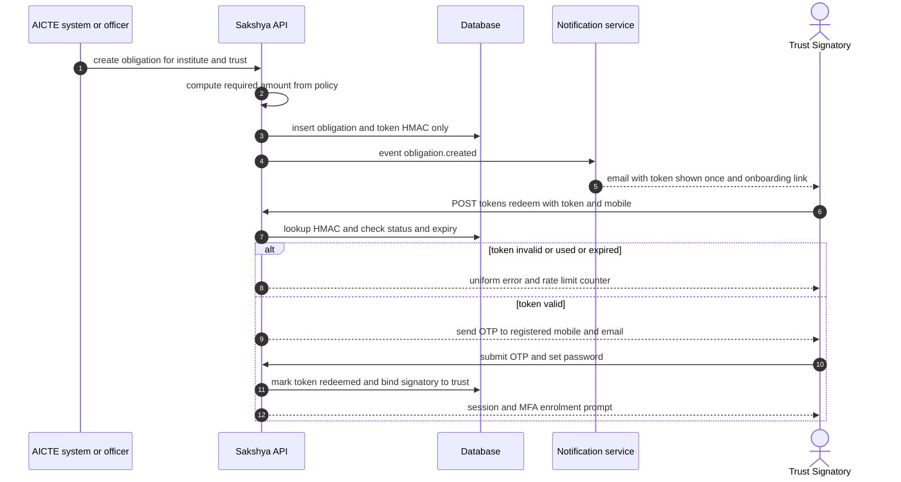

### SEQ-02 FDR submission and intake pipeline (UC-02, UC-03, UC-04)

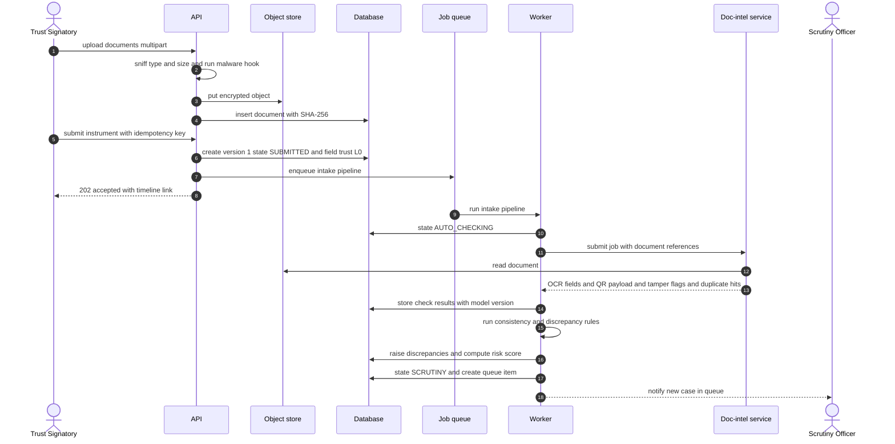

### SEQ-03 Hybrid lien confirmation (UC-08, UC-21, UC-41, UC-42)

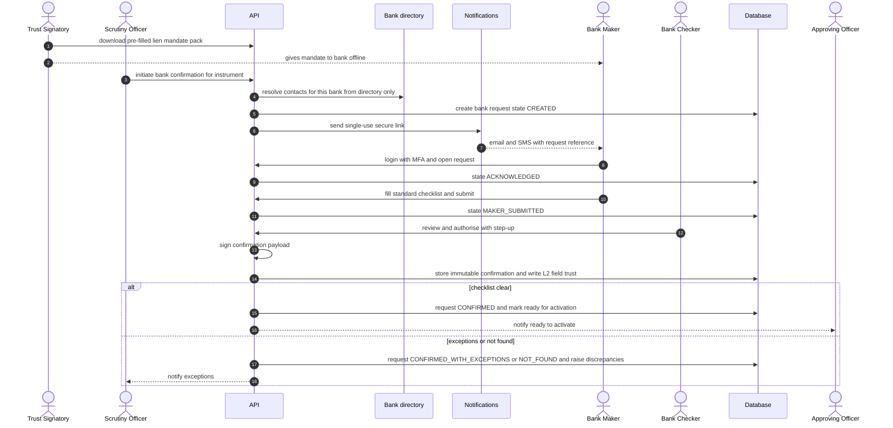

### SEQ-04 Activation with maker-checker (UC-23)

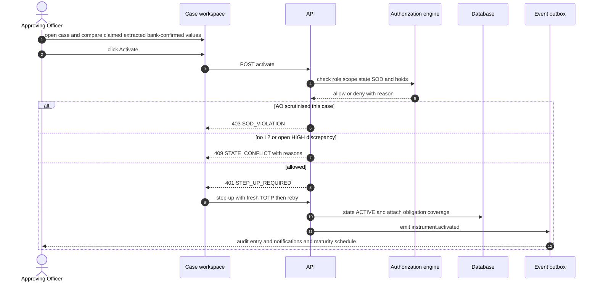

### SEQ-05 Periodic reconciliation (UC-43, UC-62)

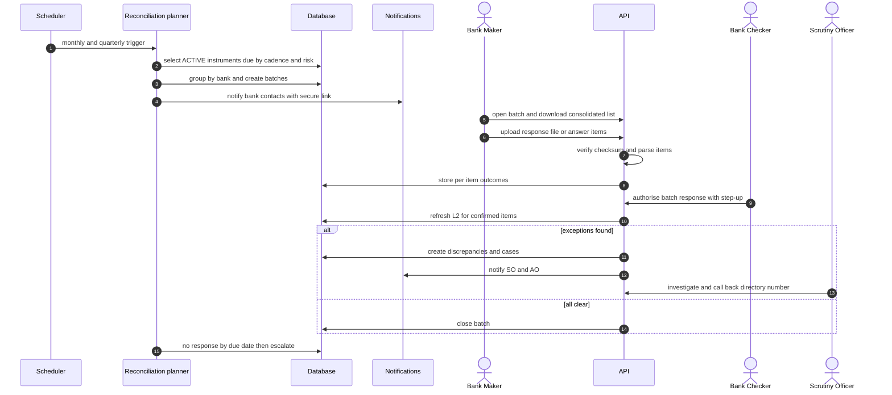

### SEQ-06 Renewal with a new FDR number (UC-10, UC-26)

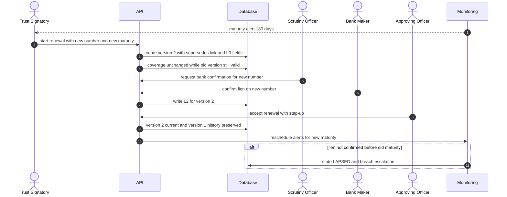

### SEQ-07 Release request to signed letter (UC-12, UC-28, UC-29)

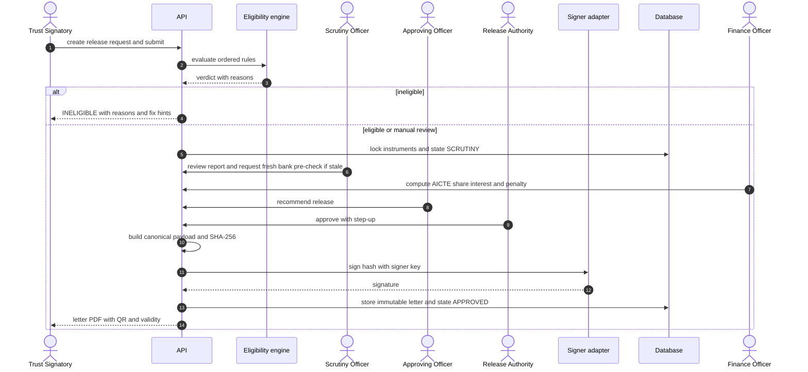

### SEQ-08 Public verification, bank execution and settlement (UC-44, UC-50)

```mermaid
sequenceDiagram
  autonumber
  actor TL as Bank teller
  participant PUB as Public verify page
  participant API as API
  participant DB as Database
  actor BM as Bank Maker
  actor BC as Bank Checker
  actor FO as Finance Officer
  TL->>PUB: enter letter code and FDR number and IFSC
  PUB->>API: POST public verify
  API->>API: rate limit and CAPTCHA escalation
  API->>DB: find letter and compare all three inputs
  alt no match or mismatch
    API-->>TL: uniform VERIFY_NO_MATCH
    API->>DB: log failed attempt and counters
  else match
    API->>API: recompute hash and verify signature
    API-->>TL: status amounts AICTE account and expiry
  end
  BM->>API: acknowledge execution with UTR amounts date
  BC->>API: authorise execution
  API->>DB: letter EXECUTED and instrument RELEASED
  API-->>FO: settlement pending notification
  FO->>API: confirm AICTE share credited
  API->>DB: settlement confirmed and case CLOSED
```

### SEQ-09 Login, MFA and step-up (UC-36)

```mermaid
sequenceDiagram
  autonumber
  actor U as User
  participant SPA as Web app
  participant API as API
  participant IDP as OIDC provider
  participant DB as Database
  alt staff with SSO
    U->>SPA: choose Sign in with SSO
    SPA->>IDP: authorization request
    IDP-->>SPA: code
    SPA->>API: exchange code
    API->>IDP: validate and fetch userinfo
  else local login
    U->>SPA: email and password
    SPA->>API: POST login
    API->>DB: verify Argon2id hash and lockout state
  end
  API-->>SPA: MFA required
  U->>SPA: enter TOTP
  SPA->>API: POST mfa verify
  API-->>SPA: access JWT and refresh cookie
  Note over SPA,API: later a sensitive action returns STEP_UP_REQUIRED
  SPA->>API: POST step-up with fresh TOTP
  API-->>SPA: 5 minute scoped proof
  SPA->>API: retry sensitive action with proof
  API->>DB: audit authz.stepup.granted
```

### SEQ-10 Forgery attempts: fake FDR and forged letter (UC-25, UC-70, UC-71)

```mermaid
sequenceDiagram
  autonumber
  actor FG as Forger
  participant API as API
  participant DI as Doc-intel
  participant BNK as Bank channel
  actor SO as Scrutiny Officer
  actor AO as Approving Officer
  actor SEC as Vigilance and Audit
  FG->>API: submit tampered FDR copy
  API->>DI: run checks
  DI-->>API: duplicate hit and tamper indicators
  API->>SO: case flagged high risk
  SO->>BNK: request confirmation via directory contact
  BNK-->>API: NOT_FOUND
  API->>API: raise D-02 HIGH
  AO->>API: quarantine instrument
  API->>SEC: security alert with evidence pack link
  FG->>API: present forged release letter to a bank teller
  Note over FG,API: teller verifies on the public page
  API-->>FG: VERIFY_NO_MATCH or revoked or expired
  API->>SEC: alert after repeated failed lookups
```

### SEQ-11 Lapse and escalation (UC-27, UC-61)

```mermaid
sequenceDiagram
  autonumber
  participant J as Scheduler
  participant MON as Monitoring
  participant DB as Database
  participant NT as Notifications
  actor TS as Trust Signatory
  actor AO as Approving Officer
  actor RA as Release Authority
  J->>MON: daily renewal_state_transition
  MON->>DB: find instruments past maturity without accepted renewal
  MON->>DB: state LAPSED and open breach case
  MON->>NT: breach notice
  NT-->>TS: notice with deadline
  NT-->>AO: case assigned
  J->>MON: lapse_escalation after N days
  alt still unresolved
    MON->>NT: escalate to RA
    NT-->>RA: unresolved breach summary
  end
  TS->>MON: late renewal submitted
  MON->>DB: case moves to renewal review
```

### SEQ-12 Policy change with two-person approval (UC-35)

```mermaid
sequenceDiagram
  autonumber
  actor PA as Policy Admin
  participant API as API
  participant DB as Database
  actor RA as Second approver
  participant EV as Event outbox
  PA->>API: propose policy version with effective date
  API->>DB: store version PROPOSED and diff
  API-->>RA: request approval
  RA->>API: review diff and approve with step-up
  API->>API: reject if approver equals proposer
  API->>DB: version APPROVED
  Note over API,DB: becomes ACTIVE at effective date
  API->>EV: emit policy.version.activated
  EV-->>API: caches invalidate and audit entry written
```

## 7.2 Release letter: payload, signing and verification

**Canonical payload** (JSON Canonicalization Scheme, RFC 8785):

```json
{
  "schema": "sakshya.letter.v1",
  "letter_id": "uuid",
  "public_code": "K7Q2-M9XD-4TPA",
  "issued_at": "2026-10-23T10:15:00Z",
  "expires_at": "2026-11-06T10:15:00Z",
  "obligation_ref": "OBL-2026-000123",
  "institute": { "aicte_id": "1-12345678", "name": "..." },
  "trust": { "name": "..." },
  "instruments": [
    { "fdr_masked": "XXXX4521", "fdr_fingerprint": "hmac-hex", "bank_ifsc": "ABCD0001234", "principal": "5000000.00" }
  ],
  "principal_to_trust": { "amount": "4500000.00", "beneficiary_ref": "trust-account-ref" },
  "aicte_share": { "amount": "500000.00", "account_ref": "policy:interest_destination" },
  "conditions": ["single use", "valid until expires_at", "bank to verify before payment"],
  "policy_version": 12,
  "issuer": { "role": "RELEASE_AUTHORITY", "signer_key_id": "key-ra-01" }
}
```

```mermaid
flowchart TB
  S1["Build payload from approved request<br/>amounts from settlement record"] --> S2["Canonicalise JSON RFC 8785"]
  S2 --> S3["hash = SHA-256 of canonical bytes"]
  S3 --> S4["Signer adapter signs hash<br/>Ed25519 with RA key after step-up"]
  S4 --> S5["Store immutable payload, hash, signature"]
  S5 --> S6["Render PDF<br/>printed hash prefix and QR"]
  S6 --> QR["QR encodes verify URL with public_code<br/>and short hash prefix"]
  V1["Verifier enters code, FDR number, IFSC"] --> V2{"Rate limit and CAPTCHA ok?"}
  V2 -->|"no"| VX["429 or challenge"]
  V2 -->|"yes"| V3["Lookup by public_code"]
  V3 --> V4{"FDR number and IFSC<br/>match instrument?"}
  V4 -->|"no"| VN["Uniform VERIFY_NO_MATCH<br/>log attempt"]
  V4 -->|"yes"| V5["Recompute hash<br/>verify signature"]
  V5 --> V6{"State ISSUED and not expired?"}
  V6 -->|"yes"| VOK["VALID: show amounts<br/>AICTE account from stored policy snapshot"]
  V6 -->|"no"| VST["Show EXPIRED, REVOKED,<br/>SUPERSEDED or EXECUTED"]
```

**Properties.** (1) Printed PDF values can differ from the payload only if tampered; the page always shows server values. (2) The AICTE account number is read from the stored policy snapshot, never from user input. (3) Verification never consumes the letter; only the authorised bank acknowledgement does. (4) Any amount change creates a new letter that supersedes the old one.

## 7.3 Risk score and priority queue

Score ∈ [0, 100] = `round(100 × Σ wᵢ · fᵢ)` with factors normalised to [0, 1]:

| Factor | Definition | Default weight |
|---|---|---|
| `f_flags` | min(1, Σ severity points / 6) where HIGH = 3, MEDIUM = 1.5, LOW = 0.5, tamper indicative = 1 | 0.25 |
| `f_aging` | min(1, days in current state / 60) | 0.20 |
| `f_amount` | percentile rank of principal among active instruments | 0.15 |
| `f_maturity` | 1 for LAPSED; otherwise 1 − min(1, days_to_maturity / 180) inside the window, else 0 | 0.15 |
| `f_bank` | bank non-response and delay history (normalised) | 0.10 |
| `f_inst` | institute history: past lapses and discrepancies | 0.10 |
| `f_recon` | days since last L2 confirmation ÷ cadence length, capped at 1 | 0.05 |

**Queue priority** = score + 20 if the SLA is breached + 10 if due within 2 days; ties broken by age. The factor breakdown is stored in `risk_score.factors` and shown to officers as "why this is first".

```mermaid
flowchart LR
  F1["Flags and discrepancies"] --> W["Weighted sum<br/>policy weights"]
  F2["Aging in state"] --> W
  F3["Amount percentile"] --> W
  F4["Maturity proximity or lapse"] --> W
  F5["Bank responsiveness"] --> W
  F6["Institute history"] --> W
  F7["Reconciliation staleness"] --> W
  W --> SC["Risk score 0 to 100"]
  SC --> PR["Priority = score + SLA boosts"]
  PR --> Q["Officer queue<br/>with factor explanation"]
  SC -->|"score at least threshold"| RC["Monthly reconciliation cadence"]
```

## 7.4 Eligibility engine

Rules run in order; each returns **PASS**, **WARN**, **FAIL** (blocking) or **MANUAL** (needs a human). Verdict: any FAIL → `INELIGIBLE`; else any MANUAL → `MANUAL_REVIEW`; else `ELIGIBLE` (WARNs listed).

| Rule | Check |
|---|---|
| E-01 | Obligation exists and belongs to the requesting Trust |
| E-02 | Requester is an active, authorised signatory |
| E-03 | Every requested instrument is ACTIVE or MATURED with L2 on principal and lien |
| E-04 | No other active release request on those instruments (release lock) |
| E-05 | Case type conditions: TERM_COMPLETE → `term_end_date ≤ today`; special cases → required certificates present and verified |
| E-06 | No active hold or quarantine on the obligation or institute |
| E-07 | No open HIGH discrepancy (MEDIUM → WARN) |
| E-08 | Latest bank confirmation younger than `recon_freshness_days`, else MANUAL (fresh pre-check required) |
| E-09 | Partial release leaves the remaining obligation covered, else FAIL |
| E-10 | Instrument maturity after term end → MANUAL (premature closure handling per policy) |
| E-11 | Penalties applicable? compute and attach (WARN) |
| E-12 | Trust beneficiary account details present and verified; authority letter valid |

```mermaid
flowchart TB
  R0["Release request submitted"] --> R1["Load policy version and request data"]
  R1 --> R2["Run rules E-01 to E-12 in order"]
  R2 --> R3{"Any FAIL?"}
  R3 -->|"yes"| IN["INELIGIBLE with reasons and fix hints"]
  R3 -->|"no"| R4{"Any MANUAL?"}
  R4 -->|"yes"| MR["MANUAL_REVIEW<br/>officer decision recorded"]
  R4 -->|"no"| EL["ELIGIBLE<br/>WARNs listed"]
  MR --> SCR["Scrutiny and recommendation"]
  EL --> SCR
  SCR --> RECOM["AO recommends"]
  RECOM --> SIGN["RA signs with step-up"]
  IN --> FIX["Institute fixes or officer closes"]
```

Policy key `recon_freshness_days` (default 90, VALIDATE) is part of §6.4.

## 7.5 Standard bank lien confirmation checklist

| # | Field | Expected | Trust effect |
|---|---|---|---|
| 1 | FDR exists and is open | Yes | Existence L2 |
| 2 | Holder name(s) | Includes the Trust | Holder L2 |
| 3 | Principal amount | Equals submitted | Principal L2 |
| 4 | Issue date | Equals submitted | Date L2 |
| 5 | Maturity date and interest rate | Equals submitted | Maturity L2 |
| 6 | Favouring | Allowed name | Favouring L2 |
| 7 | Lien marked in favour of AICTE, with lien reference and date | Yes | Lien L2 |
| 8 | No other lien, loan or overdraft against the FDR | Yes | D-15 if no |
| 9 | Premature closure, renewal or modification blocked without AICTE's written consent | Yes | Control L2 |
| 10 | Auto-renewal flag and renewal tenor | Recorded | Informational |
| 11 | Accrued interest to date | Recorded | Settlement input |
| 12 | Remarks and bank officer details (maker, checker) | Recorded | Audit |

Any "No" or mismatch becomes an exception with the bank's explanation and creates a discrepancy.

## 7.6 Document-intelligence pipeline

```mermaid
flowchart TB
  IN["Document from object store"] --> T1["Type sniff and malware hook"]
  T1 --> T2["Split pages and normalise DPI"]
  T2 --> T3["Preprocess: deskew, denoise, contrast"]
  T3 --> QRD{"QR or barcode found?"}
  QRD -->|"yes"| QRP["Decode and parse with bank plugin"]
  QRD -->|"no"| SKQ["Mark e-FDR check as not applicable"]
  T3 --> OCR["OCR English and Hindi<br/>word boxes and confidences"]
  OCR --> FX["Field extraction<br/>rules and layout cues"]
  T2 --> TP["PDF structure checks<br/>revisions, producer, fonts"]
  T3 --> TI["Image forensics<br/>error-level, copy-move,<br/>seal and signature presence"]
  FX --> CV["Consistency validator"]
  QRP --> CV
  CV --> DUP["Duplicate search<br/>blind index, perceptual hash, fuzzy fields"]
  TP --> AG["Aggregate results<br/>per check with confidence"]
  TI --> AG
  DUP --> AG
  SKQ --> AG
  AG --> OUT["Return flags only<br/>never approve or reject"]
```

All checks return `{check_name, outcome, confidence, details, model_version}`. A service failure yields `DEPENDENCY_UNAVAILABLE` and the case goes to manual review (principle P8).

## 7.7 Token and audit-chain algorithms

**Token.** 80 random bits from a CSPRNG → Crockford Base32 (16 characters) + 1 check character, displayed as `XXXX-XXXX-XXXX-XXXX-C`. Only `HMAC-SHA256(server_pepper, canonical_token)` is stored and compared in constant time. Redemption needs a successful OTP to the Trust's registered contact. Limits: 5 attempts per IP per 10 minutes, 20 per day per obligation hint, uniform error text.

**Audit hash chain.** For entry *i*: `hash_i = SHA-256(hash_{i−1} ‖ canonical_json(entry_i))`; the first entry uses 64 zero characters. Inserts take a transaction-scoped advisory lock so order is total. `audit/verify-chain` recomputes from a given sequence range. The daily anchor signs the latest hash with the audit key and stores it (and emails it to the auditor mailbox), so deleting history is detectable even by a database administrator.

## 7.8 Escalation ladders

```mermaid
flowchart LR
  A0["Bank request created"] --> A1["Day 3<br/>reminder to bank maker"]
  A1 --> A2["Day 7<br/>reminder to maker and checker"]
  A2 --> A3["Day 14<br/>alternate contact and SO notified"]
  A3 --> A4["Day 21<br/>AO notified and call-back required"]
  A4 --> A5["Day 30<br/>TIMED_OUT and D-18 raised"]
  A5 --> A6["Officer re-initiates<br/>or marks instrument at risk"]
```

```mermaid
flowchart LR
  M0["Maturity 180 days"] --> M1["Institute alert"]
  M1 --> M2["90 days<br/>institute reminder"]
  M2 --> M3["30 days<br/>institute and SO"]
  M3 --> M4["7 days<br/>institute, SO, AO"]
  M4 --> M5["Maturity passed unrenewed<br/>LAPSED and breach case"]
  M5 --> M6["After N days<br/>escalate to RA"]
```

Offsets come from policy keys `bank_reminder_days`, `escalation_days`, `maturity_alert_days`.

---

# 8. Task Breakdown

## 8.1 Async operating model

The project is split into **88 tasks in 9 workstreams**. Tasks are written so that any contributor can pick any *Ready* task without a meeting.

**Rules of the async model**

1. **Contract-first, mock-first.** A task may **start as soon as the contracts of its dependencies exist** (OpenAPI, DB schema, event schema, adapter interface) and a fake or mock is available. It may **merge** only after its hard dependencies are merged. So almost everything can start on day one; only the *merge order* is constrained.
2. **Freeze points** (changes after a freeze must be additive):

| Freeze | Contract | Owner task | Fakes delivered with it |
|---|---|---|---|
| C0 | API conventions, error model, naming | T-002 | Spectral ruleset |
| C1 | OpenAPI per module | T-002 | Prism mock (T-003), MSW handlers |
| C2 | DB schema v1 | T-011 | Factories (T-180) |
| C3 | Domain event catalogue and JSON Schemas | T-020 | In-memory event bus |
| C4 | Doc-intel job API | T-121 | `FakeDocIntel` |
| C5 | Adapter interfaces (`BankChannel`, `Signer`, `IdentityProvider`, `NotificationChannel`, `Kms`, `Clock`) | T-035, T-142, T-143, T-018, T-161, T-012 | `FakeBankChannel`, `FakeSigner`, `FakeIdP`, `FakeNotifier`, `FakeClock` |

3. **Frontend works against mocks** (`VITE_API_MODE=mock`) and flips to real (`real`) module by module when the backend task merges. The flip is a checklist item inside each frontend task.
4. **Only three sync points**, each a short async review in a PR or issue thread (call optional): **S1** contract freeze review (C0–C1), **S2** integration smoke when the first full vertical slice merges, **S3** release-candidate review (§9.2 scenarios all green).
5. **Small PRs.** Aim ≤ 400 changed lines. Stacked PRs are allowed. Incomplete work hides behind feature flags `ff_<name>`.
6. **Decisions are written down** as ADRs in `docs/adr/` (one page, status, context, decision, consequences). A PR that changes architecture must link its ADR.
7. **Board columns:** `Ready` (Definition of Ready met) → `In progress` → `In review` → `Merged` → `Verified` (covered by an E2E scenario in §9.2).

**Suggested lanes for a four-person team** (not rigid; any task can move):

| Lane | Focus | Starting tasks (all startable at once) |
|---|---|---|
| A: Platform | Core platform, security, ops | T-001, T-004, T-010, T-011, T-012, T-013, T-014, T-015, T-016 |
| B: Domain | Domain services and integrations | T-002, T-140, T-142, then T-030 → T-039, T-050 → T-064 |
| C: Frontend | Portals | T-006, T-101, T-100 (on mocks), then T-102 → T-113 |
| D: Intelligence, QA, docs | Doc-intel, synthetic data, tests, demo | T-120, T-121 → T-128, T-005, T-180, T-181, T-200 |

## 8.2 Task template and size legend

Every task contains: **Meta** (track, priority, size, hard dependencies, unblocks, how to start now), **Objective**, **Requirements**, **Interfaces and deliverables**, **Edge cases**, **Test cases** (`TC-<task>-<n>`; types: **U** unit, **I** integration, **C** contract, **E** end-to-end, **S** security, **P** performance, **M** manual/review) and **Push gate** (what must be true before pushing to GitHub).

Size (relative effort, no calendar assumed): **S** a few hours of focused work · **M** about a day · **L** a few days · **XL** about a week.

## 8.3 Global Definition of Ready and Definition of Done

**Definition of Ready (DoR)** — a task is *Ready* when: (1) its contracts exist or are in the same PR, (2) fakes/mocks for dependencies are available, (3) test cases are listed (from this SRS), (4) an owner is assigned.

**Definition of Done / Global push gate (G-DoD)** — applies to **every** task in addition to its own push gate:

| # | Gate | How it is checked |
|---|---|---|
| G-1 | Lint, format, types clean | `make lint` (ruff, mypy strict, eslint, prettier, import-linter) |
| G-2 | Tests pass; coverage gates met | `make test` (backend domain modules ≥ 85 %, frontend logic ≥ 80 %) |
| G-3 | Contract unchanged or additively changed | `make contract` (Spectral, oasdiff breaking check, Schemathesis vs running app) |
| G-4 | No secrets, no high/critical vulnerabilities | `make security` (gitleaks, bandit, semgrep, pip-audit, npm audit, trivy) |
| G-5 | Migrations reversible and in sync | `make migrate-check` (up → down → up; autogenerate diff empty) |
| G-6 | Every state change writes an audit entry and emits a domain event | Test asserts both |
| G-7 | Logs carry `request_id`, contain no PII/secrets | Log-scan test |
| G-8 | Docs updated (module README, ADR if architectural, OpenAPI examples) | PR checklist |
| G-9 | Reviewed by ≥ 1 CODEOWNER; PR ≤ 400 lines or justified | Branch protection |
| G-10 | Evidence attached: test output, screenshot/GIF or `curl` transcript | PR template |
| G-11 | Incomplete behaviour behind a feature flag; defaults safe | Review |
| G-12 | Frontend: axe has zero serious/critical violations; keyboard path works | `make test-a11y` |
| G-13 | Frontend: no hard-coded strings; keys exist in `en` and `hi` | i18n lint |
| G-14 | Conventional commit message with task id: `feat(instruments): add submit [T-032]` | commitlint |

`make verify` runs G-1 … G-5, G-12 and G-13 locally and in CI. A task is *perfect to push* when `make verify` is green, its own **Push gate** items are ticked in the PR, and its listed test cases pass.

**Branch and commit policy.** Trunk-based: short-lived branches `feat|fix|chore/T-xxx-slug`, squash merge, protected `main`, required checks = CI jobs, no force-push to `main`, tags `vMAJOR.MINOR.PATCH`.

## 8.4 Dependency graphs

### Workstream overview

```mermaid
flowchart LR
  WS0["WS0 Foundation<br/>T-001..T-006"]
  WS1["WS1 Core platform<br/>T-010..T-020"]
  WS2["WS2 Domain services<br/>T-030..T-076"]
  WS3["WS3 Frontend<br/>T-100..T-113"]
  WS4["WS4 Doc intelligence<br/>T-120..T-128"]
  WS5["WS5 Integrations<br/>T-140..T-144"]
  WS6["WS6 Security<br/>T-160..T-164"]
  WS7["WS7 QA and Ops<br/>T-180..T-185"]
  WS8["WS8 Docs and demo<br/>T-200..T-203"]
  WS0 --> WS1
  WS0 -->|"contracts and mocks"| WS3
  WS0 -->|"contracts"| WS4
  WS0 -->|"contracts"| WS5
  WS1 --> WS2
  WS5 --> WS2
  WS6 --> WS2
  WS4 -.->|"doc-intel API"| WS2
  WS2 -.->|"real API replaces mocks"| WS3
  WS2 --> WS7
  WS3 --> WS7
  WS2 --> WS8
  WS4 --> WS8
```

### DAG-A: foundation and core platform

```mermaid
flowchart LR
  T001["T-001 Monorepo"] --> T004["T-004 Docker dev"]
  T001 --> T005["T-005 CI"]
  T002["T-002 API contract"] --> T003["T-003 Mocks"]
  T001 --> T010["T-010 Platform base"]
  T004 --> T010
  T002 --> T011["T-011 DB schema"]
  T010 --> T011
  T010 --> T012["T-012 Clock"]
  T011 --> T013["T-013 Audit"]
  T011 --> T014["T-014 Identity"]
  T013 --> T014
  T014 --> T015["T-015 AuthZ"]
  T013 --> T015
  T011 --> T016["T-016 Policy"]
  T013 --> T016
  T010 --> T017["T-017 Files"]
  T011 --> T017
  T010 --> T019["T-019 Jobs"]
  T012 --> T019
  T011 --> T018["T-018 Notifications"]
  T019 --> T018
  T011 --> T020["T-020 Events"]
  T019 --> T020
  T006["T-006 UX foundations"]
```

### DAG-B: domain services

```mermaid
flowchart LR
  subgraph PLAT["Platform (DAG-A)"]
    P12["T-012 Clock"]
    P13["T-013 Audit"]
    P14["T-014 Identity"]
    P15["T-015 AuthZ"]
    P16["T-016 Policy"]
    P17["T-017 Files"]
    P18["T-018 Notifications"]
    P19["T-019 Jobs"]
    P20["T-020 Events"]
  end
  subgraph EXT["Integrations and security"]
    X142["T-142 Signer"]
    X161["T-161 Crypto"]
    X162["T-162 Hardening"]
    X140["T-140 Mock bank"]
  end
  P15 --> T030["T-030 Institutes and obligations"]
  P16 --> T030
  T030 --> T031["T-031 Token"]
  P14 --> T031
  T031 --> T032["T-032 Instrument submission"]
  T030 --> T032
  P17 --> T032
  P16 --> T032
  P17 --> T033["T-033 Intake orchestration"]
  P20 --> T033
  P14 --> T034["T-034 Bank directory"]
  P15 --> T034
  T034 --> T035["T-035 Bank channel"]
  P18 --> T035
  P20 --> T035
  T035 --> T036["T-036 Bank confirmation"]
  T032 --> T036
  T032 --> T037["T-037 Trust levels"]
  P13 --> T037
  T037 --> T038["T-038 Discrepancy engine"]
  P16 --> T038
  T038 --> T039["T-039 Scrutiny and activation"]
  T036 --> T039
  P15 --> T039
  T032 --> T050["T-050 Monitoring"]
  P19 --> T050
  P18 --> T050
  P16 --> T050
  T050 --> T051["T-051 Escalation and SLA"]
  T039 --> T052["T-052 Renewal"]
  T036 --> T052
  T050 --> T052
  T036 --> T053["T-053 Reconciliation"]
  T050 --> T053
  T030 --> T054["T-054 Holds"]
  P15 --> T054
  T032 --> T060["T-060 Eligibility"]
  T054 --> T060
  P16 --> T060
  T060 --> T061["T-061 Release workflow"]
  T039 --> T061
  T061 --> T062["T-062 Letters"]
  X142 --> T062
  X161 --> T062
  T062 --> T063["T-063 Public verify"]
  X162 --> T063
  T062 --> T064["T-064 Execution and settlement"]
  T035 --> T064
  T032 --> T066["T-066 Cash deposit"]
  T039 --> T066
  T038 --> T070["T-070 Risk and priority"]
  T050 --> T070
  T032 --> T071["T-071 Dashboards API"]
  T050 --> T071
  T032 --> T072["T-072 Search and evidence"]
  P17 --> T072
  P13 --> T074["T-074 Audit explorer"]
  P12 --> T073["T-073 Admin APIs"]
  P14 --> T073
  P15 --> T073
  P16 --> T073
  T034 --> T073
  T061 --> T075["T-075 Certificates"]
  T030 --> T076["T-076 AICTE import"]
  X140 -.-> T036
```

### DAG-C: frontend, intelligence, integrations, security, QA, docs

```mermaid
flowchart LR
  T002["T-002 Contract"] --> T003["T-003 Mocks"]
  T006["T-006 UX foundations"] --> T101["T-101 Design system"]
  T003 --> T100["T-100 App shell"]
  T006 --> T100
  T100 --> T102["T-102 Institute core"]
  T101 --> T102
  T102 --> T103["T-103 Institute renewals and release"]
  T100 --> T104["T-104 Officer workspace"]
  T101 --> T104
  T104 --> T105["T-105 Activation and discrepancy"]
  T104 --> T106["T-106 Release Authority"]
  T104 --> T107["T-107 Finance"]
  T104 --> T113["T-113 Regional and compliance"]
  T100 --> T108["T-108 Bank Console"]
  T101 --> T108
  T100 --> T109["T-109 Public verify page"]
  T100 --> T110["T-110 Dashboards"]
  T100 --> T111["T-111 Admin console"]
  T100 --> T112["T-112 Auditor workspace"]
  T120["T-120 Synthetic data"] --> T122["T-122 OCR"]
  T121["T-121 Doc-intel skeleton"] --> T122
  T122 --> T123["T-123 Field extraction"]
  T120 --> T124["T-124 QR and e-FDR"]
  T121 --> T124
  T120 --> T125["T-125 Tamper heuristics"]
  T121 --> T125
  T121 --> T126["T-126 Duplicates"]
  T123 --> T127["T-127 Consistency"]
  T124 --> T127
  T127 --> T128["T-128 Evaluation harness"]
  T125 --> T128
  T126 --> T128
  T160["T-160 Threat model"] --> T163["T-163 Privacy"]
  T160 --> T164["T-164 Security testing"]
  T005["T-005 CI"] --> T164
  T005 --> T185["T-185 Release mgmt"]
  T004["T-004 Docker dev"] --> T181["T-181 E2E suite"]
  T004 --> T184["T-184 Deployment"]
  T183["T-183 Observability"] --> T184
  T120 --> T201["T-201 Seed and scenarios"]
  T201 --> T203["T-203 Pitch and demo"]
```

## 8.5 Merge tiers (what can merge when)

All tasks can **start** immediately against contracts and fakes. This table is only the **merge order**; tasks in the same tier are fully parallel.

| Tier | Tasks |
|---|---|
| 0 | T-001, T-002, T-006, T-120, T-160 |
| 1 | T-003, T-004, T-005, T-101, T-121, T-140, T-200 |
| 2 | T-010, T-100, T-122, T-124, T-125, T-164, T-181, T-185 |
| 3 | T-011, T-012, T-123, T-142, T-161, T-183, T-102, T-104, T-108, T-109, T-110, T-111, T-112 |
| 4 | T-013, T-017, T-019, T-126, T-127, T-163, T-180, T-184, T-103, T-105, T-106, T-107, T-113 |
| 5 | T-014, T-016, T-018, T-020, T-074, T-128 |
| 6 | T-015, T-033, T-143, T-144, T-162 |
| 7 | T-030, T-034 |
| 8 | T-031, T-035, T-054, T-073, T-076 |
| 9 | T-032, T-141 |
| 10 | T-036, T-037, T-050, T-060, T-071, T-072, T-201 |
| 11 | T-038, T-051, T-053, T-182, T-202, T-203 |
| 12 | T-039, T-070 |
| 13 | T-052, T-061, T-066 |
| 14 | T-062, T-075 |
| 15 | T-063, T-064 |

**Critical path:** T-001 → T-004 → T-010 → T-011 → T-013 → T-014 → T-015 → T-030 → T-031 → T-032 → T-037 → T-038 → T-039 → T-061 → T-062 → T-063/T-064. Put your strongest capacity here; everything else can absorb delay.

## 8.6 Task index

| ID | Title | WS | Pri | Size | Hard dependencies |
|---|---|---|---|---|---|
| T-001 | Monorepo scaffold and tooling | 0 | P0 | M | — |
| T-002 | API contract (OpenAPI 3.1) | 0 | P0 | L | — |
| T-003 | Mock servers and contract-test harness | 0 | P0 | M | T-002 |
| T-004 | Docker development environment | 0 | P0 | M | T-001 |
| T-005 | CI pipeline and quality gates | 0 | P0 | M | T-001 |
| T-006 | UX foundations and wireframes | 0 | P0 | L | — |
| T-010 | Platform base (config, logging, errors, health) | 1 | P0 | M | T-001, T-004 |
| T-011 | Database schema and migrations | 1 | P0 | L | T-002, T-010 |
| T-012 | Clock service (time travel) | 1 | P0 | S | T-010 |
| T-013 | Audit service (hash chain) | 1 | P0 | M | T-011 |
| T-014 | Identity, sessions, MFA | 1 | P0 | L | T-011, T-013 |
| T-015 | Authorization engine | 1 | P0 | L | T-013, T-014 |
| T-016 | Policy engine | 1 | P0 | L | T-011, T-013 |
| T-017 | File storage service | 1 | P0 | M | T-010, T-011 |
| T-018 | Notification service | 1 | P0 | L | T-011, T-019 |
| T-019 | Job infrastructure | 1 | P0 | M | T-010, T-012 |
| T-020 | Domain events and outbox | 1 | P0 | M | T-011, T-019 |
| T-030 | Institutes, trusts, obligations | 2 | P0 | L | T-011, T-015, T-016 |
| T-031 | Token service | 2 | P0 | M | T-014, T-030 |
| T-032 | Instrument submission and versions | 2 | P0 | XL | T-016, T-017, T-030, T-031 |
| T-033 | Document intake orchestration | 2 | P0 | M | T-017, T-020 |
| T-034 | Bank directory and nodal registry | 2 | P0 | M | T-011, T-014, T-015 |
| T-035 | Bank channel abstraction and portal channel | 2 | P0 | L | T-018, T-020, T-034 |
| T-036 | Bank confirmation workflow | 2 | P0 | XL | T-032, T-035 |
| T-037 | Trust levels and provenance | 2 | P0 | M | T-013, T-032 |
| T-038 | Discrepancy engine | 2 | P0 | L | T-016, T-037 |
| T-039 | Scrutiny and activation | 2 | P0 | L | T-015, T-036, T-038 |
| T-050 | Monitoring scheduler | 2 | P0 | L | T-016, T-018, T-019, T-032 |
| T-051 | Escalation and SLA engine | 2 | P0 | M | T-018, T-050 |
| T-052 | Renewal and replacement | 2 | P0 | L | T-036, T-039, T-050 |
| T-053 | Periodic reconciliation | 2 | P0 | L | T-036, T-050 |
| T-054 | Holds and quarantine | 2 | P0 | M | T-015, T-030 |
| T-060 | Eligibility engine | 2 | P0 | L | T-016, T-032, T-054 |
| T-061 | Release request workflow | 2 | P0 | L | T-039, T-060 |
| T-062 | Release letter generation and lifecycle | 2 | P0 | XL | T-061, T-142, T-161 |
| T-063 | Public verification service | 2 | P0 | M | T-062, T-162 |
| T-064 | Execution acknowledgement and settlement | 2 | P0 | L | T-035, T-062 |
| T-066 | Cash deposit instrument | 2 | P1 | M | T-032, T-039 |
| T-070 | Risk scoring and priority queue | 2 | P0 | M | T-038, T-050 |
| T-071 | Dashboards and reports API | 2 | P0 | L | T-032, T-050 |
| T-072 | Search, history, evidence pack | 2 | P0 | L | T-017, T-032 |
| T-073 | Admin APIs | 2 | P0 | M | T-012, T-014, T-015, T-016, T-034 |
| T-074 | Audit explorer and anchoring | 2 | P0 | M | T-013 |
| T-075 | Certificates sub-flow | 2 | P1 | M | T-061 |
| T-076 | AICTE data import and integration adapter | 2 | P1 | M | T-030 |
| T-100 | App shell, auth flows, i18n, a11y | 3 | P0 | L | T-003, T-006 |
| T-101 | Design system library | 3 | P0 | L | T-006 |
| T-102 | Institute portal core | 3 | P0 | XL | T-100, T-101 |
| T-103 | Institute portal: renewals, release, queries | 3 | P0 | L | T-102 |
| T-104 | Officer console: queue and case workspace | 3 | P0 | XL | T-100, T-101 |
| T-105 | Officer console: activation and discrepancies | 3 | P0 | L | T-104 |
| T-106 | Release Authority workspace | 3 | P0 | M | T-104 |
| T-107 | Finance workspace | 3 | P0 | M | T-104 |
| T-108 | Bank Console | 3 | P0 | XL | T-100, T-101 |
| T-109 | Public verification page | 3 | P0 | M | T-100, T-101 |
| T-110 | Dashboards and reports UI | 3 | P0 | L | T-100, T-101 |
| T-111 | Admin console | 3 | P0 | L | T-100, T-101 |
| T-112 | Auditor workspace | 3 | P0 | M | T-100, T-101 |
| T-113 | Regional officer and compliance modules | 3 | P1 | M | T-104 |
| T-120 | Synthetic data generator | 4 | P0 | L | — |
| T-121 | Doc-intel service skeleton | 4 | P0 | M | T-001, T-002 |
| T-122 | Preprocessing and OCR | 4 | P0 | L | T-120, T-121 |
| T-123 | Field extraction | 4 | P0 | L | T-122 |
| T-124 | QR and e-FDR parsing | 4 | P0 | M | T-120, T-121 |
| T-125 | Tamper heuristics | 4 | P1 | L | T-120, T-121 |
| T-126 | Duplicate and similarity detection | 4 | P0 | M | T-011, T-121 |
| T-127 | Consistency validator | 4 | P0 | M | T-123, T-124 |
| T-128 | Evaluation harness | 4 | P1 | M | T-123..T-127 |
| T-140 | Mock bank service | 5 | P0 | L | T-001, T-002 |
| T-141 | Bank bulk-file and API adapters | 5 | P1 | L | T-035, T-140 |
| T-142 | Signer / eSign adapter | 5 | P0 | M | T-010 |
| T-143 | SSO / OIDC adapter | 5 | P1 | M | T-014 |
| T-144 | Email and SMS adapters | 5 | P0 | S | T-018 |
| T-160 | Threat model | 6 | P0 | M | — |
| T-161 | Cryptography and key management | 6 | P0 | M | T-010 |
| T-162 | Application hardening | 6 | P0 | M | T-010, T-014 |
| T-163 | Privacy and data governance | 6 | P1 | M | T-011, T-160 |
| T-164 | Security testing programme | 6 | P0 | M | T-005, T-160 |
| T-180 | Test strategy, factories and fakes | 7 | P0 | M | T-001, T-011 |
| T-181 | End-to-end suite | 7 | P0 | L | T-004 |
| T-182 | Performance and load tests | 7 | P1 | M | T-032, T-071 |
| T-183 | Observability | 7 | P1 | M | T-010 |
| T-184 | Deployment and operations | 7 | P1 | L | T-004, T-183 |
| T-185 | Release management | 7 | P1 | S | T-005 |
| T-200 | Documentation set | 8 | P0 | M | T-001 |
| T-201 | Seed data and scenario scripts | 8 | P0 | M | T-012, T-032, T-120 |
| T-202 | KPI instrumentation | 8 | P0 | M | T-071 |
| T-203 | Pitch deck, demo script, scenario mapping | 8 | P0 | M | T-201 |

---

## 8.7 WS0: Foundation

### T-001 · Monorepo scaffold and tooling

**Meta** — Track: Foundation · P0 · M · Depends: — · Unblocks: almost everything · Start now with: nothing needed.

**Objective.** Create the repository layout (§3.7), developer tooling and contribution rules so that every later task inherits consistent quality gates.

**Requirements**
1. Directory layout exactly as §3.7 with placeholder modules and `README.md` per top-level folder.
2. Tooling: `pre-commit` (ruff, ruff-format, mypy, eslint, prettier, gitleaks, commitlint), `.editorconfig`, `.nvmrc`, `.python-version`, dependency lockfiles (uv or pip-tools; pnpm).
3. `Makefile` targets: `bootstrap`, `lint`, `test`, `contract`, `security`, `build`, `migrate-check`, `verify`, `up`, `down`, `reset`, `seed` (stubs allowed until owning tasks land).
4. `import-linter` contracts enforcing §3.3 (modules import only each other's `api.py`).
5. `.github/` with `CODEOWNERS`, PR template (checklist = G-DoD), issue templates (task, bug, ADR), labels.
6. `LICENSE`, `SECURITY.md`, `CONTRIBUTING.md`, `CODE_OF_CONDUCT.md`, `docs/adr/0001-record-architecture-decisions.md`.
7. Conventional-commit and semantic-release configuration; Renovate/Dependabot config.

**Interfaces and deliverables.** Repo skeleton, `Makefile`, configs, ADR-0001, `docs/CONTRIBUTING` quickstart.

**Edge cases.** CRLF line endings on Windows (enforce LF via `.gitattributes`); wrong Python/Node version (fail fast with a helpful message); hooks skipped locally (CI re-runs them); monorepo path filters so unrelated changes do not run every job.

**Test cases**

| ID | Type | Scenario → Expected |
|---|---|---|
| TC-T001-01 | M | Fresh clone on a clean machine → `make bootstrap && make verify` passes |
| TC-T001-02 | U | Commit with message `fixed stuff` → commitlint rejects |
| TC-T001-03 | U | Commit containing a fake secret pattern → gitleaks blocks it |
| TC-T001-04 | U | Sample module imports another module's internals → import-linter fails |
| TC-T001-05 | M | Open a PR → template shows G-DoD checklist; CODEOWNERS auto-requests reviewers |

**Push gate** — G-DoD · `make verify` green on CI's fresh-clone job · README quickstart followed successfully by a second contributor.

---

### T-002 · API contract (OpenAPI 3.1)

**Meta** — Track: Foundation · P0 · L · Depends: — · Unblocks: T-003, T-011, T-100, T-121, T-140 · Start now with: this SRS §6.6.

**Objective.** Author the authoritative OpenAPI document for every endpoint in §6.6.2, with shared schemas, examples and policy annotations, and generate clients/mocks from it.

**Requirements**
1. Modular spec files per tag, bundled into `packages/contracts/openapi.yaml`.
2. Shared components: `Problem` (RFC 9457), `Cursor`, `Money`, `Id`, `Scope`, `StateTransition`, `AuditRef`.
3. Per operation: `operationId`, `x-roles`, `x-state-guard`, `x-audit-action`, `x-step-up`, `x-idempotent`, request and response examples, all error responses from §6.10.
4. Polymorphic instrument payloads (`oneOf` with discriminator `kind`); multipart upload schema; `202` accepted pattern for async work.
5. Generated artifacts: TypeScript types and typed fetch client; Pydantic models for contract tests.
6. Spectral ruleset (naming, mandatory error responses, no unbounded lists); breaking-change policy: additive only after freeze C1.
7. Event JSON Schemas drafted for §6.8.1 (finalised by T-020).

**Interfaces and deliverables.** `packages/contracts/{openapi.yaml, schemas/, events/, generated/}`, `docs/api-conventions.md`.

**Edge cases.** Public endpoints must declare `security: []` explicitly; money as string; pagination on every list; enum evolution (clients must tolerate unknown values).

**Test cases**

| ID | Type | Scenario → Expected |
|---|---|---|
| TC-T002-01 | C | Spectral lint → zero errors |
| TC-T002-02 | C | Script checks every operation has `x-roles` and ≥ 1 error example → passes |
| TC-T002-03 | U | Generated TS client compiles under `strict` |
| TC-T002-04 | C | Schemathesis against Prism mock → responses conform to schema |
| TC-T002-05 | C | oasdiff on a branch that removes a response field → flagged as breaking (negative test) |

**Push gate** — G-DoD · spec bundle reproducible (`make contract-build` yields no diff) · S1 review recorded in PR thread.

---

### T-003 · Mock servers and contract-test harness

**Meta** — Track: Foundation · P0 · M · Depends: T-002 · Unblocks: T-100 and all frontend work · Start now with: draft spec.

**Objective.** Let frontend and consumers develop against realistic mocks, and ensure the real API never drifts from the spec.

**Requirements**
1. Prism mock server (`mock-api`, port 4010) in Compose serving the bundled spec with dynamic examples.
2. Scenario control via headers: `Prefer: code=409`, `Prefer: example=ineligible`, plus a small **stateful scenario** layer (happy-path walkthroughs for instrument and release flows).
3. MSW handler generation from the spec for unit tests.
4. Contract-test runner: Schemathesis against the real app; custom check that every route in the app exists in the spec and vice versa.
5. CI job `contract` (G-3).

**Edge cases.** Mock must emit realistic `problem+json`; large lists paginate; auth endpoints accept test credentials only in mock mode.

**Test cases**

| ID | Type | Scenario → Expected |
|---|---|---|
| TC-T003-01 | I | GET on every list endpoint via mock → 200 with example payload |
| TC-T003-02 | I | `Prefer: code=409` → returns documented 409 body |
| TC-T003-03 | U | Frontend unit test using MSW receives typed data |
| TC-T003-04 | C | Delete a route in the app (negative test) → route/spec parity check fails |
| TC-T003-05 | C | Real endpoint returns an extra undocumented field → Schemathesis flags it |

**Push gate** — G-DoD · `docker compose up mock-api` serves all operations · docs show how to switch `VITE_API_MODE`.

---

### T-004 · Docker development environment

**Meta** — Track: Foundation · P0 · M · Depends: T-001 · Unblocks: T-010, T-181, T-184 · Start now with: service list from §3.2.

**Objective.** One command brings up the full stack locally and in CI.

**Requirements**
1. Compose services: `postgres`, `redis`, `minio` (+ bucket init), `mailpit`, `api`, `worker`, `beat`, `doc-intel`, `web`, `mock-bank`, `mock-api`; profiles `lite` (db + api) and `full`.
2. Health checks and `depends_on: condition: service_healthy`; resource limits; named volumes.
3. `.env.example` with every variable documented; secrets never committed.
4. Make targets `up`, `down`, `reset` (drops DB and buckets), `seed`, `logs`.
5. Hot reload for `api` and `web` in dev.

**Edge cases.** Port collisions (configurable via env); Apple-silicon images; slow first start; partial failures leave a clear error.

**Test cases**

| ID | Type | Scenario → Expected |
|---|---|---|
| TC-T004-01 | M | `make up` → all health checks green within the documented time |
| TC-T004-02 | I | `make reset && make up` → clean DB and buckets recreated |
| TC-T004-03 | I | Stop Redis → `/health/ready` returns 503; restart → recovers without restarting the api |
| TC-T004-04 | M | Two parallel stacks with different `COMPOSE_PROJECT_NAME` and ports run side by side |
| TC-T004-05 | S | `docker compose config` shows no secret values committed; images run as non-root |

**Push gate** — G-DoD · CI uses the same Compose file to run integration tests.

---

### T-005 · CI pipeline and quality gates

**Meta** — Track: Foundation · P0 · M · Depends: T-001 · Unblocks: T-164, T-185 · Start now with: Makefile targets.

**Objective.** Automate G-DoD on every pull request and nightly.

**Requirements**
1. Workflows: `ci.yml` (lint, unit, integration with service containers, contract, security, build, migrate-check, a11y), `e2e.yml` (nightly and on label), `release.yml`, reusable `fresh-clone` job.
2. Caching, concurrency cancellation, matrix for Python/Node versions where useful, path filters.
3. Coverage upload with gates (backend domain ≥ 85 %, frontend logic ≥ 80 %); fail on regression > 2 points.
4. Artifacts: test reports, coverage, screenshots/videos from E2E, OpenAPI diff.
5. Supply chain: dependency review, SBOM (syft), container scan (trivy), pinned action SHAs.
6. Documented branch protection (required checks, reviews, signed commits optional).
7. Workflow safety: no secrets exposed to forks; least-privilege tokens.

**Edge cases.** Flaky tests quarantine label with auto-issue; very large diffs; docs-only changes skip heavy jobs.

**Test cases**

| ID | Type | Scenario → Expected |
|---|---|---|
| TC-T005-01 | M | PR with a lint error → blocked |
| TC-T005-02 | M | PR that lowers coverage below the gate → blocked |
| TC-T005-03 | S | PR from a fork cannot read secrets (verified by a canary workflow) |
| TC-T005-04 | M | Docs-only PR → heavy jobs skipped, required checks still report success |
| TC-T005-05 | M | Pipeline duration for a typical PR ≤ 15 minutes |

**Push gate** — G-DoD · protection rules documented in `docs/ci.md` · first green run linked in PR.

---

### T-006 · UX foundations and wireframes

**Meta** — Track: Foundation (design) · P0 · L · Depends: — · Unblocks: T-100, T-101 · Start now with: §2.2, §2.6, §6.6.3.

**Objective.** Produce the information architecture, flows, wireframes and design tokens that frontend tasks implement.

**Requirements**
1. Personas for each role in §2.2 and journey maps for the 12 highest-value use cases (UC-01, 02, 03, 08, 10, 12, 20–23, 29, 41, 44, 50).
2. Information architecture and navigation per portal; low-fidelity wireframes for **every screen** in §6.6.3, including empty, loading, error and permission-denied states.
3. Design tokens (colour, typography, spacing, radius, elevation, motion) exported as JSON; contrast ≥ 4.5:1 for text.
4. **Status vocabulary:** every state in §5 mapped to a label, colour, icon and plain-language explanation (en and hi).
5. Copy deck for key flows (en + hi) in plain language.
6. Accessibility annotations (focus order, labels, landmarks) and responsive behaviour down to 360 px.
7. Output committed to `docs/ux/` (source file link, PNG/PDF exports, tokens JSON).

**Edge cases.** Long Hindi strings; very long institute names; many instruments per obligation; low-bandwidth/low-literacy users (large touch targets, minimal jargon).

**Test cases**

| ID | Type | Scenario → Expected |
|---|---|---|
| TC-T006-01 | M | Checklist: every screen in §6.6.3 has a wireframe |
| TC-T006-02 | M | Every state in §5 appears in the status vocabulary |
| TC-T006-03 | U | Script validates token pairs meet contrast ≥ 4.5:1 |
| TC-T006-04 | M | Hindi copy reviewed by a native speaker; sign-off in PR |
| TC-T006-05 | M | Quick usability check with 3 people on the FDR wizard and public verify page; findings logged |

**Push gate** — G-DoD (docs subset) · tokens JSON consumed successfully by T-101's build.

---

## 8.8 WS1: Core platform

### T-010 · Platform base

**Meta** — Track: Core · P0 · M · Depends: T-001, T-004 · Unblocks: T-011, T-012, T-017, T-019, T-142, T-161, T-162, T-183 · Start now with: FastAPI skeleton and `FakeClock`.

**Objective.** Provide the application factory and cross-cutting runtime every module relies on.

**Requirements**
1. App factory with versioned router mounting and a **module registry** (each module exposes `register(app)` and `api.py`).
2. Typed settings (pydantic-settings) with fail-fast validation listing **all** problems at once.
3. Structured JSON logging (structlog) with `request_id`, `actor_id`, `module`; PII/secret redaction filter.
4. Middleware: request id, security headers (CSP, HSTS when HTTPS, nosniff, frame-ancestors none), CORS allow-list, GZip, body-size limits, timing metrics.
5. Global exception mapping to RFC 9457 `problem+json` using the §6.10 codes; unknown errors return only `INTERNAL` and the request id.
6. Health endpoints `/health/live` and `/health/ready` (DB, Redis, object store checks).
7. Async DB session management, Redis client, graceful shutdown and startup retry with backoff.

**Interfaces and deliverables.** `services/api/app/core/*`, settings reference doc, ADR for module boundaries.

**Edge cases.** Misconfiguration in production; DB unavailable at boot; slow dependency during readiness; very large JSON bodies; malformed JSON.

**Test cases**

| ID | Type | Scenario → Expected |
|---|---|---|
| TC-T010-01 | U | Invalid env → `ConfigError` lists every invalid or missing variable |
| TC-T010-02 | I | Unknown route → `problem+json` with `request_id` |
| TC-T010-03 | I | Handler raises `RuntimeError` → response is `INTERNAL`, no stack trace or message leaked |
| TC-T010-04 | I | Stop Redis → `/health/ready` 503; `/health/live` still 200 |
| TC-T010-05 | S | Responses carry CSP, nosniff, frame-ancestors; CORS rejects unknown origin |
| TC-T010-06 | U | Log line is valid JSON with `request_id`; secret-looking values are redacted |

**Push gate** — G-DoD · OpenAPI export of health endpoints matches T-002.

---

### T-011 · Database schema and migrations

**Meta** — Track: Core · P0 · L · Depends: T-002, T-010 · Unblocks: T-013, T-014, T-016, T-017, T-018, T-020, T-030, T-126, T-180 · Start now with: §4 ERD.

**Objective.** Implement the complete schema of §4 with constraints, indexes, immutability protections and reference data. This is freeze **C2**.

**Requirements**
1. SQLAlchemy 2 models for every entity in §4.2–4.3; Alembic baseline plus one migration per module.
2. Constraints: foreign keys, check constraints for every enumeration, unique **blind index** on (`bank_id`, `fdr_fingerprint`) across obligations, partial unique indexes for single active release request per instrument.
3. Indexes: by state, region, bank, maturity date (partial on ACTIVE/RENEWAL_DUE), trigram search on names, audit sequence.
4. **Immutability:** triggers that reject UPDATE/DELETE on `instrument_version`, `document` content columns, `bank_confirmation`, `release_letter` payload columns, `verify_attempt`, `domain_event`, `audit_log`.
5. DB roles: `migrator`, `app_rw` (no UPDATE/DELETE on immutable tables), `app_ro`; `row_version` bump trigger.
6. Reference seed: roles, sample regions, sample banks, policy v1 (defaults of §6.4), demo-mode flag off.
7. Schema documentation generated (ER image, data dictionary) into `docs/data/`.
8. Partitioning plan documented for `audit_log` and `notification`.

**Edge cases.** Concurrent migrations (advisory lock); downgrade paths; large backfills run in batches; timezone handling (UTC).

**Test cases**

| ID | Type | Scenario → Expected |
|---|---|---|
| TC-T011-01 | I | `upgrade → downgrade -1 → upgrade` succeeds; autogenerate diff is empty |
| TC-T011-02 | I | As `app_rw`, UPDATE on `instrument_version` → permission/trigger error |
| TC-T011-03 | I | As `app_rw`, DELETE on `audit_log` → denied |
| TC-T011-04 | I | Insert same (`bank_id`, `fdr_fingerprint`) on two obligations → unique violation |
| TC-T011-05 | I | Two active release requests for one instrument → partial unique index violation |
| TC-T011-06 | I | Seed script run twice → idempotent, no duplicates |
| TC-T011-07 | P | EXPLAIN of "ACTIVE instruments maturing in 180 days" uses the partial index |

**Push gate** — G-DoD (G-5 strict) · data dictionary regenerated and committed · C2 freeze announced on the board.

---

### T-012 · Clock service (time travel)

**Meta** — Track: Core · P0 · S · Depends: T-010 · Unblocks: T-019, T-073, T-201 · Start now with: interface only.

**Objective.** Make time injectable so alerts, expiries and 10-year terms can be demonstrated and tested deterministically.

**Requirements**
1. `Clock` interface with `now()`, `today()`; `SystemClock` and `SimulatedClock(offset)`.
2. `clock_state` persistence and admin endpoints (`/admin/clock`, `/admin/clock/advance`) available **only when `DEMO_MODE=true`**.
3. Startup refuses to run if `ENV=prod` and `DEMO_MODE=true`.
4. Responses include `X-Demo-Time` when simulated; UI banner contract documented.
5. Advancing time triggers the scheduler catch-up (T-019) exactly once per missed window.
6. Static check forbids `datetime.now()` / `utcnow()` outside the clock module.
7. Every advance is audited and attributed.

**Edge cases.** Advancing backwards (allowed only via explicit reset to real time); multiple workers must observe the same simulated time (stored in DB/Redis); timezone display (IST) vs UTC storage.

**Test cases**

| ID | Type | Scenario → Expected |
|---|---|---|
| TC-T012-01 | U | `advance(30 days)` → `now()` shifts by 30 days |
| TC-T012-02 | I | `DEMO_MODE=false` → clock endpoints return 404 |
| TC-T012-03 | I | `ENV=prod` and `DEMO_MODE=true` → application refuses to start |
| TC-T012-04 | U | Lint rule fails when `datetime.now()` is used in a module |
| TC-T012-05 | I | Two workers read the same simulated time after an advance |

**Push gate** — G-DoD · ADR on demo-mode safety merged.

---

### T-013 · Audit service (hash-chained)

**Meta** — Track: Core · P0 · M · Depends: T-011 · Unblocks: T-014, T-015, T-016, T-037, T-074 · Start now with: canonicalisation and chain logic against a fake store.

**Objective.** Provide an append-only, tamper-evident audit trail (§7.7) used by every module.

**Requirements**
1. API `audit.record(actor, action, entity, before_hash, after_hash, payload)`; payload stores hashes and non-sensitive fields only.
2. Canonical JSON serialisation (RFC 8785 style) and `hash_i = SHA-256(hash_{i-1} ‖ canonical(entry_i))`.
3. Total ordering via transaction-scoped advisory lock; audit insert in the **same transaction** as the business change.
4. Decorator/helper for state-changing service methods; denied authorisations and sensitive reads are also recorded (FR-AUD-01).
5. `verify_chain(from_seq, to_seq)` function and CLI.
6. DB privileges prevent UPDATE/DELETE (FR-AUD-05); reading the audit log creates an audit entry.
7. Throughput ≥ 500 entries/s on the reference environment.

**Edge cases.** Rollback must leave no audit row; high concurrency; clock skew (sequence, not time, defines order); very large payloads (rejected).

**Test cases**

| ID | Type | Scenario → Expected |
|---|---|---|
| TC-T013-01 | U | Canonicalisation vectors (key order, unicode, numbers) match expected bytes |
| TC-T013-02 | I | 10 000 random entries → `verify_chain` OK |
| TC-T013-03 | S | Modify a row with a superuser → `verify_chain` reports the first broken sequence |
| TC-T013-04 | I | 8 concurrent writers → single total order, no gaps or duplicates |
| TC-T013-05 | I | Business transaction rolls back → no audit row persisted |
| TC-T013-06 | P | Sustained 500 entries/s for 60 s without errors |

**Push gate** — G-DoD · chain verification documented in `docs/runbooks/audit-verify.md`.

---

### T-014 · Identity, sessions and MFA

**Meta** — Track: Core · P0 · L · Depends: T-011, T-013 · Unblocks: T-015, T-031, T-034, T-073, T-143, T-162 · Start now with: `FakeIdP` and user model.

**Objective.** Implement authentication per §6.1.2 (FR-IDN-01…06, 11, 12).

**Requirements**
1. User lifecycle: `invited → active → locked → disabled`; invite acceptance; password reset; MFA reset with dual control for staff.
2. Argon2id hashing; password policy (≥ 12 chars, breached-list check, no reuse of last 5).
3. TOTP enrolment and verification with ±1 step drift tolerance, replay protection, backup codes.
4. JWT access tokens (asymmetric, key id, rotation via JWKS), 15 min; refresh tokens rotating with reuse detection and a 10 s grace window for concurrent refresh; HttpOnly SameSite=Strict cookie; CSRF double-submit for cookie-authenticated mutations.
5. Session table, list/revoke endpoints, idle and absolute timeouts, token-version bump to invalidate disabled users immediately.
6. Step-up endpoint issuing a 5-minute proof scoped to an **action class** (approve, sign, policy, release).
7. OTP login for institute users (email/SMS adapters) with rate limits.
8. Lockout with exponential backoff; uniform error messages.

**Edge cases.** Clock skew; simultaneous refresh from two tabs; user disabled mid-session; lost authenticator (admin-assisted recovery with dual control); invite link reuse.

**Test cases**

| ID | Type | Scenario → Expected |
|---|---|---|
| TC-T014-01 | I | Wrong password vs unknown user → identical response and timing class |
| TC-T014-02 | I | 5 failures → lockout with backoff; correct credentials still blocked during lockout |
| TC-T014-03 | U | TOTP accepted at ±1 step; same code reused → rejected |
| TC-T014-04 | S | Refresh token reused → whole family revoked, audit + security alert |
| TC-T014-05 | S | JWT with `alg=none`, tampered signature, expired → all rejected |
| TC-T014-06 | I | Step-up proof for action class `sign` rejected when used for `policy` |
| TC-T014-07 | I | User disabled → next request fails within one request cycle |
| TC-T014-08 | I | Two concurrent refreshes → exactly one rotates, other served by grace logic, family intact |

**Push gate** — G-DoD · threat-model items for authentication (T-160) linked and ticked.

---

### T-015 · Authorization engine

**Meta** — Track: Core · P0 · L · Depends: T-013, T-014 · Unblocks: T-030, T-034, T-039, T-054, T-073 · Start now with: `authz_matrix.yaml` derived from §6.1.1.

**Objective.** One decision point for role, scope, state, separation-of-duties and hold checks (FR-IDN-08…10, §6.1.3).

**Requirements**
1. `authorize(actor, action, resource, ctx) → Decision(allow|deny, reason_code)`; **deny by default**.
2. Role-to-action map in `authz_matrix.yaml` (source of truth for tests and docs); scope evaluator for region, bank, institute and assignment.
3. State-guard registry per entity (allowed transitions with predicate hooks).
4. Separation-of-duties checks: maker ≠ checker, scrutiniser ≠ activator, recommender ≠ signer, proposer ≠ approver.
5. Hold/quarantine check; delegation resolution (effective roles/scope with expiry, evaluated with `Clock`).
6. Integration helpers: `@requires(action)` dependency and `scope_filter(query, actor)` so lists never leak out-of-scope rows (out-of-scope read returns 404).
7. Denials are audited with reason codes; decisions cached per request.

**Edge cases.** Delegation expiring mid-request; multiple roles with different scopes; deleted/disabled assignments; nested delegation forbidden.

**Test cases**

| ID | Type | Scenario → Expected |
|---|---|---|
| TC-T015-01 | U | Matrix-driven test: every role × action cell in §6.1.1 (≥ 500 cases) → decision equals YAML |
| TC-T015-02 | I | SO in region A requests instrument in region B → 404 and no data leak in list endpoints |
| TC-T015-03 | U | SO who scrutinised case X tries to activate X → `SOD_VIOLATION` |
| TC-T015-04 | U | Delegation valid until T: allowed at T−1 s, denied at T+1 s with `SimulatedClock` |
| TC-T015-05 | U | Instrument on hold → release actions denied with `LOCKED_HOLD` |
| TC-T015-06 | U | Unknown action string → deny |
| TC-T015-07 | P | p95 decision time < 5 ms with 1 000 assignments |

**Push gate** — G-DoD · `authz_matrix.yaml` equals the SRS table (CI check diffing the two).

---

### T-016 · Policy engine

**Meta** — Track: Core · P0 · L · Depends: T-011, T-013 · Unblocks: T-030, T-032, T-038, T-050, T-060, T-073 · Start now with: typed accessors and in-memory store.

**Objective.** Make every regulation parameter versioned, effective-dated, approvable configuration (FR-ADM-01, U6).

**Requirements**
1. Typed accessor `policy.get(key, at=date, version=None)` with JSON-Schema validation per key (catalogue §6.4).
2. Lifecycle: `PROPOSED → APPROVED → ACTIVE → SUPERSEDED`, scheduled activation at effective date, rollback creating a new version.
3. Two-person rule (proposer ≠ approver, step-up on approve).
4. Binding: obligations and cases store the `policy_version_id` they were created under; retroactive changes only if the version is flagged so (BR-23).
5. Helpers: `required_amount(obligation_inputs)`, `penalty(case_type, amounts)`, `approval_chain(case_type, amount)`.
6. `amount_table` import from CSV with validation and diff preview.
7. In-process cache with event-driven invalidation (`policy.version.activated`).
8. Missing key raises `POLICY_MISSING` and alerts.

**Edge cases.** Two versions with the same effective date (reject); activation while a case is mid-flight; invalid JSON; policy deletion (forbidden).

**Test cases**

| ID | Type | Scenario → Expected |
|---|---|---|
| TC-T016-01 | U | `required_amount` table-driven incl. leased multiplier and multiple programmes |
| TC-T016-02 | U | Effective-date boundary: value changes exactly at the effective date |
| TC-T016-03 | I | Proposer approves own proposal → `SOD_VIOLATION` |
| TC-T016-04 | U | Invalid value for a key → validation error with path |
| TC-T016-05 | I | New version activates; existing case still reads its bound version |
| TC-T016-06 | I | Rollback produces a new version equal to the old values |
| TC-T016-07 | I | After activation, other worker's cache returns new value within 1 s |
| TC-T016-08 | U | Missing key → `POLICY_MISSING` and alert emitted |

**Push gate** — G-DoD · defaults of §6.4 seeded and documented · every `VALIDATE` key flagged in the admin UI contract.

---

### T-017 · File storage service

**Meta** — Track: Core · P0 · M · Depends: T-010, T-011 · Unblocks: T-032, T-033, T-072 · Start now with: in-memory `ObjectStore` fake.

**Objective.** Safe, encrypted, immutable document storage (FR-DOC-01…03, 13).

**Requirements**
1. Streaming upload; type detection by magic bytes (PDF, JPEG, PNG); size and page-count limits from policy; reject SVG/HTML/archives.
2. Malware scan hook (`clean | infected | error`; error → quarantined and manual review).
3. SHA-256 content hash computed while streaming; duplicate detection by hash.
4. Envelope encryption: per-file DEK wrapped by `Kms`; object key scheme `tenant/year/month/uuid`; object versioning.
5. Presigned access URLs valid ≤ 60 s; every issuance audited.
6. Preview generation (first page PNG) with viewer watermark for officers; sanitised image copy (EXIF stripped) while the original hash is preserved.
7. Deletion is a tombstone (retention and legal hold).
8. PDF decompression-bomb and page-count defences.

**Edge cases.** Interrupted uploads; concurrent uploads of the same file; encrypted/password-protected PDFs (flagged for manual handling); very large scans.

**Test cases**

| ID | Type | Scenario → Expected |
|---|---|---|
| TC-T017-01 | S | `.exe` renamed `.pdf` → rejected by magic-byte check |
| TC-T017-02 | I | 16 MB file → `FILE_REJECTED` |
| TC-T017-03 | S | EICAR test string → rejected, audited |
| TC-T017-04 | I | Raw bytes in MinIO differ from plaintext; decrypt round-trip equals original hash |
| TC-T017-05 | I | Presigned URL expires after 60 s; issuance logged |
| TC-T017-06 | S | PDF claiming 10 000 pages → rejected |
| TC-T017-07 | I | Officer preview image contains viewer id watermark |

**Push gate** — G-DoD · key-handling ADR (with T-161) merged.

---

### T-018 · Notification service

**Meta** — Track: Core · P0 · L · Depends: T-011, T-019 · Unblocks: T-035, T-050, T-051, T-144 · Start now with: `FakeNotifier`, template engine.

**Objective.** Deliver the §6.9 matrix reliably, in the user's language, without leaking sensitive data.

**Requirements**
1. Templates (Jinja2) with `en` and `hi` locales, plain-text and HTML parts, versioned in DB with preview endpoint.
2. Rule table (`notification_rules.yaml`) mapping events to recipients, channels and mandatory flag.
3. Channels via `NotificationChannel`: email (SMTP), SMS (simulated), in-app; delivery status tracking.
4. Outbox consumer with retries (exponential backoff), dead-letter and alert on repeated failure.
5. De-duplication keys, throttling, digest builder, preferences (mandatory cannot be disabled).
6. Masking helper ensuring no full FDR/account numbers appear.
7. Single-use secure link generator bound to recipient and request with TTL.

**Edge cases.** Missing locale; user without email; bounced mail; huge recipient lists; quiet hours (institute only).

**Test cases**

| ID | Type | Scenario → Expected |
|---|---|---|
| TC-T018-01 | I | Table-driven: each trigger in §6.9 → expected recipients and channels |
| TC-T018-02 | U | Mandatory notification with user opt-out → still delivered |
| TC-T018-03 | U | Locale `hi` missing a template → falls back to `en` and logs |
| TC-T018-04 | I | Duplicate event within window → one message |
| TC-T018-05 | I | SMTP down → retries then DLQ; alert raised |
| TC-T018-06 | I | Secure link: second use fails; expired link fails |
| TC-T018-07 | S | Regex scan of rendered output → no 9+ digit FDR/account numbers |

**Push gate** — G-DoD · rule table covered 1:1 by tests (script compares YAML to §6.9).

---

### T-019 · Job infrastructure

**Meta** — Track: Core · P0 · M · Depends: T-010, T-012 · Unblocks: T-018, T-020, T-050, T-053 · Start now with: Celery app and in-memory runner for tests.

**Objective.** Reliable, idempotent, observable scheduled and background execution (§6.7).

**Requirements**
1. Celery app with queues (`default`, `ocr`, `notifications`, `reports`), Beat schedule defined in code from the J-01…J-20 catalogue, overridable in DB.
2. `@job` decorator: records `job_run`, injects `Clock`, enforces idempotency key (name + business key + window), retry policy, timeouts.
3. Redis lock for singleton jobs; graceful shutdown; metrics.
4. Dead-letter store with replay API.
5. Catch-up: after downtime or time travel, each missed window runs **once**.
6. Admin API to list and manually trigger jobs (SA only, audited).

**Edge cases.** Two beats started by mistake; worker killed mid-task; very long jobs; clock jumps.

**Test cases**

| ID | Type | Scenario → Expected |
|---|---|---|
| TC-T019-01 | I | Two workers race for a singleton job → one execution |
| TC-T019-02 | I | Transient failure → retry then success; `job_run` shows attempts |
| TC-T019-03 | I | Poison task → DLQ after max retries; replay works |
| TC-T019-04 | I | Stop beat for 3 simulated days → each missed window executes once |
| TC-T019-05 | U | Test enumerates schedule and asserts J-01…J-20 are all present |
| TC-T019-06 | S | Manual trigger by non-SA → 403; by SA → audited |

**Push gate** — G-DoD · runbook `docs/runbooks/jobs.md`.

---

### T-020 · Domain events and outbox

**Meta** — Track: Core · P0 · M · Depends: T-011, T-019 · Unblocks: T-033, T-035 · Start now with: in-memory bus. Freeze **C3**.

**Objective.** Decouple modules with reliable, schema-validated events (§6.8.1).

**Requirements**
1. `emit(event)` inserts into `domain_event` within the business transaction.
2. Relay worker publishes to Redis streams; consumer registry with idempotency table `processed_event`; ordering per aggregate id.
3. JSON Schema validation at emit time (schemas from T-002/contracts).
4. Retry with backoff; dead-letter; replay tool by id or time range.
5. Auto-generated event catalogue doc; lag metric.

**Edge cases.** Relay crash between publish and mark-sent; duplicate delivery; consumer deployed before the schema; schema evolution (additive only).

**Test cases**

| ID | Type | Scenario → Expected |
|---|---|---|
| TC-T020-01 | I | Transaction rolls back → no event stored |
| TC-T020-02 | I | Same event delivered twice → consumer effect applied once |
| TC-T020-03 | I | Events for one aggregate are consumed in order |
| TC-T020-04 | U | Payload violating schema → rejected at emit |
| TC-T020-05 | I | Kill relay mid-batch, restart → no loss, no duplicate effects |
| TC-T020-06 | I | Replay of a time range re-delivers without duplicate side effects |

**Push gate** — G-DoD · C3 freeze announced · event catalogue doc regenerated.

---

## 8.9 WS2: Domain services (part 1 — intake, verification, activation)

### T-030 · Institutes, trusts and obligations

**Meta** — Track: Domain · P0 · L · Depends: T-011, T-015, T-016 · Unblocks: T-031, T-032, T-054, T-076 · Start now with: models + `FakePolicy`.

**Objective.** Maintain the legal and organisational entities and the *obligation* each Trust owes (FR-INS-01…03, 07…12).

**Requirements**
1. Entities and APIs for Region, Institute, Trust, TrustSignatory (authority-letter document, validity window).
2. **Signatory change workflow:** propose → AO approves → old signatory revoked (sessions invalidated for submit/release actions) → audited.
3. Obligation creation (by SA/AO or import T-076): required amount via `policy.required_amount`, programme scope, term dates, bound `policy_version_id`.
4. **Exempt institutions** (e.g., government or government-aided, per policy `deposit_exempt_categories`): institute flag `deposit_exempt` with reason; no obligation or token is generated.
5. **Coverage service:** Σ principal of ACTIVE bank-confirmed instruments → obligation status per §5.6, driven by events `instrument.activated`, `instrument.lapsed`, `instrument.released`.
6. Top-up/increase workflow creating an additional requirement with audit.
7. Institute-admin invitation (limited rights) by the signatory.
8. Trust/institute detail change workflow with approval; region reassignment history.
9. Scope-filtered list/detail endpoints.

**Edge cases.** An institute changing Trust over time (history preserved); duplicate AICTE id (409); Trust name change; obligations across multiple approval years; programme closure reducing requirement (handled by T-061, not here).

**Test cases**

| ID | Type | Scenario → Expected |
|---|---|---|
| TC-T030-01 | U | Required amount with leased multiplier and two programmes equals the policy table result |
| TC-T030-02 | I | Exempt institute → no obligation and no token created |
| TC-T030-03 | I | Two active instruments sum ≥ required → COVERED; one lapses → PARTIALLY_COVERED |
| TC-T030-04 | I | Signatory revoked → their submit/release calls return 403 immediately |
| TC-T030-05 | I | Duplicate `aicte_id` → 409 |
| TC-T030-06 | I | RGO lists institutes → only own region returned |
| TC-T030-07 | I | Institute admin invited by signatory can upload drafts but cannot submit |

**Push gate** — G-DoD · coverage logic documented with a state table in the module README.

---

### T-031 · Token service

**Meta** — Track: Domain · P0 · M · Depends: T-014, T-030 · Unblocks: T-032 · Start now with: generator and HMAC store.

**Objective.** Bind each obligation to an unguessable onboarding token (FR-INS-04…06, §7.7).

**Requirements**
1. Generation: 80-bit CSPRNG → Crockford Base32 + check character; display format `XXXX-XXXX-XXXX-XXXX-C`; shown once (email + onboarding PDF).
2. Store only `HMAC-SHA256(pepper, canonical_token)`; constant-time compare.
3. Redemption requires OTP to the Trust's registered contact; binds the redeeming user as signatory; single use; TTL `token_ttl_days`.
4. Revoke and re-issue (AO, with reason) invalidating the old token; notifications.
5. Rate limits: per IP, per obligation hint, global; uniform `TOKEN_INVALID` response; alert on distributed guessing patterns.
6. Client-side checksum helper to catch typos before submission.

**Edge cases.** Token shared with the wrong person (re-issue and revoke); email bounce; redemption race; user closes the browser after OTP (resume); Trust contact changed before redemption.

**Test cases**

| ID | Type | Scenario → Expected |
|---|---|---|
| TC-T031-01 | U | Generated token format and check character validate; 10⁶ tokens contain no duplicates |
| TC-T031-02 | S | Database scan finds no plaintext token anywhere (tables, logs, events) |
| TC-T031-03 | I | Valid token + OTP → status REDEEMED, user bound as signatory |
| TC-T031-04 | I | Wrong, expired, revoked and already-used tokens → identical `TOKEN_INVALID` response |
| TC-T031-05 | S | 6th attempt from one IP in 10 min → 429; distributed 1 000 guesses → 0 successes and an alert |
| TC-T031-06 | I | Re-issue → old token fails, new token works |
| TC-T031-07 | I | Two simultaneous redemptions → one succeeds |

**Push gate** — G-DoD · authentication threat items in T-160 ticked.

---

### T-032 · Instrument submission and versions

**Meta** — Track: Domain · P0 · XL · Depends: T-016, T-017, T-030, T-031 · Unblocks: T-036, T-037, T-050, T-060, T-066, T-071, T-072 · Start now with: contract + validators + `FakeFiles`.

**Objective.** Let the Trust submit FDRs (and other instruments) as immutable versions with full validation (FR-SUB-01…09, 12).

**Requirements**
1. Draft lifecycle (create, autosave, resume, withdraw, abandon-expiry) with IS/IA permissions and `If-Match` locking.
2. Field set per FR-SUB-02; **validators** for IFSC format and bank-prefix match, per-bank FDR-number formats (plugin registry with a generic fallback), date logic, positive principal, favouring text normalisation.
3. **Fingerprinting:** normalised FDR number → `fingerprint = HMAC(pepper, bank_id ‖ normalised_number)` for duplicate detection; the number and account/customer reference are encrypted (E) with masked display.
4. Submission: completeness check by mode (e-FDR vs physical), idempotency key, creates version 1 with **L0** `field_trust` rows, emits `instrument.submitted`, triggers intake (T-033).
5. Corrections after `CHANGES_REQUESTED` create new versions (immutable history, version diff API).
6. Multiple instruments per obligation with live coverage preview.
7. **Lien mandate pack** PDF (pre-filled with instrument identifiers, AICTE name, bank instructions, QR with request reference).
8. Mode capture (`e_fdr` / `physical`) and a custody expectation flag for physical mode (consumed by T-113).
9. Human-readable timeline from events.
10. Clone-from-rejected helper to resubmit with prior data.

**Edge cases.** Double-click submit (idempotent); same number as another obligation (accepted for review but D-05 flagged); maturity date in the past (rejected unless legacy import); unknown bank format; very long names; concurrent edits (409); IA attempting final submit (403).

**Test cases**

| ID | Type | Scenario → Expected |
|---|---|---|
| TC-T032-01 | U | Validators: bad IFSC, IFSC not matching bank, maturity before issue, negative principal → field errors |
| TC-T032-02 | I | Submit twice with same `Idempotency-Key` → one version, same response |
| TC-T032-03 | I | Submit → version 1 exists with L0 on every field and state SUBMITTED |
| TC-T032-04 | I | Edit after changes requested → version 2; version 1 unchanged; diff API lists changed fields |
| TC-T032-05 | S | Raw DB read of `fdr_number_enc` is ciphertext; API returns masked value to non-privileged roles |
| TC-T032-06 | I | Same FDR number under another obligation → submission accepted, flag D-05 raised later by T-038 |
| TC-T032-07 | I | IA calls submit → 403 |
| TC-T032-08 | I | Lien pack PDF contains instrument identifiers and request QR that resolves |
| TC-T032-09 | I | Concurrent edits with stale `If-Match` → 409 `VERSION_CONFLICT` |

**Push gate** — G-DoD · versioning behaviour documented with a sequence in the module README · migration for `fingerprint` index verified.

---

### T-033 · Document intake orchestration

**Meta** — Track: Domain · P0 · M · Depends: T-017, T-020 (soft: T-121) · Unblocks: T-038 · Start now with: `FakeDocIntel` (freeze C4).

**Objective.** Run document intelligence asynchronously and safely, feeding results to verification (FR-DOC-09, 10).

**Requirements**
1. Event consumer for `instrument.submitted` and document uploads creates a `doc_check_job` per document.
2. `DocIntelClient` with async job API, timeouts, retries, **circuit breaker**; HMAC-signed callbacks or polling.
3. Results stored per check with `model_version`; idempotent by (document SHA-256, model version).
4. **Suggestions are stored separately** from entered values; entered values are never overwritten.
5. Fallback: if doc-intel is unavailable, record "checks not run", route to manual scrutiny and alert (principle P8).
6. Re-run endpoint for officers; re-run creates a new result set.
7. After checks: invoke rule engine (T-038), compute risk (T-070), set state `SCRUTINY`, create the queue item.

**Edge cases.** Corrupt PDF; password-protected PDF; very large scans; duplicate uploads; callback replay; partial results (some checks fail).

**Test cases**

| ID | Type | Scenario → Expected |
|---|---|---|
| TC-T033-01 | I | Happy path with `FakeDocIntel` → results stored, state SCRUTINY, queue item created |
| TC-T033-02 | I | Doc-intel timeout → state SCRUTINY with "checks not run" flag and alert |
| TC-T033-03 | I | Same document hash resubmitted → cached results reused (no new job) |
| TC-T033-04 | U | Extraction suggestion differing from entered value → both stored, entered value unchanged |
| TC-T033-05 | I | Re-run → new result set with new `model_version`; old set retained |
| TC-T033-06 | I | Circuit opens after N failures; later calls short-circuit; half-open recovers |
| TC-T033-07 | S | Callback with bad HMAC → rejected |

**Push gate** — G-DoD · C4 contract tests pass against both `FakeDocIntel` and the real skeleton (T-121) when available.

---

### T-034 · Bank directory and nodal registry

**Meta** — Track: Domain · P0 · M · Depends: T-011, T-014, T-015 · Unblocks: T-035, T-073 · Start now with: models and import format.

**Objective.** Maintain the AICTE-controlled directory that is the **only** routing source for bank communication (FR-BNK-01…03, 16).

**Requirements**
1. Bank master: name, aliases, IFSC prefixes, status, successor mapping for mergers/renames, per-bank configuration (`channel_kind`, `maker_checker_required`, SLA overrides).
2. Nodal contacts with types: maker, checker, **escalation desk** (head office/regional govt-banking), alternate; official email domain allow-list per bank; verified call-back numbers.
3. **Dual-approved** enrolment and change: SA proposes → AO approves → invite → bank user activates with MFA.
4. Contact removal or officer departure reroutes open requests to an alternate contact and notifies.
5. Directory versioning with history; bulk CSV import with dry-run.
6. Bank-onboarding checklist and test mode (sandbox requests that never touch real FDRs).

**Edge cases.** Bank merger (history retained under successor); IFSC changes; shared mailbox contacts (rejected unless flagged "desk"); the same person at two banks; contact on leave.

**Test cases**

| ID | Type | Scenario → Expected |
|---|---|---|
| TC-T034-01 | I | Enrol contact with a non-allowed email domain → 422 |
| TC-T034-02 | I | Proposer approves own enrolment → `SOD_VIOLATION` |
| TC-T034-03 | I | Remove contact with open requests → requests rerouted and audited |
| TC-T034-04 | I | Merger: successor mapping returns history for both banks |
| TC-T034-05 | I | Bank user lists directory → sees only own bank's contacts |
| TC-T034-06 | I | Call-back numbers endpoint returns only verified directory numbers |
| TC-T034-07 | I | Bulk CSV dry-run reports row-level errors without writing |

**Push gate** — G-DoD · onboarding checklist document merged to `docs/banks/`.

---

### T-035 · Bank channel abstraction and portal channel

**Meta** — Track: Domain · P0 · L · Depends: T-018, T-020, T-034 · Unblocks: T-036, T-064, T-141 · Start now with: interface + `FakeBankChannel` (freeze C5).

**Objective.** Define how AICTE talks to banks and implement the default **portal channel** (FR-BNK-03, 05, 10, 11, NOT-08).

**Requirements**
1. `BankChannel` interface (`send_request`, `fetch_status`, `ingest_response`, `send_bulk`, `ingest_bulk`) and registry by `bank.channel_kind`.
2. **PortalChannel:** create request (CREATED), generate single-use secure link, notify **directory contacts only**, track acknowledgement and states of §5.4.
3. **ManualAttestedChannel:** officer attaches evidence (e.g., stamped letter) and a call-back record; output is **L1 only** and flagged lower assurance.
4. Routing guard BR-19: any response must come from an authenticated directory contact; otherwise reject, raise D-13, alert.
5. Prefilled request payload (masked identifiers + purpose: `LIEN_INITIAL`, `RENEWAL_RECONFIRM`, `PERIODIC_RECON`, `RELEASE_PRECHECK`).
6. Idempotent creation (one open request per instrument and purpose); resend, cancel.
7. Events: `bank.request.created`, `bank.request.reminded`, `bank.request.escalated`.

**Edge cases.** Contact missing from directory (fallback to escalation desk, officer alerted); bank channel misconfigured; link forwarded to another person (MFA login required; link alone is not enough); duplicate requests.

**Test cases**

| ID | Type | Scenario → Expected |
|---|---|---|
| TC-T035-01 | I | Document contains another email; request still goes to directory contacts only |
| TC-T035-02 | I | Secure link opened twice → second open requires login and does not re-issue content |
| TC-T035-03 | I | ManualAttested confirmation → trust level L1 and "lower assurance" flag |
| TC-T035-04 | S | Response submitted by a user not in the directory → rejected, D-13, security alert |
| TC-T035-05 | I | Second request for the same instrument and purpose → returns the existing open request |
| TC-T035-06 | I | Cancel request → reminders stop, state CANCELLED |
| TC-T035-07 | U | `FakeBankChannel` and `PortalChannel` pass the same interface contract tests |

**Push gate** — G-DoD · C5 freeze for `BankChannel` announced.

---

### T-036 · Bank confirmation workflow

**Meta** — Track: Domain · P0 · XL · Depends: T-032, T-035 · Unblocks: T-039, T-052, T-053 · Start now with: checklist schema and `FakeBankChannel`.

**Objective.** Implement the maker-checker bank response that creates **L2** facts (FR-BNK-04…08, 12, 14, §7.5).

**Requirements**
1. Versioned checklist schema (§7.5) and server-side validation.
2. **Comparison engine:** per field, submitted vs bank answer → match/mismatch with explanation.
3. Maker submits (`MAKER_SUBMITTED`); checker authorises with **step-up**; if the bank is single-person, flag lower assurance.
4. On authorisation: payload canonicalised, **signed** (bank-user key via `Signer`/`Kms`), stored immutably in `bank_confirmation`; L2 rows written by T-037; outcome set (`CONFIRMED`, `CONFIRMED_WITH_EXCEPTIONS`, `NOT_FOUND`).
5. Exceptions create discrepancies via T-038; `lien_status` updated.
6. Return-to-maker path; overdue handling via T-051.
7. **Bank-initiated events** endpoint (closure by order, lien released) → D-17 / D-14 and quarantine suggestion.
8. Call-back verification record by officers (who called which directory number, when, outcome).
9. Renewal re-confirmation purpose reuses the same flow.

**Edge cases.** Checker same as maker; bank edits after authorisation (impossible; new request needed); partial confirmations; bank answers "yes" to all but amount differs; request cancelled while maker is typing.

**Test cases**

| ID | Type | Scenario → Expected |
|---|---|---|
| TC-T036-01 | I | All answers match → CONFIRMED; L2 on principal, maturity, favouring, lien |
| TC-T036-02 | I | Principal differs → CONFIRMED_WITH_EXCEPTIONS; D-01 or D-16 raised |
| TC-T036-03 | I | "Not found" → NOT_FOUND; D-02 HIGH |
| TC-T036-04 | I | Same user as maker and checker (two-person bank) → `SOD_VIOLATION` |
| TC-T036-05 | S | Mutate stored confirmation via SQL → signature verification fails and security alert |
| TC-T036-06 | I | Authorise replayed with same idempotency key → no duplicate L2 writes |
| TC-T036-07 | I | Bank-initiated closure event → D-17, quarantine suggestion, AO notified |
| TC-T036-08 | I | Single-person bank → confirmation marked lower assurance |

**Push gate** — G-DoD · sequence SEQ-03 and the module behaviour match (reviewer checks).

---

### T-037 · Trust levels and provenance

**Meta** — Track: Domain · P0 · M · Depends: T-013, T-032 · Unblocks: T-036 (effects), T-038, T-039 · Start now with: rules table and guard.

**Objective.** Enforce the claim-vs-fact model (FR-VER-01, 02, 07; U1).

**Requirements**
1. `field_trust` rows for every verifiable field of every version: level, source channel, evidence reference, verified by/at.
2. **L2 write guard:** only the bank-confirmation service (holding a valid, signed `bank_confirmation` id) may write L2; any other caller is rejected.
3. **L1:** officer attestation with required evidence (document or call-back record).
4. Edits in a new version reset changed fields to L0; unchanged fields keep their level only if the previous confirmation covers the same values.
5. **Assurance level** of an instrument = minimum over critical fields (principal, maturity, favouring, lien).
6. Freshness timestamp of the latest L2 (updated by reconciliation).
7. API returning per-field level with evidence for the comparison UI.

**Edge cases.** Partial L2 (some fields confirmed); conflicting bank answers across requests (latest authoritative, earlier retained); backfilled legacy data (L0 or L1 only).

**Test cases**

| ID | Type | Scenario → Expected |
|---|---|---|
| TC-T037-01 | U | New version → all fields L0 |
| TC-T037-02 | I | Officer attests with evidence → L1; without evidence → 422 |
| TC-T037-03 | S | Another module tries to write L2 → rejected and audited |
| TC-T037-04 | I | Version with changed principal → principal L0, unchanged fields keep level |
| TC-T037-05 | U | Assurance level = min of critical fields |
| TC-T037-06 | I | Reconciliation confirmation refreshes freshness timestamp |

**Push gate** — G-DoD · mutation-testing of the guard (a deliberately weakened guard makes a test fail).

---

### T-038 · Discrepancy engine

**Meta** — Track: Domain · P0 · L · Depends: T-016, T-037 · Unblocks: T-039, T-070 · Start now with: rule plugin interface.

**Objective.** Evaluate catalogued rules D-01…D-20 and manage their lifecycle (FR-VER-03…06, 08…10, §6.11).

**Requirements**
1. Rule plugins with explicit inputs, thresholds from policy, severity and effects; explanation payload (inputs, thresholds, outcome).
2. Trigger points: document checks done, version created, bank confirmation received, reconciliation item processed, timers (non-response, custody).
3. De-duplication: one open discrepancy per (rule, instrument); update evidence instead of duplicating.
4. Lifecycle: `OPEN → ACKNOWLEDGED → RESOLVED | ESCALATED | REJECTED`; **HIGH needs two approvers** (AO + RA or another AO).
5. Institute dispute with evidence (visible to officers).
6. Auto-resolve when the condition clears (e.g., later bank confirmation) with a note.
7. Effects: block activation/release, quarantine suggestion, raise risk.
8. Recompute open items when policy thresholds change.

**Edge cases.** Rule flapping; conflicting rules; resolved discrepancy that later recurs (re-open with link); rule exception for legacy import.

**Test cases**

| ID | Type | Scenario → Expected |
|---|---|---|
| TC-T038-01 | U | One table-driven case per rule D-01…D-20 (input → expected outcome and severity) |
| TC-T038-02 | I | Raise same rule twice → one open discrepancy with updated evidence |
| TC-T038-03 | I | HIGH resolved by a single approver → rejected; by two distinct approvers → resolved |
| TC-T038-04 | I | Later bank confirmation clears condition → auto-resolved with note |
| TC-T038-05 | I | Institute dispute attaches evidence; officer decision recorded |
| TC-T038-06 | U | Explanation payload contains inputs and thresholds used |
| TC-T038-07 | I | Open HIGH blocks activation attempt with reasons |

**Push gate** — G-DoD · rule catalogue doc auto-generated from code and equals §6.11.

---

### T-039 · Scrutiny and activation

**Meta** — Track: Domain · P0 · L · Depends: T-015, T-036, T-038 · Unblocks: T-052, T-061, T-066 · Start now with: queue model.

**Objective.** Give officers the case workflow from intake to ACTIVE (FR-ACT-01…08).

**Requirements**
1. Case queue (`case_item`) with filters, SLA timers, priority (T-070) and **assignment**: auto by region and load, manual, reassign; conflict-of-interest declaration.
2. Observations (internal or institute-visible) with attachments; request changes with structured reasons (moves to `CHANGES_REQUESTED`).
3. Reject with reason and notification.
4. Bank-confirmation initiation from the case (via T-035).
5. **Activation:** guards = L2 on principal, maturity, favouring, lien; no open HIGH; AO ≠ scrutiniser; **step-up**; creates coverage; emits `instrument.activated`.
6. Provisional-window logic: `provisional_window_days` timer with escalation.
7. Case timeline combining system events and officer actions.

**Edge cases.** Two AOs click Activate at once (one wins, other gets 409); COI after assignment; case reassigned mid-review; institute resubmits while an officer is typing.

**Test cases**

| ID | Type | Scenario → Expected |
|---|---|---|
| TC-T039-01 | E | Submit → checks → bank confirms → AO activates → ACTIVE and coverage updated |
| TC-T039-02 | I | Activation without L2 → 409 with reasons |
| TC-T039-03 | I | Activation with open HIGH → 409 |
| TC-T039-04 | I | Scrutinising officer activates → `SOD_VIOLATION` |
| TC-T039-05 | I | Activation without step-up → `STEP_UP_REQUIRED` |
| TC-T039-06 | I | Request changes → institute resubmits → version 2 → case returns to SCRUTINY |
| TC-T039-07 | I | COI declaration reassigns case and audits |
| TC-T039-08 | I | Concurrent activations → exactly one succeeds |
| TC-T039-09 | I | Provisional window exceeded → escalation event |

**Push gate** — G-DoD · first full vertical slice demo (GIF) attached; triggers sync point **S2**.

---

## 8.10 WS2: Domain services (part 2 — monitoring, release, oversight)

### T-050 · Monitoring scheduler

**Meta** — Track: Domain · P0 · L · Depends: T-016, T-018, T-019, T-032 · Unblocks: T-051, T-052, T-053, T-070, T-071 · Start now with: `SimulatedClock` + job skeletons.

**Objective.** Automate every time-driven transition and alert (FR-MON-01…03, 09…11; jobs J-01, J-02, J-03).

**Requirements**
1. `maturity_alert_scan`: emit `maturity.window.opened` and alerts at `maturity_alert_days` offsets for ACTIVE instruments.
2. `renewal_state_transition`: ACTIVE → RENEWAL_DUE when the window opens and the obligation is still running; RENEWAL_DUE → LAPSED when maturity passes without an accepted renewal; ACTIVE/RENEWAL_DUE → MATURED when the term is complete.
3. **Renewal-chain tracking:** for FDRs whose tenor is shorter than the remaining term, keep a chain toward the term end and WARN (D-04) until a renewal is accepted.
4. **Term-complete detection:** obligation → TERM_COMPLETE and an institute prompt to request release.
5. Lapse breach case opening (handled with T-051 escalation).
6. Maturity calendar API (by month, bank, region).
7. **Catch-up semantics:** after downtime or time travel, emit only the **most recent applicable** alert per instrument and mark earlier windows skipped (never a flood).
8. All logic reads `Clock`; every transition emits an event and audit entry.

**Edge cases.** Instrument renewed on the same day as the alert; leap years; maturity on a holiday (alert earlier by policy); instrument with an open release request; holds.

**Test cases**

| ID | Type | Scenario → Expected |
|---|---|---|
| TC-T050-01 | I | Clock at maturity−180 d → one alert; at −90, −30, −7 → one each; none duplicated on re-run |
| TC-T050-02 | I | Maturity passes, no renewal → LAPSED and breach case opened |
| TC-T050-03 | I | 2-year FDR in a 10-year obligation → D-04 WARN and renewal chain visible |
| TC-T050-04 | I | Clock reaches term end → obligation TERM_COMPLETE; institute notified |
| TC-T050-05 | I | Jump 200 days at once → a single "most recent window" alert per instrument, earlier windows marked skipped |
| TC-T050-06 | I | Instrument in RELEASE_LOCKED is not moved to LAPSED |
| TC-T050-07 | P | Daily scan over 250 000 instruments completes within the documented budget |

**Push gate** — G-DoD · scenario "approaching maturity" scripted for T-181.

---

### T-051 · Escalation and SLA engine

**Meta** — Track: Domain · P0 · M · Depends: T-018, T-050 · Unblocks: T-036 (timeouts), T-053 · Start now with: ladder config model.

**Objective.** Make "pending too long" impossible to miss (FR-MON-04…06, 12, FR-BNK-09).

**Requirements**
1. SLA timers per case type (bank request, scrutiny, activation, release review, settlement) with **pause** while waiting on an external party and resume afterwards.
2. Ladders from policy (`bank_reminder_days`, `escalation_days`, lapse escalation) escalating by **role**, never by named person.
3. Events `sla.warning`, `sla.breached`, `sla.escalated`; automatic discrepancy D-18 on bank timeout.
4. Overdue digest per officer; stuck-case detector J-15 (cases with no activity or impossible state).
5. Provisional-window escalation (FR-ACT-08).
6. Acknowledgement of alerts and de-duplication.

**Edge cases.** Role vacancy (escalate to delegate, then next role); timers during time travel; manual SLA override with reason.

**Test cases**

| ID | Type | Scenario → Expected |
|---|---|---|
| TC-T051-01 | I | Bank request untouched: day 3, 7 reminders; day 14 alternate contact + SO; day 21 AO; day 30 TIMED_OUT + D-18 |
| TC-T051-02 | I | Case waiting for institute → SLA paused; resumes with remaining time on resubmission |
| TC-T051-03 | I | Vacant AO role → escalation goes to delegate, else RA |
| TC-T051-04 | I | Stuck case (no event for N days) appears in J-15 output |
| TC-T051-05 | U | Ladder offsets read from policy; changing policy changes behaviour without redeploy |

**Push gate** — G-DoD · ladders match the diagrams in §7.8 (review).

---

### T-052 · Renewal and replacement

**Meta** — Track: Domain · P0 · L · Depends: T-036, T-039, T-050 · Unblocks: T-181 scenarios · Start now with: state-transition tests.

**Objective.** Keep continuous coverage across renewals and replacements with full history (FR-REN-01…07, SEQ-06).

**Requirements**
1. **Same-number renewal:** new version with new maturity; lien re-confirmation requested by policy default (configurable for same number).
2. **New-number renewal:** new version, **mandatory** bank re-confirmation (BR-16) before it counts; old version remains valid until its maturity.
3. **Replacement:** new instrument linked with `supersedes`; old becomes SUPERSEDED when the new one is ACTIVE; supports a different bank.
4. **Late renewal** from LAPSED with an explanatory note and officer approval.
5. **Auto-renewal detection:** reconciliation reports changed maturity or number → system proposes a renewal version pre-filled from L2 data for officer acceptance.
6. Acceptance by AO with step-up; D-16 on principal reduction.
7. **Coverage-gap analysis** between old maturity and new activation; timeline per obligation.

**Edge cases.** New FDR split into two; merged FDRs; renewal with higher principal; renewal at a different bank; renewal while on hold (blocked); two renewals racing.

**Test cases**

| ID | Type | Scenario → Expected |
|---|---|---|
| TC-T052-01 | E | New number renewal: coverage unchanged until bank confirms; after AO accepts, version 2 current, version 1 preserved |
| TC-T052-02 | I | New number not confirmed before old maturity → LAPSED and escalation |
| TC-T052-03 | I | Replacement at another bank → old SUPERSEDED only after new ACTIVE |
| TC-T052-04 | I | Late renewal after LAPSED → ACTIVE with note; breach case closed |
| TC-T052-05 | I | Reconciliation shows new maturity → proposed renewal appears for officer |
| TC-T052-06 | I | Principal reduced in renewal → D-16 HIGH, acceptance blocked |
| TC-T052-07 | I | Renewal attempted during hold → `LOCKED_HOLD` |

**Push gate** — G-DoD · coverage-gap report sample attached to PR.

---

### T-053 · Periodic reconciliation

**Meta** — Track: Domain · P0 · L · Depends: T-036, T-050 · Unblocks: T-071 (coverage), T-128 inputs · Start now with: batch model and `FakeBankChannel`.

**Objective.** Catch silent lien removal, loans or encashment through risk-based, bank-wise bulk confirmations (FR-REC-01…08, SEQ-05).

**Requirements**
1. **Planner (J-06):** default quarterly; monthly for risk ≥ `high_risk_threshold`; event-driven after renewals or bank events; idempotent per (bank, window).
2. **Batch export** (CSV/XML) with checksum: consolidated list of the bank's AICTE-lien FDRs with masked identifiers and expected values.
3. **Bulk response ingestion** with schema validation, per-item outcomes (`CONFIRMED`, `MISMATCH`, `NOT_FOUND`, `CLOSED`, `OTHER_LIEN`), unknown-FDR handling (items the bank reports that AICTE does not know → exception).
4. Per-item API responses and checker authorisation (step-up); L2 freshness refresh for confirmed items.
5. Exceptions → discrepancies (T-038) and cases.
6. Non-response escalation (T-051); **spot-check sampler (J-19)** picks `recon_spot_check_pct` of confirmed items for officer call-back to directory numbers.
7. Coverage dashboard data and auditor reports.

**Edge cases.** Partial file; wrong checksum; bank returns an FDR twice; instruments activated after batch creation (next cycle); bank unreachable for the whole cycle.

**Test cases**

| ID | Type | Scenario → Expected |
|---|---|---|
| TC-T053-01 | I | Planner twice for same window → one batch per bank |
| TC-T053-02 | I | High-risk instrument → included in monthly cycle; others only quarterly |
| TC-T053-03 | I | Response file with bad checksum → rejected with clear error |
| TC-T053-04 | I | Item "OTHER_LIEN" → D-15 HIGH; "NOT_FOUND" → D-02 |
| TC-T053-05 | I | Bank lists an FDR unknown to AICTE → exception for officer review |
| TC-T053-06 | I | No response by due date → escalation ladder runs |
| TC-T053-07 | I | Spot-check sampler selects the configured percentage deterministically given a seed |

**Push gate** — G-DoD · sample batch/response files committed under `docs/banks/samples/`.

---

### T-054 · Holds and quarantine

**Meta** — Track: Domain · P0 · M · Depends: T-015, T-030 · Unblocks: T-060 · Start now with: hold model.

**Objective.** Let compliance block risky actions and let officers quarantine suspected forgeries (FR-VER-08, BR-10, BR-24).

**Requirements**
1. **Hold** (CO): reason code, scope (obligation or instrument), review date, placed-by; lift with reason; institute sees only a generic message.
2. **Quarantine** overlay (AO, RA, CO): blocks all outward actions (release, renewal acceptance, notifications to the institute except mandatory), alerts vigilance/audit roles, links evidence pack.
3. Automatic hold on events: approval withdrawn, institution closure, high-severity forgery suspicion (BR-24).
4. Effects integrated in the authorisation engine (`LOCKED_HOLD`) and eligibility rules E-06.
5. Review reminders; lifting quarantine requires two approvers.
6. Audit and events (`hold.placed`, `hold.lifted`, `instrument.quarantined`).

**Edge cases.** Multiple holds (all must be lifted); hold on obligation vs instrument; hold placed during an in-flight release (letter revoked automatically if issued).

**Test cases**

| ID | Type | Scenario → Expected |
|---|---|---|
| TC-T054-01 | I | Hold placed → release request submit returns `LOCKED_HOLD` |
| TC-T054-02 | I | Two holds, one lifted → still blocked |
| TC-T054-03 | I | Quarantine → vigilance and auditors alerted; institute not told reason |
| TC-T054-04 | I | Lifting quarantine by one person → rejected; two distinct approvers → lifted |
| TC-T054-05 | I | Approval-withdrawn event → automatic hold created |
| TC-T054-06 | I | Hold placed while letter ISSUED → letter revoked with reason, bank desk notified |

**Push gate** — G-DoD · matrix tests updated for hold-related denials.

---

### T-060 · Eligibility engine

**Meta** — Track: Domain · P0 · L · Depends: T-016, T-032, T-054 · Unblocks: T-061 · Start now with: rule plugin interface.

**Objective.** Evaluate release eligibility with explainable, policy-driven rules E-01…E-12 (FR-REL-02, 03, 05, 20; §7.4).

**Requirements**
1. Each rule is a plugin returning `PASS | WARN | FAIL | MANUAL` with reason code, message (en/hi), inputs and fix hint.
2. Verdict logic: any FAIL → `INELIGIBLE`; else any MANUAL → `MANUAL_REVIEW`; else `ELIGIBLE`.
3. Case-type configuration from policy `release_case_types` (required certificates, additional rules).
4. **Immutable report** per evaluation run (`eligibility_report`), bound to the policy version used; re-run on demand.
5. Partial-release computation: remaining obligation after release must remain covered (E-09).
6. Manual override of a FAIL requires reason + RA approval and is shown prominently on the letter workflow.
7. Deterministic with `Clock`; no network calls.

**Edge cases.** Request mixing instruments of different banks; stale confirmation (E-08 MANUAL); term complete but FDR maturity after term (E-10); expired authority letter (E-12).

**Test cases**

| ID | Type | Scenario → Expected |
|---|---|---|
| TC-T060-01 | U | One test per rule E-01…E-12 for PASS and for FAIL/MANUAL paths |
| TC-T060-02 | U | Verdict aggregation truth table (FAIL > MANUAL > WARN > PASS) |
| TC-T060-03 | I | Report is immutable; re-run creates a new report and keeps the old |
| TC-T060-04 | U | Partial release leaving obligation under-covered → E-09 FAIL |
| TC-T060-05 | I | Override without RA approval → blocked |
| TC-T060-06 | U | Messages exist in `en` and `hi` for every reason code |

**Push gate** — G-DoD · rule list in docs equals §7.4 (generated check).

---

### T-061 · Release request workflow

**Meta** — Track: Domain · P0 · L · Depends: T-039, T-060 · Unblocks: T-062, T-075 · Start now with: state machine from §5.2.

**Objective.** Run the release request through eligibility, scrutiny, recommendation and approval (FR-REL-01, 05, 06, 07, 18).

**Requirements**
1. Create/submit request (Trust signatory): case type, selected instruments, optional partial amounts, certificates (T-075), beneficiary details.
2. **Instrument locking:** on submit, instruments move to RELEASE_LOCKED under row locks; unique active request per instrument (DB index).
3. Eligibility run (T-060); `INELIGIBLE` returns reasons and allows resubmission.
4. Scrutiny: officer reviews report; if E-08 stale, **trigger a fresh bank pre-check** (`RELEASE_PRECHECK`) before recommendation.
5. Recommend (AO), return, reject; **approval matrix** from policy decides who must sign and thresholds.
6. Unlock instruments on reject, withdraw or letter expiry; obligation recompute on partial release.
7. Finance computes AICTE share/penalty (T-064 data) **before** the Release Authority signs.
8. Notifications and timeline; SLA timers.

**Edge cases.** Two requests on overlapping instruments (second blocked); institute withdraws after recommendation; hold placed mid-flight; policy change mid-flight (case keeps bound version).

**Test cases**

| ID | Type | Scenario → Expected |
|---|---|---|
| TC-T061-01 | E | Term complete → request → eligible → scrutiny → recommend → sign (stub) → APPROVED |
| TC-T061-02 | I | Second request on a locked instrument → 409 |
| TC-T061-03 | I | Ineligible request shows each failed rule with fix hint; fix and resubmit passes |
| TC-T061-04 | I | Stale bank confirmation → pre-check request created automatically |
| TC-T061-05 | I | Recommender attempts to sign → `SOD_VIOLATION` |
| TC-T061-06 | I | Withdraw → instruments return to MATURED/ACTIVE and unlock |
| TC-T061-07 | I | Partial release → obligation requirement recomputed |

**Push gate** — G-DoD · SEQ-07 reflected in an E2E script.

---

### T-062 · Release letter generation and lifecycle

**Meta** — Track: Domain · P0 · XL · Depends: T-061, T-142, T-161 · Unblocks: T-063, T-064 · Start now with: canonicalisation + `FakeSigner`.

**Objective.** Produce the verifiable, single-use, expiring release letter (FR-REL-08…10, 16; §7.2).

**Requirements**
1. **Payload builder** from approved request and settlement data: instruments (masked + fingerprint), principal to Trust, AICTE share and `account_ref` snapshot from `interest_destination` policy, conditions, policy version, issuer, validity.
2. **Invariants:** Σ amounts equals Σ instrument principal plus accrued interest as recorded; AICTE account only from policy snapshot (never user input).
3. RFC 8785 canonicalisation → SHA-256 → **Signer adapter** (Ed25519, release-authority key) after step-up; store immutable payload, hash, signature, `signer_key_id`.
4. `public_code` generation (Crockford + check char, unique, non-sequential).
5. **PDF rendering** with QR (verify URL + short hash prefix), printed hash, validity dates, accessible text layer.
6. **Lifecycle** (§5.3): ISSUED → EXECUTED | EXPIRED | REVOKED | SUPERSEDED; revoke with reason (RA); re-issue after expiry creating a superseding letter; any amount change → new letter.
7. Expiry job J-08 (hourly) unlocking instruments; reminders at 2 days before expiry.
8. Bank desk notification on issue/revoke (policy configurable).
9. Key rotation support (`signer_key_id` retained for old letters).

**Edge cases.** Signer unavailable (blocked with clear error, no unsigned letters); two RAs signing concurrently (one wins); revoke after bank started execution (execution rejected if revoked before authorise); expiry at time-zone boundaries; policy changes after issuance (snapshot preserved).

**Test cases**

| ID | Type | Scenario → Expected |
|---|---|---|
| TC-T062-01 | U | Canonical bytes match fixed test vectors; hash stable across runs |
| TC-T062-02 | I | Signing requires step-up; without it → `STEP_UP_REQUIRED` |
| TC-T062-03 | S | Tamper stored payload → signature/hash verification fails |
| TC-T062-04 | I | Letter validity = policy days; after expiry state EXPIRED and instruments unlocked |
| TC-T062-05 | I | Re-issue after expiry → new `public_code`; old becomes SUPERSEDED |
| TC-T062-06 | I | Revoke → state REVOKED; verification shows revoked; bank desk notified |
| TC-T062-07 | I | `Signer` down → no letter created, request stays APPROVAL_PENDING with alert |
| TC-T062-08 | M | PDF check: QR resolves, printed hash prefix equals stored hash, text is selectable |
| TC-T062-09 | U | Invariant violation (amounts do not add up) → generation refuses |

**Push gate** — G-DoD · letter sample PDFs (valid, expired, revoked) committed for demos.

---

### T-063 · Public verification service

**Meta** — Track: Domain · P0 · M · Depends: T-062, T-162 · Unblocks: T-109 · Start now with: handler + uniform responses.

**Objective.** Let banks verify letters without logging in, without leaking data or enabling guessing (FR-REL-11…13, 17; UC-50, 51, 77).

**Requirements**
1. `POST /public/verify` with `public_code`, FDR number, IFSC; match all three against the letter's instruments.
2. **Uniform no-match** response for unknown code and mismatch, with response-time equalisation.
3. Rate limits per IP, per code and global; **CAPTCHA escalation** after 3 failures (pluggable provider + simulator); lockout windows.
4. On match: recompute hash and verify signature server-side; return state (`VALID`, `EXPIRED`, `REVOKED`, `SUPERSEDED`, `EXECUTED`), amounts, beneficiary reference, **AICTE account from the stored snapshot**, expiry countdown.
5. QR landing endpoint serving the form (never details without inputs).
6. `verify_attempt` logging (hashed IP, result) with alerting on distributed failures; no data in logs.
7. Authenticated bank variant `/letters/{id}/verify` with richer details.
8. `Cache-Control: no-store`; no CORS for the public API except the web origin.

**Edge cases.** FDR number entered with spaces/dashes (normalised); lowercase IFSC; copy-paste with hidden characters; letter verified after bank already executed (shows EXECUTED).

**Test cases**

| ID | Type | Scenario → Expected |
|---|---|---|
| TC-T063-01 | I | Valid inputs → VALID with amounts and AICTE account from snapshot |
| TC-T063-02 | S | Unknown code vs wrong IFSC → byte-identical responses; timing difference below threshold |
| TC-T063-03 | S | 4th failed attempt → CAPTCHA challenge; 11th → temporary lockout |
| TC-T063-04 | I | Expired, revoked, executed letters → correct distinct states |
| TC-T063-05 | S | Forged PDF with edited amount cannot change server response (page shows server values) |
| TC-T063-06 | S | Scripted scraping of 1 000 random codes → zero hits and alert raised |
| TC-T063-07 | I | FDR number with spaces/dashes normalises and matches |
| TC-T063-08 | I | Response headers include `no-store`; no sensitive values in logs |

**Push gate** — G-DoD · abuse-case sign-off from T-160 owner.

---

### T-064 · Execution acknowledgement and settlement

**Meta** — Track: Domain · P0 · L · Depends: T-035, T-062 · Unblocks: T-107, T-181 · Start now with: settlement model.

**Objective.** Close the loop: bank confirms payout, Finance confirms AICTE's share (FR-REL-14, 15, 19; FR-FIN-01…03, 05).

**Requirements**
1. **Execution acknowledgement** by bank maker, authorised by checker (step-up): UTR (unique), principal paid, AICTE share paid, execution date, remarks.
2. Compare with expected amounts; mismatch → exception to Finance (state stays open).
3. On success: letter EXECUTED (single use), instruments RELEASED, request EXECUTED → SETTLEMENT_PENDING.
4. **Settlement record** (Finance): accrued interest, **penalty** (from policy `penalty_rules`), AICTE share, net to Trust; draft before signing, confirmed after credit.
5. Finance confirms credit of AICTE share (manual entry or statement import); mismatch raises exception; close case → request CLOSED, instruments CLOSED, obligation recomputed.
6. Reversal handling (P2): reversal note, re-open with audit.
7. Acknowledgement after expiry or revocation is rejected with an explanatory error.
8. Idempotency; UTR uniqueness; financial reports (FR-FIN-06 via T-071).

**Edge cases.** Bank pays principal but short on AICTE share; double acknowledgement; ack for a letter superseded earlier; rounding (paise) rules; payout on the last valid day across time zones.

**Test cases**

| ID | Type | Scenario → Expected |
|---|---|---|
| TC-T064-01 | E | Letter → bank verify → ack → Finance confirm → CLOSED; instruments CLOSED |
| TC-T064-02 | I | Ack with amounts differing from expected → exception, letter not closed |
| TC-T064-03 | I | Ack for revoked or expired letter → rejected |
| TC-T064-04 | I | Duplicate UTR → 409 |
| TC-T064-05 | U | Penalty computation table-driven from policy (10 %, 50 % example rules, zero) |
| TC-T064-06 | I | Maker equals checker (two-person bank) → `SOD_VIOLATION` |
| TC-T064-07 | I | Finance cannot close before credit confirmation |

**Push gate** — G-DoD · SEQ-08 verified by an E2E script.

---

### T-066 · Cash deposit instrument (feature-flagged)

**Meta** — Track: Domain · P1 · M · Depends: T-032, T-039 · Unblocks: — · Start now with: flag and model.

**Objective.** Support a direct payment to an AICTE account as an alternative instrument (FR-SUB-11, FR-FIN-04; ASM-10).

**Requirements**
1. Feature flag `cash_deposit_enabled` (default off); instrument kind `CASH_DEPOSIT` with payment reference (UTR/NEFT), amount, date, remitter.
2. **Finance confirmation** of credit via manual entry or bank-statement CSV import (duplicate and amount matching) → instrument ACTIVE with trust source `FINANCE_CREDIT` (treated as L2 for this kind).
3. Coverage counts like other instruments; no lien or bank requests.
4. Release produces a **refund order** workflow (no bank letter) with the same eligibility engine, maker-checker and audit.
5. Reporting separates cash deposits from FDRs.

**Edge cases.** Credit not found (D-type exception); partial payment; overpayment; remitter differs from Trust (flag).

**Test cases**

| ID | Type | Scenario → Expected |
|---|---|---|
| TC-T066-01 | I | Flag off → endpoints 404; on → available |
| TC-T066-02 | I | Statement import matches UTR and amount → ACTIVE |
| TC-T066-03 | I | Amount mismatch → exception for Finance |
| TC-T066-04 | I | Release on cash deposit → refund order, no bank-letter path |
| TC-T066-05 | I | Coverage includes confirmed cash deposits |

**Push gate** — G-DoD · flag documented as **VALIDATE** (ASM-10).

---

### T-070 · Risk scoring and priority queue

**Meta** — Track: Domain · P0 · M · Depends: T-038, T-050 · Unblocks: T-104 (queue UI) · Start now with: scoring function and fixtures.

**Objective.** Rank work by explainable risk (FR-RSK-01…05; §7.3).

**Requirements**
1. Implement factors `f_flags`, `f_aging`, `f_amount`, `f_maturity`, `f_bank`, `f_inst`, `f_recon` with weights from policy `risk_weights`.
2. Store score and factor breakdown in `risk_score`; recompute on events and nightly (J-10) with incremental updates.
3. Queue priority = score + SLA boosts; API returns the ranked list with the "why" explanation.
4. Score ≥ `high_risk_threshold` feeds reconciliation cadence (T-053).
5. Deterministic and unit-tested; weights sum validated to 1.0.
6. Backtest hook for T-128/FR-RSK-06.

**Edge cases.** Missing inputs (neutral 0 with a "data missing" marker); new instruments (no history); ties; extreme amounts.

**Test cases**

| ID | Type | Scenario → Expected |
|---|---|---|
| TC-T070-01 | U | Fixed fixtures produce documented scores (golden values) |
| TC-T070-02 | U | Weights not summing to 1 → policy validation error |
| TC-T070-03 | I | HIGH discrepancy added → score rises and queue position moves up |
| TC-T070-04 | I | SLA breach adds +20 and reorders queue |
| TC-T070-05 | P | Nightly re-score of 250 000 instruments within budget using incremental updates |
| TC-T070-06 | U | API explanation lists top three contributing factors |

**Push gate** — G-DoD · golden-value fixtures committed.

---

### T-071 · Dashboards and reports API

**Meta** — Track: Domain · P0 · L · Depends: T-032, T-050 · Unblocks: T-110, T-182, T-202 · Start now with: query design on seed data.

**Objective.** Serve counters, drill-downs and reports efficiently and scope-aware (FR-RPT-01…05, 11; FR-REC-07, 08; FR-FIN-06).

**Requirements**
1. Summary counters: active, expiring (by window), matured, renewed, released, pending (by pipeline stage).
2. Drill-downs: by region, bank, aging buckets, risk bands, reconciliation coverage, release pipeline, SLA breaches.
3. Reports: pending verifications, upcoming maturities, missing documents, cases needing intervention, bank-wise exceptions, finance settlements.
4. Pre-aggregation (J-14 snapshots/materialised views) with freshness timestamp; live fallback for small scopes.
5. Exports (CSV, XLSX, PDF) with scope enforcement and audit entry.
6. ETag caching; p95 targets per NFR-PERF-03.
7. Scheduled report emails (P2).

**Edge cases.** Empty scopes; very large exports (streamed); data changing during export (consistent snapshot).

**Test cases**

| ID | Type | Scenario → Expected |
|---|---|---|
| TC-T071-01 | I | Counters equal ground truth computed directly from tables on seeded data |
| TC-T071-02 | I | RGO dashboard counts only own region; LDR counts all |
| TC-T071-03 | I | Export audited; unauthorised role → 403 |
| TC-T071-04 | P | Summary p95 ≤ 1.5 s on 250 000 instruments |
| TC-T071-05 | I | Snapshot freshness timestamp updates after J-14 |
| TC-T071-06 | I | 100 000-row CSV export streams without timeout |

**Push gate** — G-DoD · query plans reviewed; indexes added in migrations.

---

### T-072 · Search, history and evidence pack

**Meta** — Track: Domain · P0 · L · Depends: T-017, T-032 · Unblocks: T-104, T-112 · Start now with: search indexes.

**Objective.** Find anything fast and export an auditable case file (FR-RPT-06…08, 10; FR-REN-06).

**Requirements**
1. Scope-aware full-text and filtered search (pg_trgm + tsvector) over institutes, trusts, instruments (by masked/fingerprinted number), cases.
2. Document history, version comparison and unified case timeline.
3. **Evidence pack (PDF):** case summary, per-field trust table, documents with hashes, bank confirmations with signature verification result, discrepancies and resolutions, audit extract with chain-verification result, generation metadata and QR.
4. Saved views (P2); chain-of-custody section for physical originals.
5. Search by FDR number uses the **blind index**, so exact lookups work without exposing numbers.

**Edge cases.** Hindi text search; typos; very common names; evidence pack on very large cases (paginated and size-capped).

**Test cases**

| ID | Type | Scenario → Expected |
|---|---|---|
| TC-T072-01 | I | Search by institute name with a typo → relevant results ranked |
| TC-T072-02 | I | Exact FDR number search finds only the in-scope instrument |
| TC-T072-03 | S | Out-of-scope record never appears in results or counts |
| TC-T072-04 | I | Evidence pack includes chain verification = OK and document hashes equal stored |
| TC-T072-05 | I | Version comparison highlights changed fields and trust levels |
| TC-T072-06 | P | Search p95 ≤ 400 ms on 250 000 instruments |

**Push gate** — G-DoD · sample evidence pack committed to `docs/samples/`.

---

### T-073 · Admin APIs

**Meta** — Track: Domain · P0 · M · Depends: T-012, T-014, T-015, T-016, T-034 · Unblocks: T-111 · Start now with: contract.

**Objective.** Administrative surface with strict separation of duties (FR-ADM-02…09, FR-IDN-10, 11).

**Requirements**
1. Users, invitations, role assignments with scope and validity; disabling users and reassigning their open cases.
2. Delegation (create, revoke, auto-expiry with notifications and case reassignment).
3. Feature flags, notification templates, system settings, clock endpoints (demo mode only), import controls.
4. **Break-glass:** time-boxed elevated access requiring two approvals; alerts security roles; fully audited.
5. System Admin **cannot** approve business data (enforced by the authorisation engine).
6. Policy proposal/approval endpoints delegate to T-016.

**Edge cases.** Removing the last PA/RA; self-escalation attempts; delegation chains (forbidden); user on leave.

**Test cases**

| ID | Type | Scenario → Expected |
|---|---|---|
| TC-T073-01 | I | SA attempts to activate an instrument → 403 |
| TC-T073-02 | I | User cannot grant themselves a role |
| TC-T073-03 | I | Disable user → open cases reassigned; sessions revoked |
| TC-T073-04 | I | Break-glass needs two approvals, expires on time (SimulatedClock), alerts fired |
| TC-T073-05 | I | Attempt to remove the last Release Authority → blocked |
| TC-T073-06 | I | Delegation chain (delegate delegating again) → rejected |

**Push gate** — G-DoD · break-glass runbook documented.

---

### T-074 · Audit explorer and anchoring

**Meta** — Track: Domain · P0 · M · Depends: T-013 · Unblocks: T-112 · Start now with: search API.

**Objective.** Make the audit trail usable and provably intact (FR-AUD-03, 04, 06; J-12).

**Requirements**
1. Search/filter/export API (actor, entity, action, time range) with pagination; export audited.
2. `verify-chain` endpoint producing a signed report; background verification of the last N entries hourly.
3. **Daily anchor** J-12: sign the latest hash with the audit key, store in `anchor`, email to auditor mailbox, optional external write (file or git tag).
4. Anchor verification endpoint and tooling; **chain-break alarm** to AUD/SA/CO.
5. Access restricted (AUD full; SA limited to system events; RA own cases).

**Edge cases.** Anchor job failure (immediate alert, retry); very large ranges (streamed verification); key rotation (old anchors verifiable).

**Test cases**

| ID | Type | Scenario → Expected |
|---|---|---|
| TC-T074-01 | I | Filter by actor and time range returns correct entries and total |
| TC-T074-02 | S | Tamper with a row → hourly verification raises alarm within one run |
| TC-T074-03 | I | Anchor created daily; verification matches stored chain head |
| TC-T074-04 | I | Delete an old anchor row via superuser → detected by external copy comparison |
| TC-T074-05 | I | SA can read system events but not business entries |

**Push gate** — G-DoD · auditor how-to in `docs/runbooks/audit-verify.md`.

---

### T-075 · Certificates sub-flow (P1)

**Meta** — Track: Domain · P1 · M · Depends: T-061 · Unblocks: — · Start now with: certificate model.

**Objective.** Handle University/Board or other certificates required by special release cases (FR-REL-04; UC-13, 14).

**Requirements**
1. Certificate kinds: `NO_STUDENT`, `PROGRAMME_CLOSURE`, `INSTITUTION_CLOSURE`, `MERGER_ORDER`, `CONVERSION_ORDER`, `OTHER`.
2. Upload by the institute or by `UNIVERSITY_CERTIFIER` (minimal portal) with issuer details and reference number.
3. SO verification (L1 with evidence), optional verification-code check against a simulated issuer registry.
4. Expiry/validity, linkage to eligibility rule E-05, audit.
5. Rejection with reason and resubmission.

**Edge cases.** Certificate issued before the request cut-off; certificate for another institute (mismatch); duplicates.

**Test cases**

| ID | Type | Scenario → Expected |
|---|---|---|
| TC-T075-01 | I | Missing required certificate → E-05 FAIL listing it |
| TC-T075-02 | I | Verified certificate → E-05 PASS |
| TC-T075-03 | I | Certificate naming another institute → rejected with reason |
| TC-T075-04 | I | University certifier sees only certificates addressed to their university |

**Push gate** — G-DoD · flagged **VALIDATE** (ASM-07).

---

### T-076 · AICTE data import and integration adapter (P1)

**Meta** — Track: Domain · P1 · M · Depends: T-030 · Unblocks: — · Start now with: file formats.

**Objective.** Reduce duplicate data entry and load legacy records (FR-INS-01, FR-SUB-13, FR-INT-01, 02; UC-39).

**Requirements**
1. `AicteSystemAdapter` interface with a file-based implementation (CSV/JSON) and a mock-HTTP implementation.
2. Mapping profiles for institute master, approvals, obligations.
3. **Legacy FDR register import:** dry-run with row-level errors, idempotent upsert by AICTE id and FDR fingerprint, imported rows tagged `legacy` with trust **L0/L1 only** and a mandatory attestation step by SO.
4. Commit/rollback of an import batch; error report download.
5. Outbound **webhooks** (HMAC-signed) for status changes; replay-safe.

**Edge cases.** Mixed encodings, date formats, thousands separators; duplicate rows; partially valid files; huge files (streamed).

**Test cases**

| ID | Type | Scenario → Expected |
|---|---|---|
| TC-T076-01 | I | Dry-run reports row errors and writes nothing |
| TC-T076-02 | I | Re-import same file → no duplicates (idempotent) |
| TC-T076-03 | I | Legacy rows carry `legacy` tag and cannot become L2 without bank confirmation |
| TC-T076-04 | I | Commit then rollback restores previous state |
| TC-T076-05 | S | Webhook payload signature verifies; tampered payload fails |

**Push gate** — G-DoD · sample import files under `scripts/samples/`.

---

## 8.11 WS3: Frontend

**Common frontend rules (apply to every T-1xx task).** Work against the Prism/MSW mocks first (`VITE_API_MODE=mock`); each task ends with an **integration flip checklist** (switch to `real` when the named backend tasks are merged and re-run the E2E script). Every screen implements loading, empty, error, permission-denied and stale-data states; all text goes through i18n (`en`, `hi`); money is shown in INR with lakh/crore grouping; dates show IST while the API uses UTC; tables are keyboard-navigable; no PII in `console` or client logs; destructive or sensitive actions need a confirm dialog with a reason where specified.

### T-100 · App shell, auth flows, i18n and accessibility

**Meta** — Track: Frontend · P0 · L · Depends: T-003, T-006 · Unblocks: all portal tasks · Start now with: mock mode and tokens.

**Objective.** Provide the shared SPA foundation: routing, authentication UX, API client, error handling, localisation and accessibility.

**Requirements**
1. Vite + React 18 + TypeScript (strict); routes grouped per portal with **role-aware guards**; layouts per portal (public, institute, officer, bank, leadership/audit, admin).
2. Auth UX: login, MFA, OIDC redirect, session expiry handling with a **single-flight refresh queue**, logout everywhere, **StepUp modal** that intercepts `STEP_UP_REQUIRED`, retries the original action on success.
3. Typed API client from the generated contract; interceptors for `request_id`, `Idempotency-Key` helper, `ETag`/`If-Match`, `problem+json` → user-friendly messages by error code.
4. TanStack Query defaults (stale times, retries off for mutations), optimistic updates only where safe.
5. i18n with ICU plurals, `en-IN` number and date formats, hi/en switcher persisted per user; string-key lint (G-13).
6. Accessibility: landmarks, skip links, focus management on route change, reduced-motion support, high-contrast tokens.
7. Demo banner when `X-Demo-Time` header is present; feature-flag hook; global error boundary; offline/slow-network banner.

**Edge cases.** Two tabs refreshing tokens; user loses role mid-session; deep link to a screen that requires step-up; very long Hindi labels.

**Test cases**

| ID | Type | Scenario → Expected |
|---|---|---|
| TC-T100-01 | U | Route guard: user without role is redirected to a permission-denied page |
| TC-T100-02 | U | API returns `STEP_UP_REQUIRED` → modal opens → after success the original request is retried once |
| TC-T100-03 | U | Two simultaneous 401s → one refresh call, both requests replayed |
| TC-T100-04 | U | i18n parity: every key in `en` exists in `hi` (script fails otherwise) |
| TC-T100-05 | U | INR formatting: 12345678.5 → `₹1,23,45,678.50` |
| TC-T100-06 | I | axe on shell (each portal layout) → zero serious/critical violations |
| TC-T100-07 | M | Keyboard-only walkthrough of login → dashboard works; focus visible throughout |

**Push gate** — G-DoD · storybook of layouts · mock/real switch documented.

---

### T-101 · Design system library

**Meta** — Track: Frontend · P0 · L · Depends: T-006 · Unblocks: T-102…T-112 · Start now with: tokens JSON.

**Objective.** Build the reusable, accessible component set with Storybook as living documentation.

**Requirements**
1. Primitives: Button, Input, Select/Combobox, DatePicker (IST), **MoneyInput** (INR), Textarea, Checkbox/Radio/Switch, Tabs, Dialog, Drawer, Tooltip, Toast.
2. Data: Table (sticky header, column resize, virtualisation, row selection, keyboard), Pagination, FilterBar, KPI card, chart wrappers with accessible table alternative.
3. Domain components: **StatusChip** (from the T-006 vocabulary for every state in §5), **TrustBadge** (L0/L1/L2 with evidence popover), **MaskedValue** (reveal with audit callback), **SideBySideCompare** (claimed/extracted/bank), **Timeline**, **Stepper/Wizard**, **FileDropzone** (progress, retry), **DocumentViewer** (PDF/image, zoom, page nav, annotation overlay), **ConfirmWithReason**, **CopyableCode**, **StepUpModal**.
4. Storybook with a11y addon, light/high-contrast themes, `en`/`hi` toggle, visual regression snapshots.
5. Published as an internal package consumed by `apps/web`.

**Edge cases.** Very long unbroken strings; RTL not required but layout must not break; 10 000-row tables; slow image decoding.

**Test cases**

| ID | Type | Scenario → Expected |
|---|---|---|
| TC-T101-01 | U | Every component has a story and an RTL test for primary behaviour |
| TC-T101-02 | I | axe across all stories → zero serious/critical |
| TC-T101-03 | U | MaskedValue reveal calls the audit callback exactly once per reveal |
| TC-T101-04 | U | StatusChip renders label, colour and icon for every state key; unknown state → neutral fallback |
| TC-T101-05 | I | Visual regression: Hindi long-text variants do not overflow containers |
| TC-T101-06 | U | Table keyboard navigation (arrow keys, home/end, enter) works |

**Push gate** — G-DoD · Storybook builds and is deployed as a CI artifact.

---

### T-102 · Institute portal core

**Meta** — Track: Frontend · P0 · XL · Depends: T-100, T-101 · Real APIs: T-030, T-031, T-032, T-017 · Start now with: mocks.

**Objective.** Let Trust signatories and admins onboard and submit instruments easily (UC-01…09).

**Requirements**
1. **Onboarding:** token entry with live checksum feedback, OTP, password and MFA setup; resumable.
2. **Dashboard:** obligations with coverage progress, alerts, next actions, maturity timeline.
3. **FDR wizard:** (1) bank (searchable), (2) details with inline validation and masked helpers, (3) documents with progress/retry, (4) **OCR suggestions shown as suggestions** with accept/ignore per field, (5) review (all fields + documents), (6) submit with idempotency; autosave and resume; e-FDR vs physical branching with custody instructions.
4. Lien mandate pack download with plain-language steps for the bank visit.
5. Instrument detail with **plain-language status timeline** and expected next step/SLA hint; multi-instrument obligation view.
6. Drafts management, withdraw, clone-from-rejected.
7. Profile, signatories view, notification bell.

**Edge cases.** Upload interrupted; browser refresh mid-wizard; two admins editing the same draft; IA trying final submit (button disabled with explanation); low-bandwidth mode.

**Test cases**

| ID | Type | Scenario → Expected |
|---|---|---|
| TC-T102-01 | U | Token with one wrong character shows checksum error before any request |
| TC-T102-02 | U | Wizard blocks next step on invalid IFSC, past maturity, non-numeric principal with field-level messages |
| TC-T102-03 | U | OCR suggestion is never auto-applied; accepting one fills only that field |
| TC-T102-04 | I | Upload fails mid-way → retry resumes; wizard state preserved after refresh (autosave) |
| TC-T102-05 | E | Mock-mode journey: redeem token → submit FDR → see timeline "Under scrutiny" |
| TC-T102-06 | I | IA sees disabled Submit with tooltip explaining signatory-only action |
| TC-T102-07 | I | axe zero serious/critical on every step; works at 360 px width |
| TC-T102-08 | E | Real-mode journey (after backend merges) passes the same script |

**Push gate** — G-DoD · screenshots of every wizard step attached · flip checklist ticked.

---

### T-103 · Institute portal: renewals, release, queries

**Meta** — Track: Frontend · P0 · L · Depends: T-102 · Real APIs: T-052, T-061, T-062, T-075 · Start now with: mocks.

**Objective.** Cover post-activation journeys (UC-10…17).

**Requirements**
1. **Renewal wizard** (same number / new number / replacement) with a **coverage-gap warning** and clear explanation that a new number needs bank re-confirmation.
2. Maturity calendar and alert center; mandatory notices flagged.
3. **Release wizard:** case type, instrument selection (partial release), certificate upload, **eligibility result with each rule's outcome and fix hint**, submit, track; letter view/download and re-issue request.
4. **Discrepancy response/dispute** UI with evidence upload.
5. Query threads with officers; signatory change request; invite institute admin.
6. Generic hold/quarantine messaging (no sensitive reasons).

**Edge cases.** Release on partially locked instruments; letter expiring in 2 days (prominent banner); institute leaves the wizard after eligibility failure; concurrent request attempt.

**Test cases**

| ID | Type | Scenario → Expected |
|---|---|---|
| TC-T103-01 | U | New-number renewal shows gap warning when old maturity < expected bank confirmation SLA |
| TC-T103-02 | U | Ineligible release lists failed rules with hints in selected language |
| TC-T103-03 | E | Mock journey: term complete → release request → recommended → letter visible |
| TC-T103-04 | U | Letter expiry banner appears at ≤ 2 days and re-issue button after expiry |
| TC-T103-05 | I | Hold present → release wizard shows generic message and disables submit |
| TC-T103-06 | I | axe zero serious/critical; 360 px layout OK |

**Push gate** — G-DoD · flip checklist ticked after T-061/T-062 merge.

---

### T-104 · Officer console: queue and case workspace

**Meta** — Track: Frontend · P0 · XL · Depends: T-100, T-101 · Real APIs: T-039, T-070, T-072, T-037 · Start now with: mocks.

**Objective.** Make scrutiny fast, safe and explainable (UC-20…22, 38).

**Requirements**
1. **Queue:** priority order with "why" popover (top factors), SLA chips, filters, saved views, region/bank filters, limited bulk actions (assign, remind).
2. **Case workspace** header: state, assurance level, risk, SLA; tabs: **Documents** (viewer with extracted/entered/suggested side by side and flag overlays), **Fields & trust** (per-field L0/L1/L2 with evidence), **Discrepancies**, **Bank requests**, **Observations**, **History** (timeline + audit extract), **Related** (obligation and sibling instruments).
3. Contextual **action bar** by role/state; disabled actions show the exact reason (SOD, missing L2, hold).
4. COI declaration and reassignment; keyboard shortcuts; polling or SSE for live updates.
5. Document access shows viewer watermark; every reveal of masked values is logged.

**Edge cases.** Case changed by someone else while open (banner + refresh); very large documents; 50 instruments under one obligation; officer without access (404 page).

**Test cases**

| ID | Type | Scenario → Expected |
|---|---|---|
| TC-T104-01 | U | Queue order equals API order; "why" popover lists top three factors |
| TC-T104-02 | U | Side-by-side compare highlights mismatching fields and shows trust badges |
| TC-T104-03 | U | Activation button disabled with reason "open HIGH discrepancy" when applicable |
| TC-T104-04 | I | Stale case: server returns 409 → UI shows conflict banner and offers refresh |
| TC-T104-05 | I | Masked value reveal triggers the audit call |
| TC-T104-06 | E | Mock journey: open case → add observation → request changes → state chip updates |
| TC-T104-07 | I | axe zero serious/critical; full keyboard path through tabs and actions |

**Push gate** — G-DoD · demo GIF of scrutiny flow · flip checklist ticked.

---

### T-105 · Officer console: activation, discrepancies, renewals, bank requests

**Meta** — Track: Frontend · P0 · L · Depends: T-104 · Real APIs: T-038, T-039, T-036, T-052 · Start now with: mocks.

**Objective.** Complete the officer actions around a case.

**Requirements**
1. **Activation dialog:** checklist of guards (L2 fields, discrepancies, SOD) with pass/fail reasons; step-up; success summary.
2. **Discrepancy console:** list/filter, resolve/escalate/reject with mandatory notes, **second-approver indicator** for HIGH, institute dispute viewer.
3. **Request-changes composer** with structured reasons and reusable templates (en/hi).
4. Reject, quarantine and lift dialogs (two-approver flow for lifting).
5. **Bank request panel:** initiate (shows directory contacts, never free-text email), resend, cancel, manual-attest with evidence upload and **call-back record** form, SLA timer view.
6. **Renewal review** screen with version diff and coverage-gap chart; accept with step-up.

**Edge cases.** Directory contact missing (shows escalation desk and warning); AO tries to resolve own HIGH; renewal while hold; case with multiple open bank requests.

**Test cases**

| ID | Type | Scenario → Expected |
|---|---|---|
| TC-T105-01 | U | Activation dialog lists unmet guards and disables confirm until all pass |
| TC-T105-02 | U | HIGH discrepancy resolution by first approver shows "awaiting second approver" |
| TC-T105-03 | U | Bank request panel offers only directory contacts; no free-text address field exists |
| TC-T105-04 | U | Manual attest without evidence cannot be submitted |
| TC-T105-05 | E | Mock journey: renewal with new number → request bank re-confirmation → accept |
| TC-T105-06 | I | axe zero serious/critical |

**Push gate** — G-DoD · flip checklist ticked.

---

### T-106 · Release Authority workspace

**Meta** — Track: Frontend · P0 · M · Depends: T-104 · Real APIs: T-061, T-062 · Start now with: mocks.

**Objective.** Make signing deliberate, informed and auditable (UC-28, 29).

**Requirements**
1. Release queue with recommended cases, aging and amount filters.
2. Request detail: eligibility report (rule by rule), manual overrides highlighted, settlement draft (principal to Trust vs AICTE share), recommender identity, history.
3. **Sign flow:** letter preview (PDF + payload summary + hash), step-up, confirmation; success shows verification URL and QR.
4. Revoke dialog with mandatory reason; re-issue flow; delegation indicator ("signing as delegate of …").
5. Approval-matrix display (who must sign at this amount).

**Edge cases.** Signer unavailable (clear error, nothing created); case changed after preview (hash mismatch warning); RA is also the recommender (blocked with explanation).

**Test cases**

| ID | Type | Scenario → Expected |
|---|---|---|
| TC-T106-01 | U | Sign button disabled when user recommended the case |
| TC-T106-02 | U | Preview hash equals hash returned after signing |
| TC-T106-03 | I | Signer failure → error banner; no letter shown |
| TC-T106-04 | U | Revoke requires reason (min length) and shows impact summary |
| TC-T106-05 | E | Mock journey: recommended → sign → letter visible with QR |

**Push gate** — G-DoD · flip checklist ticked.

---

### T-107 · Finance workspace

**Meta** — Track: Frontend · P0 · M · Depends: T-104 · Real APIs: T-064, T-066 · Start now with: mocks.

**Objective.** Support settlement computation and credit confirmation (UC-30).

**Requirements**
1. Settlement queue (pre-sign drafts, post-execution pending credit).
2. Settlement editor showing **policy basis** for interest and penalty; computed AICTE share and net to Trust; comparison with bank acknowledgement.
3. Credit confirmation (manual entry and statement CSV import with match preview); mismatch exception handling.
4. Close case with summary; export reports; cash-deposit credit confirmation (when flag on).

**Edge cases.** Rounding differences (paise); partial credit; duplicate statement lines; statement import with unknown columns.

**Test cases**

| ID | Type | Scenario → Expected |
|---|---|---|
| TC-T107-01 | U | Settlement shows policy basis and recomputes on penalty rule change preview |
| TC-T107-02 | U | CSV import preview marks matched, unmatched and duplicate lines |
| TC-T107-03 | U | Close disabled until credit confirmed |
| TC-T107-04 | E | Mock journey: ack received → confirm credit → case closed |
| TC-T107-05 | I | axe zero serious/critical |

**Push gate** — G-DoD · flip checklist ticked.

---

### T-108 · Bank Console

**Meta** — Track: Frontend · P0 · XL · Depends: T-100, T-101 · Real APIs: T-035, T-036, T-053, T-064 · Start now with: mocks.

**Objective.** A bank-side portal simple enough for a nodal officer to use without training (UC-40…46).

**Requirements**
1. **Inbox:** requests by status and due date; filters; SLA chips; reminders visible.
2. **Request detail (maker):** instrument identifiers (visible to the bank only), the **standard checklist form** (§7.5) with inline comparison against what AICTE holds, explanatory help, save draft, submit.
3. **Checker queue:** review maker's answers, authorise with step-up, or return with a comment.
4. **Reconciliation:** download consolidated list, upload response file with **client-side validation preview** (checksum, row errors), per-item grid editing, authorise batch.
5. **Letter tools:** verify a release letter (authenticated), execution acknowledgement forms (UTR, amounts, date) with maker-checker.
6. **Bank-initiated events** form (closure/lien release).
7. History, profile and MFA setup, sample files and help.

**Edge cases.** Bank configured single-person (checker step hidden, banner "lower assurance"); large batches (thousands of rows); letter expired during execution entry; officer left bank (admin-managed).

**Test cases**

| ID | Type | Scenario → Expected |
|---|---|---|
| TC-T108-01 | U | Checklist form requires every item; "No" answers require an explanation |
| TC-T108-02 | U | Inline comparison highlights differences between bank answers and AICTE values |
| TC-T108-03 | U | Response file preview flags bad checksum and row-level errors before upload |
| TC-T108-04 | U | Single-person bank shows lower-assurance banner and no checker step |
| TC-T108-05 | E | Mock journey: open request → maker submits → checker authorises → status CONFIRMED |
| TC-T108-06 | E | Mock journey: verify letter → acknowledge execution → maker-checker complete |
| TC-T108-07 | I | axe zero serious/critical; keyboard path through checklist |

**Push gate** — G-DoD · demo GIF for bank flows · flip checklist ticked.

---

### T-109 · Public verification page

**Meta** — Track: Frontend · P0 · M · Depends: T-100, T-101 · Real APIs: T-063 · Start now with: mocks.

**Objective.** The page a bank teller will actually use: fast, clear and unambiguous (UC-50, 51).

**Requirements**
1. Minimal page (en/hi) with three fields (letter code, FDR number, IFSC), input helpers (strip spaces/dashes, uppercase IFSC, paste-safe), clear labels and examples.
2. CAPTCHA widget on escalation; clear rate-limit and lockout messages.
3. Result views for each state (`VALID`, `EXPIRED`, `REVOKED`, `SUPERSEDED`, `EXECUTED`, no match) using **colour + icon + text**; printable result with timestamp.
4. QR landing opens the same form with the code prefilled (details still need FDR number and IFSC).
5. **Progressive enhancement:** works without JavaScript via a plain form post; bundle ≤ 100 KB gzipped; no analytics or third-party cookies.
6. Prominent warning to compare printed values with the verified values.

**Edge cases.** Slow networks; screen readers; copy-paste with hidden characters; browser autofill; mobile camera scanning flows.

**Test cases**

| ID | Type | Scenario → Expected |
|---|---|---|
| TC-T109-01 | U | Input helpers normalise `abcd 0001-234` correctly |
| TC-T109-02 | U | Each result state renders distinct colour, icon and text |
| TC-T109-03 | E | Disable JavaScript → form still verifies via server-rendered result |
| TC-T109-04 | I | Bundle size budget enforced in CI (≤ 100 KB gzipped) |
| TC-T109-05 | I | axe zero violations; usable with screen reader; 360 px layout |
| TC-T109-06 | U | No-match message is identical for unknown code and wrong IFSC |

**Push gate** — G-DoD · size budget check green · flip checklist ticked.

---

### T-110 · Dashboards and reports UI

**Meta** — Track: Frontend · P0 · L · Depends: T-100, T-101 · Real APIs: T-071, T-202 · Start now with: mocks.

**Objective.** Exceptions-first visibility for leadership and officers (UC-33; FR-RPT-01…05, FR-MON-09).

**Requirements**
1. Executive dashboard: counters (active, expiring, matured, renewed, released, pending), pipeline funnel, risk heat map, SLA breaches, reconciliation coverage.
2. Drill-downs by region, bank, aging; maturity calendar and upcoming list.
3. **KPI panel** for measurable improvement (T-202).
4. Reports list with filters, export (CSV/XLSX/PDF), snapshot freshness label.
5. Accessible chart alternatives (data tables), responsive layouts, empty states.

**Edge cases.** Scope-limited users (region only); freshness lag; very large numbers; no data.

**Test cases**

| ID | Type | Scenario → Expected |
|---|---|---|
| TC-T110-01 | U | Counters render API values; clicking a counter opens the filtered list |
| TC-T110-02 | U | Every chart has a table alternative toggle |
| TC-T110-03 | U | Scope-limited user sees region badge and no cross-region data |
| TC-T110-04 | I | Export triggers a download with the active filters applied |
| TC-T110-05 | I | axe zero serious/critical; works at 768 px and 360 px |

**Push gate** — G-DoD · flip checklist ticked.

---

### T-111 · Admin console

**Meta** — Track: Frontend · P0 · L · Depends: T-100, T-101 · Real APIs: T-073, T-016, T-034, T-019 · Start now with: mocks.

**Objective.** Safe administration with visible separation of duties (UC-35…37).

**Requirements**
1. Users/roles/scope with validity; invitations; delegation management.
2. Banks and nodal contacts with **dual-approval UI** (pending approvals queue).
3. **Policy editor:** typed forms per key (schema-driven), `VALIDATE` badges, effective date, diff viewer, approval workflow, rollback; amount-table CSV import preview.
4. Notification template editor with en/hi preview and sample data.
5. Jobs monitor (runs, failures, DLQ replay), clock control (visible only in demo mode, with persistent banner), imports, feature flags, system health, break-glass requests.

**Edge cases.** Editing a policy value that existing cases depend on (impact summary); last-admin removal blocked; invalid CSV.

**Test cases**

| ID | Type | Scenario → Expected |
|---|---|---|
| TC-T111-01 | U | Policy form validates against schema and shows path-level errors |
| TC-T111-02 | U | Proposer cannot see an Approve button for their own proposal |
| TC-T111-03 | U | Clock panel hidden when demo mode is off; banner visible when on |
| TC-T111-04 | U | Diff viewer highlights changed keys and effective dates |
| TC-T111-05 | E | Mock journey: propose → approve → activate shows version history |
| TC-T111-06 | I | axe zero serious/critical |

**Push gate** — G-DoD · flip checklist ticked.

---

### T-112 · Auditor workspace

**Meta** — Track: Frontend · P0 · M · Depends: T-100, T-101 · Real APIs: T-074, T-072 · Start now with: mocks.

**Objective.** Let auditors trace, verify and export without touching data (UC-34).

**Requirements**
1. Audit explorer with filters, export, and entity deep links.
2. **Chain verification UI:** run for a range, progress, result, comparison with daily anchors.
3. Case trace view and evidence-pack download.
4. Reconciliation coverage and exception reports (read-only).
5. Time-boxed access banner and strict read-only UI (no mutation controls rendered).

**Edge cases.** Chain break (clear alarm state and instructions); very large ranges (streamed progress); expired access.

**Test cases**

| ID | Type | Scenario → Expected |
|---|---|---|
| TC-T112-01 | U | No mutation buttons render for the AUDITOR role anywhere |
| TC-T112-02 | U | Chain-break response shows alarm view with first broken sequence |
| TC-T112-03 | I | Export respects filters and records an audit entry |
| TC-T112-04 | I | axe zero serious/critical |

**Push gate** — G-DoD · flip checklist ticked.

---

### T-113 · Regional officer and compliance modules (P1)

**Meta** — Track: Frontend · P1 · M · Depends: T-104 · Real APIs: T-032 (custody), T-054 · Start now with: mocks.

**Objective.** Physical-original custody and compliance holds (UC-31, 32).

**Requirements**
1. **Custody log:** record receipt of physical original (manual or barcode), condition notes, location, transfers between officers with confirmation, overdue list (D-20).
2. **Holds console:** place/lift/review holds with reason codes, review dates and impact summary; quarantine requests.
3. Region dashboard for RGO (own region only).

**Edge cases.** Lost original (opens indemnity task with checklist); transfer rejected by receiver.

**Test cases**

| ID | Type | Scenario → Expected |
|---|---|---|
| TC-T113-01 | U | Custody transfer needs receiver confirmation before status changes |
| TC-T113-02 | U | Overdue custody entries are listed with age and instrument |
| TC-T113-03 | U | Hold placement shows impact summary of blocked actions |
| TC-T113-04 | I | axe zero serious/critical |

**Push gate** — G-DoD · flip checklist ticked.

---

## 8.12 WS4: Document intelligence and synthetic data

**Common doc-intel rules.** All checks produce **flags with confidence**, never approvals (principle P1). Documented targets below are *acceptance thresholds on the synthetic corpus*, not claims about real-world performance; each model has a **model card** stating limitations. No real bank branding or personal data is used anywhere: banks in the corpus are fictional.

### T-120 · Synthetic dataset generator

**Meta** — Track: AI/data · P0 · L · Depends: — · Unblocks: T-122, T-124, T-125, T-201 · Start now with: layout designs.

**Objective.** Generate a labelled, reproducible corpus covering normal, noisy, tampered and duplicate cases.

**Requirements**
1. Library producing FDR documents for **≥ 12 fictional banks** with different layouts, fonts, tables and languages (English and Hindi).
2. Variants: **digital PDFs** (text layer), **e-FDR** with QR payloads (several fictional schemas, some signed), **scanned** (rotation, skew, blur, noise, low DPI, stamps/seals), **photographed** (perspective, shadows).
3. **Tampered** variants with labelled edits: digit changes in amount/date/number, font substitution, pasted patches, removed/added seals, altered QR vs printed text.
4. **Duplicate sets:** exact copies, re-scans at different DPI, same FDR number on different obligations, near-duplicates with changed fields.
5. Auxiliary documents: lien confirmation letters, release letters (valid/forged), certificates, bank response CSV/XML for reconciliation, statement CSVs.
6. Ground-truth JSON per document (fields, bounding boxes, tamper regions, class, seed); deterministic generation by seed; dataset versioning with checksums; ≥ 2 000 documents across classes.
7. Fictional bank master (names, IFSC prefixes) exported for seeding T-011/T-201.

**Edge cases.** Amount words vs digits variants; Indian number grouping; two-line holder names; very long Trust names; leap-day dates.

**Test cases**

| ID | Type | Scenario → Expected |
|---|---|---|
| TC-T120-01 | U | Same seed → byte-identical documents and labels |
| TC-T120-02 | U | Every document has a label file; class counts match the configured distribution |
| TC-T120-03 | U | Tampered variant differs from its source only within the labelled region |
| TC-T120-04 | U | Scan for real-looking PII/brand names against a deny-list → none found |
| TC-T120-05 | U | Generated PDFs open without errors in two independent PDF libraries |
| TC-T120-06 | P | Generation of 2 000 documents completes within the documented time budget |

**Push gate** — G-DoD · dataset README with class distribution table and version checksum.

---

### T-121 · Doc-intel service skeleton

**Meta** — Track: AI · P0 · M · Depends: T-001, T-002 · Unblocks: T-122…T-126, T-033 · Start now with: API spec. Freeze **C4**.

**Objective.** An isolated, sandboxed service exposing an async job API and a pluggable check pipeline.

**Requirements**
1. FastAPI service: `POST /jobs` (document refs, requested checks), `GET /jobs/{id}`, HMAC-signed webhook callback, `GET /health`.
2. Job store and worker pool with per-job CPU/memory/time limits; **sandboxed parsing** (non-root, read-only filesystem, no outbound network).
3. Check registry: `ocr`, `fields`, `qr`, `consistency`, `tamper`, `duplicate` plugins with versioned `model_version` and results in a common schema `{check_name, outcome, confidence, details, model_version}`.
4. Idempotency by (document SHA-256, pipeline version); results cache.
5. Input only via object-store references; no URL fetching.
6. Metrics (latency per check, failure rate); structured logs.
7. `FakeDocIntel` shipped as a library for other services' tests.

**Edge cases.** Poison PDFs (crash isolation); huge pages; concurrent identical jobs; plugin failure (partial results returned with failed-check markers).

**Test cases**

| ID | Type | Scenario → Expected |
|---|---|---|
| TC-T121-01 | C | Job API conforms to the OpenAPI (contract tests) and `FakeDocIntel` passes the same tests |
| TC-T121-02 | I | Job exceeding time limit is killed; result shows `TIMEOUT` for that check only |
| TC-T121-03 | S | Malformed PDF crashing a parser does not crash the worker pool |
| TC-T121-04 | S | Network egress attempt inside a check → blocked and logged |
| TC-T121-05 | I | Same document submitted twice → second call served from cache |
| TC-T121-06 | S | Webhook with wrong HMAC rejected by consumers; correct HMAC accepted |

**Push gate** — G-DoD · C4 freeze announced · container runs as non-root with read-only FS.

---

### T-122 · Preprocessing and OCR

**Meta** — Track: AI · P0 · L · Depends: T-120, T-121 · Unblocks: T-123 · Start now with: pipeline code on sample docs.

**Objective.** Reliable text and word boxes from digital and scanned documents (FR-DOC-04).

**Requirements**
1. Prefer the **embedded text layer** for digital PDFs; OCR fallback for scans.
2. Render at 300 DPI; page cap; orientation detection (0/90/180/270), deskew, denoise, adaptive binarisation, contrast normalisation.
3. Tesseract with English + Hindi models, word-level boxes and confidences; language detection per page.
4. Output normalised text, reading order, tables (basic) and per-word confidence.
5. Error handling: corrupted/encrypted PDF → structured error, not an exception.

**Edge cases.** Stamps over text, handwriting (low confidence flagged), mixed scripts, very low DPI.

**Test cases** (targets measured on the synthetic corpus)

| ID | Type | Scenario → Expected |
|---|---|---|
| TC-T122-01 | U | Clean digital PDFs: text-layer extraction used; character error rate ≤ 1 % |
| TC-T122-02 | U | Moderately noisy scans: character error rate ≤ 8 % (English) |
| TC-T122-03 | U | Rotated 90/180° scans corrected before OCR |
| TC-T122-04 | U | Hindi sample pages recognised with CER ≤ 15 % |
| TC-T122-05 | U | Encrypted PDF → structured `UNREADABLE` result |
| TC-T122-06 | P | Median OCR time per page within the documented budget |

**Push gate** — G-DoD · evaluation numbers recorded by T-128 baseline.

---

### T-123 · Field extraction

**Meta** — Track: AI · P0 · L · Depends: T-122 · Unblocks: T-127 · Start now with: rules on OCR outputs.

**Objective.** Convert text and layout into typed FDR fields with calibrated confidence (FR-DOC-04, 10).

**Requirements**
1. Fields: bank, branch, IFSC, FDR number, masked account/customer ref, holder names, principal, rate, issue date, maturity date, maturity amount, auto-renew, favouring/lien wording.
2. Methods: bilingual keyword/regex rules, key-value proximity on layout, **per-bank template plugins**, optional learned ranker (scikit-learn) for ambiguous candidates.
3. Parsing: Indian numbering (lakh/crore, commas), **amount words vs digits** cross-check, many date formats with bank-format hints; ambiguous dates flagged, never guessed silently.
4. Output suggestions with bounding boxes and **calibrated confidence**; unknown layout → low confidence rather than wrong high confidence.

**Edge cases.** Multiple amounts (principal vs maturity vs interest); two FDRs on a single page; masked digits; transliterated names.

**Test cases**

| ID | Type | Scenario → Expected |
|---|---|---|
| TC-T123-01 | U | Field-level F1 ≥ 0.90 on clean synthetic documents; ≥ 0.80 on noisy scans |
| TC-T123-02 | U | `₹12,50,000` and "Twelve lakh fifty thousand" parse to the same value; mismatch flagged |
| TC-T123-03 | U | `03/04/2026` with unknown bank hint → flagged ambiguous |
| TC-T123-04 | U | Unknown layout → confidence below threshold and `needs_manual_entry` |
| TC-T123-05 | U | Calibration: expected calibration error ≤ 0.10 on the validation split |
| TC-T123-06 | U | Two FDRs on one page → two candidate groups returned |

**Push gate** — G-DoD · model card committed (scope, limits, thresholds).

---

### T-124 · QR and e-FDR parsing

**Meta** — Track: AI · P0 · M · Depends: T-120, T-121 · Unblocks: T-127 · Start now with: decoder spike.

**Objective.** Decode and interpret e-FDR QR codes and compare to printed and entered values (FR-DOC-05; D-11).

**Requirements**
1. Detect and decode QR/barcodes robustly (zxing/pyzbar + OpenCV preprocessing) including skewed scans and multiple codes.
2. **Parser plugin interface** `parse(payload) → fields | unknown`; plugins for the fictional schemas (signed JSON, URL with parameters, delimited text); signature verification when a (fictional) public key is registered.
3. Outcomes: `DECODED_MATCH`, `DECODED_UNKNOWN_FORMAT`, `NOT_PRESENT`, `DECODE_FAILED`, with details.
4. Comparison with OCR/entered values feeding D-11.
5. **Never fetch URLs** found in payloads; sanitise all strings.

**Edge cases.** Damaged codes; QR printed beside misleading text; duplicate QR codes with different payloads.

**Test cases**

| ID | Type | Scenario → Expected |
|---|---|---|
| TC-T124-01 | U | Clean QR decode rate 100 %; moderate scan ≥ 95 % |
| TC-T124-02 | U | Unknown payload format → `DECODED_UNKNOWN_FORMAT` (no guessing) |
| TC-T124-03 | S | Payload containing a URL is not fetched (network sandbox test) |
| TC-T124-04 | U | QR payload differs from printed amount → mismatch flagged (D-11) |
| TC-T124-05 | U | Signed payload with valid vs invalid signature fixtures → correct outcomes |

**Push gate** — G-DoD · plugin authoring guide in `docs/doc-intel/qr-plugins.md`.

---

### T-125 · Tamper heuristics (P1)

**Meta** — Track: AI · P1 · L · Depends: T-120, T-121 · Unblocks: T-128 · Start now with: PDF structure checks.

**Objective.** Raise **indicative** tamper flags with visual evidence (FR-DOC-07; D-12). Heuristics reduce reviewer effort; they are not proof.

**Requirements**
1. **PDF structure:** incremental update count, producer/creator anomalies, font-subset inconsistencies around numeric regions, object-stream edits.
2. **Image forensics:** error-level analysis, local noise inconsistency, JPEG double-quantisation, copy-move detection.
3. **Seal/signature presence** via template matching and contour heuristics (presence/absence only).
4. **Text-versus-pixels check:** text layer differs from rendered pixels in a region.
5. Output overlays (heat maps) and per-signal contributions; global statement of limitations; thresholds tuned on the synthetic corpus.

**Edge cases.** Legitimate re-saves by scanners; compressed scans; stamps overlapping digits.

**Test cases** (targets on the synthetic corpus)

| ID | Type | Scenario → Expected |
|---|---|---|
| TC-T125-01 | U | Tampered set: recall ≥ 0.70 at false-positive rate ≤ 0.10 |
| TC-T125-02 | U | Untouched originals re-saved by a scanner profile stay below the flag threshold at ≥ 90 % |
| TC-T125-03 | U | Digit patch in a digital PDF caught by text-vs-pixels check |
| TC-T125-04 | U | Overlay image generated and stored for each flagged document |
| TC-T125-05 | U | Output always labelled `indicative`; no field named `reject` or `approve` exists in the schema |

**Push gate** — G-DoD · limitations section reviewed by T-160 owner.

---

### T-126 · Duplicate and similarity detection

**Meta** — Track: AI · P0 · M · Depends: T-011, T-121 · Unblocks: T-038 (D-05) · Start now with: hashing code.

**Objective.** Detect reuse of the same instrument or document across institutes (FR-DOC-08; UC-04, UC-76).

**Requirements**
1. **Exact:** blind-index lookup of FDR fingerprint (API-side), document SHA-256.
2. **Perceptual:** pHash/dHash of the first page and key regions with Hamming-distance search in PostgreSQL (`bit` operations).
3. **Fuzzy:** (bank, principal, issue date, holder) similarity with rapidfuzz.
4. Results list candidate matches with similarity and linkage; **scope-aware disclosure:** SO sees "duplicate exists in another institute (details restricted)", AO/AUD see details.
5. Index maintenance on new documents; performance on 250 000 documents.

**Edge cases.** Legitimate resubmission by the same institute (not flagged as cross-institute duplicate); standard bank templates producing similar hashes.

**Test cases**

| ID | Type | Scenario → Expected |
|---|---|---|
| TC-T126-01 | U | Exact FDR fingerprint on another obligation → HIGH candidate |
| TC-T126-02 | U | Same document re-scanned at different DPI → perceptual match |
| TC-T126-03 | U | Different FDR with the same bank template → not flagged |
| TC-T126-04 | I | SO response omits other institute's identifiers; AO response includes them |
| TC-T126-05 | P | pHash search over 250 000 documents ≤ 200 ms p95 |
| TC-T126-06 | U | Threshold sweep report stored (precision/recall vs distance) |

**Push gate** — G-DoD · index migration reviewed in T-011 terms.

---

### T-127 · Consistency validator

**Meta** — Track: AI · P0 · M · Depends: T-123, T-124 · Unblocks: T-128, T-033 · Start now with: rule table.

**Objective.** Cross-check fields for internal and external consistency (FR-DOC-06; FR-SUB-04).

**Requirements**
1. Rules: IFSC format and prefix ↔ bank; per-bank FDR-number regex registry; date logic; maturity value ≥ principal and plausible rate range from policy; amount words ↔ digits; OCR ↔ entered; QR ↔ entered; holder ↔ Trust (fuzzy with transliteration); favouring text ↔ allowed list (**near-match detection**, e.g., spelling variations flagged separately from exact match).
2. Deterministic outputs consumed by T-038 with inputs and thresholds in the explanation.
3. Thresholds configurable via policy.

**Edge cases.** Transliteration variants (Hindi to English), trailing punctuation, abbreviations ("Mem. Secy."), numerals in different scripts.

**Test cases**

| ID | Type | Scenario → Expected |
|---|---|---|
| TC-T127-01 | U | Table-driven: each rule with pass, fail and borderline inputs |
| TC-T127-02 | U | "Member Secratary AICTE" flagged near-match, not exact |
| TC-T127-03 | U | Holder name transliteration variants match above threshold |
| TC-T127-04 | U | Rate outside plausible range → flagged with the range used |
| TC-T127-05 | U | Output includes inputs and thresholds for every outcome |

**Push gate** — G-DoD · rule table in docs equals implementation (generated check).

---

### T-128 · Evaluation harness (P1)

**Meta** — Track: AI/QA · P1 · M · Depends: T-123…T-127 · Unblocks: — · Start now with: metrics skeleton.

**Objective.** Make quality measurable and regressions visible (FR-DOC-14, FR-RSK-06).

**Requirements**
1. Offline evaluation over versioned corpora: OCR CER/WER, field F1, QR decode rate, tamper ROC/PR, duplicate precision/recall, calibration curves.
2. **Regression gates** in CI: fail when a metric drops beyond tolerance versus the stored baseline.
3. Reports (Markdown/HTML) as CI artifacts; model cards updated with metrics and limitations.
4. **Risk-score backtest:** simulate outcomes on synthetic cases to compare queue orderings (FR-RSK-06).
5. Reproducible seeds; sample run on 200 documents under 5 minutes.

**Edge cases.** Class imbalance; flaky OCR versions (pinned); dataset version mismatches.

**Test cases**

| ID | Type | Scenario → Expected |
|---|---|---|
| TC-T128-01 | I | Sample evaluation (200 docs) completes in ≤ 5 minutes and produces the report |
| TC-T128-02 | I | Injected degradation (e.g., disable deskew) → regression gate fails |
| TC-T128-03 | U | Same seed twice → identical metrics |
| TC-T128-04 | U | Report contains every metric listed in requirement 1 |
| TC-T128-05 | I | Backtest compares risk orderings and outputs a ranking-quality metric |

**Push gate** — G-DoD · baseline metrics file committed and referenced by CI.

---

## 8.13 WS5: Integrations and simulators

### T-140 · Mock bank service

**Meta** — Track: Integration · P0 · L · Depends: T-001, T-002 · Unblocks: T-141, T-181, T-201 · Start now with: scenario format.

**Objective.** A deterministic multi-bank simulator so every bank behaviour — good and bad — can be demonstrated and tested (FR-INT-04).

**Requirements**
1. Fictional banks (from T-120 master) with an internal ledger of FDRs seeded from fixtures; REST API for `ApiChannel` (HMAC-signed requests) and file endpoints for bulk exchange.
2. **Behaviour switches per bank/FDR:** latency, random errors, **wrong answers**, **colluding bank** (confirms FDRs that do not exist), no response, response from an out-of-directory sender, partial confirmation, duplicate responses, closure/lien-release events, bulk response with controlled exceptions.
3. YAML scenario scripts executed deterministically (seeded randomness); runtime control endpoint and minimal admin page.
4. Persistent state with reset endpoint; request/response log for assertions.
5. Used by T-141, T-053, T-181, T-201.

**Edge cases.** Concurrent scenario changes; clock-aware behaviour (respond "after N simulated days"); very large bulk responses.

**Test cases**

| ID | Type | Scenario → Expected |
|---|---|---|
| TC-T140-01 | I | Same scenario + seed twice → identical response sequences |
| TC-T140-02 | I | "Colluding bank" mode confirms a non-existent FDR; the platform still flags via reconciliation spot-check/duplicate evidence (documented negative control) |
| TC-T140-03 | I | "No response" mode triggers the escalation ladder with time travel |
| TC-T140-04 | S | Requests with bad HMAC are rejected |
| TC-T140-05 | I | Reset returns ledger to baseline |

**Push gate** — G-DoD · scenario catalogue documented with one example per behaviour.

---

### T-141 · Bank bulk-file and API adapters (P1)

**Meta** — Track: Integration · P1 · L · Depends: T-035, T-140 · Unblocks: — · Start now with: file schemas.

**Objective.** Support banks that cannot use the portal for volume or that can offer an API (FR-BNK-10, 15, FR-REC-03).

**Requirements**
1. **BulkFileChannel:** CSV/XML schemas with versioning, checksum and optional detached signature, upload via portal and a simulated drop-folder; per-row validation.
2. **ApiChannel:** HMAC-signed REST client with retries, circuit breaker, idempotency keys, polling and signed webhook ingestion.
3. Mapping to the §7.5 checklist; results enter the same confirmation pipeline (maker-checker equivalents recorded by bank identity).
4. **Conformance suite** shared by `FakeBankChannel`, `PortalChannel`, `BulkFileChannel`, `ApiChannel`.
5. Bank-facing integration guide with samples.

**Edge cases.** Bank changes schema version; clock skew on signatures; replayed webhooks; huge files.

**Test cases**

| ID | Type | Scenario → Expected |
|---|---|---|
| TC-T141-01 | C | All four channels pass the same conformance tests |
| TC-T141-02 | I | Bulk file with bad checksum rejected; with one bad row → row-level error, others processed |
| TC-T141-03 | I | API timeout → retries then circuit opens; officer sees "channel degraded" |
| TC-T141-04 | S | Replayed webhook (same id) ignored; wrong signature rejected |
| TC-T141-05 | I | ApiChannel confirmation yields the same L2 effects as portal confirmation |

**Push gate** — G-DoD · integration guide in `docs/banks/integration-guide.md`.

---

### T-142 · Signer / eSign adapter

**Meta** — Track: Integration · P0 · M · Depends: T-010 · Unblocks: T-062 · Start now with: interface and software signer. Part of freeze **C5**.

**Objective.** Sign letters and bank confirmations behind an interface that can later use eSign/DSC providers (FR-INT-05).

**Requirements**
1. `Signer` interface (`sign`, `verify`, `key_info`) and **SimulatedSigner:** per-user Ed25519 keys created at role assignment, private keys wrapped by `Kms`, signing only with a valid step-up proof of class `sign`.
2. Certificate-like metadata (subject, serial, validity) emulating a DSC; key rotation and revocation list; verification honours validity at signing time.
3. **EsignProviderAdapter** skeleton with documented flow (request → redirect/OTP → callback) and contract tests using a stub provider.
4. Timestamping; signature algorithm identifiers stored with each signature.

**Edge cases.** Signer key revoked after a letter was issued (letter remains verifiable, flagged); provider downtime; expired certificate; step-up replay.

**Test cases**

| ID | Type | Scenario → Expected |
|---|---|---|
| TC-T142-01 | U | Sign/verify round trip; tampered payload fails |
| TC-T142-02 | S | Signing without valid step-up proof → denied |
| TC-T142-03 | I | Key rotation: old signatures verify with old key id; new use new key |
| TC-T142-04 | I | Revoked signer → new signing blocked; old letters verify with "signer revoked later" note |
| TC-T142-05 | C | `SimulatedSigner` and stub provider adapter pass the same interface tests |

**Push gate** — G-DoD · key-handling reviewed with T-161.

---

### T-143 · SSO / OIDC adapter (P1)

**Meta** — Track: Integration · P1 · M · Depends: T-014 · Unblocks: — · Start now with: mock IdP container.

**Objective.** Staff sign-in through a Parichay-compatible OIDC provider (FR-IDN-07).

**Requirements**
1. Authorization-code flow with PKCE; discovery, JWKS caching and rotation; validation of `iss`, `aud`, `nonce`, `exp`, `at_hash`.
2. Claim-to-role/scope mapping via configuration; **pre-invited users only** by default (no auto-provisioning).
3. Single logout where supported; fallback to local login (configurable per environment).
4. Local mock IdP for dev/CI; audit of SSO events.

**Edge cases.** IdP outage; claim changes (role removed in IdP); clock skew; account linking by email vs subject.

**Test cases**

| ID | Type | Scenario → Expected |
|---|---|---|
| TC-T143-01 | I | Valid flow → session with mapped roles |
| TC-T143-02 | S | Wrong `aud`, wrong `nonce`, expired token → rejected |
| TC-T143-03 | I | User not pre-invited → denied with generic message |
| TC-T143-04 | I | IdP role removed → next login drops role |
| TC-T143-05 | I | JWKS rotation handled without restart |

**Push gate** — G-DoD · configuration guide for real IdP onboarding.

---

### T-144 · Email and SMS adapters

**Meta** — Track: Integration · P0 · S · Depends: T-018 · Unblocks: — · Start now with: Mailpit.

**Objective.** Concrete delivery channels (FR-INT-06, FR-NOT-04).

**Requirements**
1. SMTP adapter (TLS, auth, multipart MIME, bounce hooks); SPF/DKIM/DMARC notes in deployment docs.
2. SMS interface plus **SimulatedSMS** (messages visible in a dev inbox endpoint), delivery-receipt simulation, segment-length validation (Latin vs Hindi/Unicode), cost guard and per-recipient rate limits.
3. Sender-id and template-id configuration for DLT-style registration requirements (**VALIDATE** with the operator).

**Edge cases.** Unicode truncation; long URLs in SMS; invalid numbers.

**Test cases**

| ID | Type | Scenario → Expected |
|---|---|---|
| TC-T144-01 | I | Email appears in Mailpit with HTML and text parts |
| TC-T144-02 | U | Hindi SMS longer than the Unicode segment limit is rejected or shortened per rule |
| TC-T144-03 | I | Simulated bounce updates delivery status |
| TC-T144-04 | I | Per-recipient SMS rate limit enforced |

**Push gate** — G-DoD · deployment checklist for mail/SMS sender setup.

---

## 8.14 WS6: Security and privacy

### T-160 · Threat model

**Meta** — Track: Security · P0 · M · Depends: — · Unblocks: T-163, T-164 · Start now with: §3 diagrams.

**Objective.** Make security requirements explicit before and during build.

**Requirements**
1. Assets, actors and **trust boundaries**; data-flow diagrams (Mermaid) for institute submission, bank confirmation, release, public verification, admin.
2. STRIDE analysis per container and flow; risk ratings; mitigations mapped to tasks.
3. Expand abuse cases UC-70…77 with attacker goals, preconditions, mitigations and the **test case id** that proves each mitigation.
4. Map requirements to OWASP ASVS Level 2 chapters with status per item.
5. Residual-risk register; review on every architectural change.
6. Output `docs/security/threat-model.md` and tracking issues for gaps.

**Edge cases.** Insider collusion (officer + bank staff); compromised signing key; poisoned documents targeting parsers; supply-chain attacks.

**Test cases**

| ID | Type | Scenario → Expected |
|---|---|---|
| TC-T160-01 | M | Every abuse case has a mitigation and at least one automated test id |
| TC-T160-02 | M | Every trust boundary lists authentication, authorisation and encryption controls |
| TC-T160-03 | M | ASVS L2 mapping covers ≥ 90 % of applicable requirements with an owner |
| TC-T160-04 | M | Two reviewers sign off; DFDs match the architecture diagrams in this SRS |

**Push gate** — G-DoD (docs subset) · tickets created for each unmitigated item.

---

### T-161 · Cryptography and key management

**Meta** — Track: Security · P0 · M · Depends: T-010 · Unblocks: T-062, T-017 · Start now with: `Kms` interface. Part of freeze **C5**.

**Objective.** One safe way to encrypt, wrap keys and derive blind indexes (NFR-SEC-02, 03).

**Requirements**
1. `Kms` interface and **SoftwareKms** (dev) with master key from a secret file/env; KMS/HSM adapter contract for production.
2. Envelope encryption helpers (AES-256-GCM) with **AAD bound to entity and field**; key versioning in ciphertext headers.
3. Field-level encryption for FDR number, account/customer references and PAN-like identifiers; **blind index** `HMAC(pepper, normalised value)` with per-purpose peppers.
4. Rotation: re-wrap DEKs without re-encrypting content; background re-encryption job for fields.
5. Signing key management for audit anchors; separation of keys by purpose.
6. Prohibited: ECB, custom ciphers, key material in logs/events; crypto-agility notes.

**Edge cases.** Lost master key (documented recovery impossibility → backups of key material in escrow procedure); nonce reuse prevention; partial rotation.

**Test cases**

| ID | Type | Scenario → Expected |
|---|---|---|
| TC-T161-01 | U | Encrypt/decrypt round trip with known-answer vectors |
| TC-T161-02 | U | Ciphertext moved to another entity (AAD mismatch) fails to decrypt |
| TC-T161-03 | I | After rotation, old ciphertexts decrypt; new writes use the new key version |
| TC-T161-04 | U | Blind index stable for equal inputs, different across banks/purposes |
| TC-T161-05 | S | Log and event scan shows no key material or plaintext identifiers |
| TC-T161-06 | U | 1 M encryptions show no nonce collisions (statistical check) |

**Push gate** — G-DoD · key-management runbook merged; ADR for blind-index design.

---

### T-162 · Application hardening

**Meta** — Track: Security · P0 · M · Depends: T-010, T-014 · Unblocks: T-063 · Start now with: rate-limit library.

**Objective.** Close common web and API attack paths (FR-IDN-04, 13, 14; NFR-SEC-04).

**Requirements**
1. **Rate limiting** (Redis sliding window) with policy classes: auth, public verify, upload, default API; per-IP, per-user, per-resource keys.
2. **CAPTCHA** provider interface with simulator; challenge escalation rules.
3. CSRF protection for cookie-authenticated routes; strict CORS; CSP with nonces; secure cookie flags; HSTS; frame-ancestors none.
4. Input hardening: body/JSON depth limits, ReDoS-safe regexes (reviewed or RE2), upload limits, no server-side fetch of user-supplied URLs (SSRF).
5. Admin IP allow-list; uniform error responses to prevent enumeration; security event logging in SIEM-friendly format.
6. Nginx hardening (request size, timeouts, smuggling-safe config).

**Edge cases.** Shared NAT IPs (per-user limits matter); legitimate bulk uploads by banks (separate limit class); proxies and `X-Forwarded-For` trust configuration.

**Test cases**

| ID | Type | Scenario → Expected |
|---|---|---|
| TC-T162-01 | S | Exceed auth rate limit → 429 with `Retry-After`; other users unaffected |
| TC-T162-02 | S | Mutation without CSRF token (cookie auth) → rejected |
| TC-T162-03 | S | Deeply nested JSON (10 000 levels) → rejected quickly |
| TC-T162-04 | S | Fuzz of all regexes with pathological inputs completes under time bound |
| TC-T162-05 | S | ZAP baseline scan → zero High findings |
| TC-T162-06 | S | Header audit script verifies CSP, HSTS, cookie flags on all route classes |
| TC-T162-07 | S | Enumeration test: known vs unknown accounts give indistinguishable responses |

**Push gate** — G-DoD · hardening checklist in `docs/security/hardening.md` ticked.

---

### T-163 · Privacy and data governance (P1)

**Meta** — Track: Security · P1 · M · Depends: T-011, T-160 · Unblocks: — · Start now with: data inventory.

**Objective.** Treat financial and institutional data responsibly (NFR-PRV-01, FR-DOC-12, FR-AUD-07).

**Requirements**
1. **Data inventory** with classification per column/table (public, internal, confidential, restricted); CI check fails if a new column lacks classification.
2. Role-based **masking rules** and purpose limitation matrix.
3. Retention schedule implementation (J-13) with legal-hold exemption; backup retention aligned.
4. Notice/consent text (en/hi) at onboarding (**VALIDATE** with legal); data-subject request workflow documenting regulatory retention constraints.
5. Log and fixture hygiene (no real data in dev; synthetic only); export controls.

**Edge cases.** Legal hold during retention expiry; erasure requests conflicting with regulatory retention; backups containing expired data.

**Test cases**

| ID | Type | Scenario → Expected |
|---|---|---|
| TC-T163-01 | I | Add a column without classification → CI inventory check fails |
| TC-T163-02 | I | Masking matrix test: each role sees the expected masked/unmasked forms |
| TC-T163-03 | I | Retention job deletes only eligible records and skips legal holds |
| TC-T163-04 | M | DSR runbook walk-through produces a documented outcome for each request type |
| TC-T163-05 | S | PII scan of logs and fixtures finds nothing |

**Push gate** — G-DoD · legal review items listed as **VALIDATE** in the PR.

---

### T-164 · Security testing programme

**Meta** — Track: Security · P0 · M · Depends: T-005, T-160 · Unblocks: — · Start now with: tool configs.

**Objective.** Continuously test the system for vulnerabilities (NFR-SEC-01, 05).

**Requirements**
1. SAST (semgrep, bandit), dependency scanning (pip-audit, npm audit, trivy), secrets scanning, container configuration scanning.
2. **DAST:** OWASP ZAP baseline and authenticated scan against the Compose stack.
3. **API fuzzing:** Schemathesis with stateful links plus custom negative tests.
4. **IDOR/BOLA suite:** generated for every endpoint with an object id; cross-tenant access must return 404.
5. **AuthZ matrix tests** imported from T-015; crypto-misuse checks.
6. Penetration-test checklist and report template; vulnerability triage SLAs; nightly job and weekly summary artifact.

**Edge cases.** False positives (suppression requires justification and expiry); tools failing silently (positive controls).

**Test cases**

| ID | Type | Scenario → Expected |
|---|---|---|
| TC-T164-01 | S | Positive control: a seeded vulnerable sample is detected by each tool |
| TC-T164-02 | S | IDOR suite: for each id-bearing endpoint, other-tenant access → 404 |
| TC-T164-03 | S | ZAP authenticated scan → zero High, Mediums triaged |
| TC-T164-04 | S | Suppression without expiry or justification → CI fails |
| TC-T164-05 | M | Weekly summary artifact is generated and linked in the board |

**Push gate** — G-DoD · triage SLA document merged.

---

## 8.15 WS7: Quality assurance, observability, operations

### T-180 · Test strategy, factories and fakes

**Meta** — Track: QA · P0 · M · Depends: T-001, T-011 · Unblocks: all backend tests · Start now with: conventions.

**Objective.** Provide the shared test infrastructure so every task can test quickly and deterministically.

**Requirements**
1. Test pyramid rules (unit ≫ integration > E2E), naming (`TC-Txxx-nn` in docstrings or markers) and a **traceability marker** `@pytest.mark.tc("TC-T032-02")`.
2. `factory_boy` factories for every entity; scenario builders (e.g., `an_active_instrument_in_region(region)`).
3. **Fakes package:** `FakeClock`, `FakeBankChannel`, `FakeSigner`, `FakeDocIntel`, `FakeNotifier`, `FakeIdP`, `FakeKms`, `InMemoryObjectStore`, each passing the shared interface contract suites.
4. Testcontainers fixtures (Postgres, Redis, MinIO); parallel-safe database isolation; deterministic seeds.
5. Time-travel helper `with_time("2036-01-01")`.
6. **Property-based tests** (Hypothesis) for state machines (random transition sequences never reach an illegal state), canonicalisation and audit chain.
7. **Mutation testing** (mutmut) on authorisation, trust-level guard and eligibility engine; flaky-test quarantine policy.

**Edge cases.** Test pollution across parallel workers; timezone-dependent assertions; large factory graphs slowing tests.

**Test cases**

| ID | Type | Scenario → Expected |
|---|---|---|
| TC-T180-01 | U | Every factory yields rows that satisfy DB constraints |
| TC-T180-02 | U | Property test (10 000 random transition sequences) → invariants hold for instrument and release state machines |
| TC-T180-03 | U | Mutation score ≥ 70 % on T-015, T-037, T-060 modules |
| TC-T180-04 | U | Each fake passes the same contract suite as its real counterpart |
| TC-T180-05 | I | Tests run with `-n auto` without cross-test interference |
| TC-T180-06 | M | Script lists test-case ids in this SRS missing an implementing test (report, not failure, until the owning task lands) |

**Push gate** — G-DoD · testing guide in `docs/testing.md`.

---

### T-181 · End-to-end suite

**Meta** — Track: QA · P0 · L · Depends: T-004 (grows with every feature) · Unblocks: S2, S3 · Start now with: harness and first scenario.

**Objective.** Prove complete journeys across portals, jobs and time (§9.2).

**Requirements**
1. Playwright suite implementing scenarios **E2E-01 … E2E-25** with page objects and API-level setup via seed scenarios (T-201) and clock control.
2. **Multi-actor choreography** with several browser contexts (institute, officer, bank, release authority, finance) in one test.
3. Mock-bank behaviours (T-140) and time travel for alerts, lapse, expiry.
4. Artifacts: videos, traces, screenshots; accessibility checks inside flows; Hindi smoke test.
5. Runs on CI nightly and on label; chromium on PRs, full browser matrix nightly; independent data per scenario; flake control.

**Edge cases.** Long async steps (wait on events, not sleeps); parallel scenarios sharing a bank; clock side-effects between tests (isolated environments or serialised).

**Test cases**

| ID | Type | Scenario → Expected |
|---|---|---|
| TC-T181-01 | E | All scenarios in §9.2 pass on the integrated environment |
| TC-T181-02 | E | Each of the six problem-statement test scenarios is covered by ≥ 1 E2E scenario (script checks the mapping table) |
| TC-T181-03 | M | 20 consecutive nightly runs show flake rate < 2 % |
| TC-T181-04 | E | Hindi smoke: institute wizard and public verify render and work in `hi` |
| TC-T181-05 | I | Trace and video artifacts attached for any failure |

**Push gate** — G-DoD · scenario status table in `docs/e2e-status.md` kept current.

---

### T-182 · Performance and load tests (P1)

**Meta** — Track: QA · P1 · M · Depends: T-032, T-071 · Unblocks: — · Start now with: seed generator.

**Objective.** Verify NFR-PERF/CAP targets.

**Requirements**
1. k6 scripts: dashboards, search, queue, submission, **public verify burst**, bank bulk upload, reconciliation ingest.
2. Synthetic data generator for 50 000 obligations, 250 000 instruments and 10 M audit rows in a performance environment; smaller nightly profile.
3. SLO assertions per NFR-PERF; soak (1 h) and spike tests; DB plan-regression checks.
4. Report template with graphs; thresholds enforced nightly.

**Edge cases.** Warm vs cold caches; noisy neighbours in CI (use relative thresholds); public verify under attack-like load (rate limits must hold).

**Test cases**

| ID | Type | Scenario → Expected |
|---|---|---|
| TC-T182-01 | P | Read APIs p95 ≤ 300 ms at 100 req/s |
| TC-T182-02 | P | Dashboard summary p95 ≤ 1.5 s at full scale |
| TC-T182-03 | P | Soak 1 h: error rate < 0.5 %, no memory growth trend |
| TC-T182-04 | P | Spike on public verify: rate limits engage; core APIs unaffected |
| TC-T182-05 | P | Query-plan regression test fails when a seq scan appears on hot paths |

**Push gate** — G-DoD · baseline report committed.

---

### T-183 · Observability (P1)

**Meta** — Track: Ops · P1 · M · Depends: T-010 · Unblocks: T-184 · Start now with: logging/metrics conventions.

**Objective.** See what the system is doing and know when it is unhealthy (NFR-OBS-01).

**Requirements**
1. Logs to Loki; metrics (RED plus **business metrics**: pending cases, lapse count, alerts sent, job success, audit-chain status, reconciliation coverage); **OpenTelemetry tracing** across API → worker → doc-intel with trace-id propagation.
2. Provisioned Grafana dashboards: API, jobs, doc-intel, business KPIs, security.
3. Alerts: job failure, DLQ growth, **audit-chain break**, missing anchor, 5xx rate, SLA-breach spike, public-verify failure spike.
4. Log scrubbing; metric-cardinality guardrails; runbook links in alerts.

**Edge cases.** High-cardinality labels (instrument ids); trace sampling; alert fatigue.

**Test cases**

| ID | Type | Scenario → Expected |
|---|---|---|
| TC-T183-01 | I | A request crossing API → worker → doc-intel yields one connected trace |
| TC-T183-02 | I | Inject DLQ growth → alert fires within the configured window |
| TC-T183-03 | I | Tamper audit row in test env → chain-break alert fires |
| TC-T183-04 | U | Dashboard JSON validates and is auto-provisioned |
| TC-T183-05 | S | Log scrubbing test: secrets and identifiers never appear in log output |

**Push gate** — G-DoD · alert catalogue with runbook links committed.

---

### T-184 · Deployment and operations (P1)

**Meta** — Track: Ops · P1 · L · Depends: T-004, T-183 · Unblocks: — · Start now with: Helm skeleton.

**Objective.** Run reliably in a government-style environment (NFR-AVL, REL, DEP).

**Requirements**
1. **Helm chart** for api, worker, beat, doc-intel, web and ingress; DB migration job; HPA, PodDisruptionBudgets, network policies, resource requests/limits, readiness gating.
2. Compose production profile for single-node deployments.
3. **Backups:** PostgreSQL PITR (WAL archiving) and object-store versioning; **restore drills** (J-18) validating audit chain and row counts.
4. Zero-downtime strategy: expand/contract migrations, rolling updates, feature flags.
5. Runbooks: deployment, rollback, secret rotation, DR, incident response; environment matrix (dev/stage/prod); capacity plan.

**Edge cases.** Migration during peak; partial rollout; Redis loss (jobs re-queue idempotently); object-store outage.

**Test cases**

| ID | Type | Scenario → Expected |
|---|---|---|
| TC-T184-01 | I | `helm lint` and template rendering pass for all value sets |
| TC-T184-02 | I | Restore drill: backup → restore → audit chain verifies and counts match |
| TC-T184-03 | I | Rolling update under load → zero failed requests |
| TC-T184-04 | I | Expand/contract migration test: old and new app versions run against the intermediate schema |
| TC-T184-05 | S | Network policy blocks cross-namespace access to the database |

**Push gate** — G-DoD · runbooks reviewed by a second person.

---

### T-185 · Release management (P1)

**Meta** — Track: Ops · P1 · S · Depends: T-005 · Unblocks: — · Start now with: workflow files.

**Objective.** Make releases boring and reproducible.

**Requirements**
1. Semantic versioning from conventional commits; automated changelog and release PR.
2. Tagged GitHub Releases with artifacts: container images by digest (signed with cosign), SBOM, bundled OpenAPI, docs.
3. Release checklist (includes sync point **S3** and §9.2 all green), rollback and hotfix procedures, deprecation policy, migration notes.

**Edge cases.** Hotfix touching a migration; yanked releases; version skew between images.

**Test cases**

| ID | Type | Scenario → Expected |
|---|---|---|
| TC-T185-01 | I | Dry-run release produces changelog, tag, artifacts |
| TC-T185-02 | I | Image signature verifies with the published public key |
| TC-T185-03 | I | SBOM attached and parsable |
| TC-T185-04 | M | Rollback drill documented and executed once |

**Push gate** — G-DoD · release checklist merged.

---

## 8.16 WS8: Documentation, demo and impact

### T-200 · Documentation set

**Meta** — Track: Docs · P0 · M · Depends: T-001 · Unblocks: — · Start now with: skeleton.

**Objective.** Everything a new contributor, operator, auditor or user needs.

**Requirements**
1. README (quickstart), architecture docs (diagrams from this SRS), per-module READMEs, ADRs, API reference (Redoc), runbooks (jobs, audit verify, break-glass, backup/restore, bank onboarding, key management).
2. **User manuals** per portal (institute manual in en + hi), FAQs, glossary.
3. Docs-as-code with link checker; screenshots auto-generated from E2E runs.
4. **Traceability script** `make trace`: parses this SRS and verifies that every FR is mapped to ≥ 1 task, every task has ≥ 3 test cases, every test id is referenced by a test (warn until implemented).

**Edge cases.** Docs drifting from code; broken links after refactors; screenshots with stale UI.

**Test cases**

| ID | Type | Scenario → Expected |
|---|---|---|
| TC-T200-01 | I | Link checker finds zero broken links |
| TC-T200-02 | I | Script verifies every module has a README with required sections |
| TC-T200-03 | M | A new contributor follows the quickstart on a clean machine successfully |
| TC-T200-04 | I | `make trace` passes on the SRS (every FR mapped, every task ≥ 3 test cases) |
| TC-T200-05 | M | Runbooks executed by a second person without verbal help |

**Push gate** — G-DoD (docs subset).

---

### T-201 · Seed data and scenario scripts

**Meta** — Track: Docs/demo · P0 · M · Depends: T-012, T-032, T-120 · Unblocks: T-181, T-203 · Start now with: dataset spec.

**Objective.** Deterministic, believable data and scripted stories for demos and tests.

**Requirements**
1. `make seed`: 500+ obligations across states, fictional banks, instruments, discrepancies, reconciliation history, users per role (documented demo credentials only in dev).
2. **Named scenarios** (YAML) executed through the API and clock: S1 new FDR happy path · S2 tampered FDR caught · S3 approaching maturity · S4 renewal with new number · S5 lapse and escalation · S6 discrepancy resolution · S7 release happy path · S8 forged release letter attempt · S9 partial release · S10 bank non-response ladder · S11 reconciliation exception · S12 policy change · S13 delegation · S14 cash deposit.
3. Demo "time travel" script that jumps through the story with pauses; `make reset` returns to baseline.
4. Deterministic ids for stable screenshots; no real data.

**Edge cases.** Seed re-run on a dirty DB; scenario depending on previous scenario; clock left advanced.

**Test cases**

| ID | Type | Scenario → Expected |
|---|---|---|
| TC-T201-01 | I | `make seed` twice → identical counts (idempotent) |
| TC-T201-02 | E | Each scenario ends in its documented final states (asserted) |
| TC-T201-03 | I | `make reset` returns the stack to baseline and the clock to real time |
| TC-T201-04 | U | PII/brand scan of seed data finds nothing |
| TC-T201-05 | I | Dashboards are non-empty and counts are plausible after seeding |

**Push gate** — G-DoD · scenario catalogue table in `docs/demo/scenarios.md`.

---

### T-202 · KPI instrumentation

**Meta** — Track: Docs/impact · P0 · M · Depends: T-071 · Unblocks: T-110 KPI panel, T-203 · Start now with: formulas.

**Objective.** Demonstrate the measurable improvements the problem statement requires.

**Requirements**
1. KPI definitions and formulas:
   - **Record accuracy:** share of instruments with L2 on all critical fields; discrepancy rate; correction rate.
   - **Verification turnaround:** submit → bank-confirmed (median, p90) and bank-request response time.
   - **Timely renewal monitoring:** share of renewals accepted before maturity; alert lead time achieved.
   - **Manual-effort reduction:** automated actions (checks, reminders, escalations) counted; officer touch time estimated from audit events.
   - **Pending-case visibility:** aged pending cases, share of cases with owner and SLA, queue freshness.
   - **Fraud-catch (synthetic):** precision/recall of flags on the labelled corpus (labelled as synthetic).
2. Snapshot job and `/dashboard/kpis` API; every comparison with a "before" value states `baseline_source: "assumed"` or `"measured"`.
3. Before/after panel with explicit labels; export for the pitch.

**Edge cases.** Division by zero; very small samples; time-travel distorting durations (use simulated clock consistently).

**Test cases**

| ID | Type | Scenario → Expected |
|---|---|---|
| TC-T202-01 | U | Each KPI formula passes fixture-based unit tests |
| TC-T202-02 | I | API payload marks every baseline as `assumed` or `measured` |
| TC-T202-03 | I | Running seeded scenarios changes KPIs in the expected direction |
| TC-T202-04 | U | No division by zero or negative durations |
| TC-T202-05 | I | Snapshot job is idempotent per day |

**Push gate** — G-DoD · KPI definition doc linked in the pitch deck notes.

---

### T-203 · Pitch deck, demo script and scenario mapping

**Meta** — Track: Docs/demo · P0 · M · Depends: T-201 · Unblocks: — · Start now with: outline from §1.4 and §9.1.

**Objective.** Present the work clearly to judges and stakeholders.

**Requirements**
1. Pitch outline: problem and root causes, **USPs U1–U8**, architecture, live demo, measurable impact, roadmap and limitations.
2. **Demo script** mapping the six problem-statement test scenarios to E2E and seed scenarios, with timings and fallbacks; backup video recording.
3. Judge checklist mapping the ten expected capabilities to features (§9.1).
4. Q&A preparation for hard questions: bank API availability, legal basis of lien, limits of forgery detection, scalability, privacy, deployment in a government environment.
5. Numbers in the deck are labelled **assumed** or **measured**; every claim links to a feature or test.
6. (When a PowerPoint file is wanted, it is produced from this outline as a separate deliverable.)

**Edge cases.** Live demo failure (fallback video); network loss; stale seed state.

**Test cases**

| ID | Type | Scenario → Expected |
|---|---|---|
| TC-T203-01 | M | Demo executed twice end-to-end with no manual DB edits |
| TC-T203-02 | M | Every claim in the deck maps to a feature id or test id |
| TC-T203-03 | M | Backup video exists and plays offline |
| TC-T203-04 | M | Judge checklist covers all ten expected capabilities with evidence links |

**Push gate** — G-DoD (docs subset) · rehearsal notes attached.

---

# 9. Traceability, Scenarios, Risks, Appendices

## 9.1 Traceability to the problem statement

### Trust chain at a glance

```mermaid
flowchart LR
  A["Registered institute<br/>token bound to Trust and amount"] --> B["FDR submitted<br/>all fields L0"]
  B --> C["Layer-1 checks<br/>flags only"]
  C --> D["Bank confirms directly<br/>maker-checker, signed<br/>fields L2"]
  D --> E["Officer activates<br/>maker-checker, step-up"]
  E --> F["Continuous assurance<br/>alerts and reconciliation"]
  F --> G["Release request<br/>eligibility engine"]
  G --> H["Recommend then sign<br/>two different people"]
  H --> I["Verifiable letter<br/>hash, QR, 14 days, single use"]
  I --> J["Bank verifies on public page<br/>and pays"]
  J --> K["Bank acknowledges<br/>Finance confirms AICTE share"]
  K --> L["Closed with full evidence pack"]
```

### Ten expected capabilities → requirements → tasks → scenarios

| # | Expected capability (problem statement) | Requirements | Tasks | E2E scenarios |
|---|---|---|---|---|
| 1 | Centralised Security Deposit/FDR repository | FR-INS, FR-SUB, FR-REN-06, FR-RPT-06, FR-RPT-07 | T-030, T-032, T-072, T-102 | E2E-02, E2E-03, E2E-24 |
| 2 | Digital document management | FR-DOC-01…03, 09…13 | T-017, T-033, T-104 | E2E-02, E2E-03 |
| 3 | Verification and discrepancy detection | FR-BNK, FR-VER, FR-DOC-04…08 | T-034…T-038, T-120…T-127 | E2E-08, E2E-09, E2E-11 |
| 4 | Automated validity and maturity tracking | FR-MON-01…03, 10, 11 | T-050 | E2E-04, E2E-05, E2E-12 |
| 5 | Renewal and replacement monitoring | FR-REN | T-052 | E2E-06, E2E-07 |
| 6 | Release and refund workflow | FR-REL, FR-FIN | T-060…T-064, T-066, T-075 | E2E-13…E2E-17, E2E-23 |
| 7 | Automated alerts and escalation | FR-MON-04…08, FR-NOT, FR-BNK-09 | T-018, T-051, T-144 | E2E-04, E2E-10, E2E-12, E2E-20 |
| 8 | Dashboard and management reports | FR-RPT | T-071, T-110, T-202 | E2E-25 |
| 9 | Audit trail and access control | FR-IDN, FR-AUD | T-013…T-015, T-074, T-112 | E2E-18, E2E-19, E2E-21 |
| 10 | System integration and data security | FR-INT, NFR-SEC, NFR-PRV | T-076, T-140…T-144, T-160…T-164 | E2E-22, E2E-24 |

### Six test scenarios named in the problem statement

| Problem-statement scenario | E2E scenarios | Seed scenario |
|---|---|---|
| New FDR submission | E2E-02, E2E-03 | S1 |
| Validity tracking | E2E-04 | S3 |
| Approaching maturity | E2E-05, E2E-12 | S3, S5 |
| Renewal | E2E-06, E2E-07 | S4 |
| Discrepancy identification | E2E-08, E2E-09, E2E-11 | S2, S6, S11 |
| Authorised release processing | E2E-13 (plus 14–17) | S7, S8, S9 |

### Measurable improvements → KPIs

| Required improvement | KPI (T-202) | Evidence in demo |
|---|---|---|
| Record accuracy | Share of instruments with L2 on all critical fields; discrepancy rate | Dashboard KPI panel after S1–S6 |
| Verification turnaround time | Submit → bank-confirmed median and p90 | Timeline of S1 with time travel |
| Timely renewal monitoring | Renewals accepted before maturity; alert lead time | S3, S4 |
| Reduction in manual tracking effort | Automated actions counted; estimated officer touch time (baseline labelled *assumed*) | KPI panel |
| Visibility into pending cases | Aged pending cases, owner and SLA coverage | Queue and dashboard |

## 9.2 End-to-end scenario catalogue

Each scenario is implemented by T-181 using seed scenarios (T-201), mock-bank behaviours (T-140) and time travel (T-012).

| ID | Scenario | Key steps | Expected end state | UCs |
|---|---|---|---|---|
| E2E-01 | Onboarding and token | Obligation created → email token → redeem with OTP → MFA setup | Signatory bound; token REDEEMED; wrong/expired token yields uniform error | UC-01, UC-72 |
| E2E-02 | New e-FDR to ACTIVE | Wizard with QR e-FDR → checks → bank request → maker/checker confirm → AO activates | Instrument ACTIVE; fields L2; coverage COVERED | UC-02, 21, 23, 41 |
| E2E-03 | Physical FDR with low OCR confidence | Upload scan → OCR suggestions low → manual entry → custody logged → bank confirm → activate | ACTIVE; custody entry exists | UC-03, 31 |
| E2E-04 | Validity tracking | Time travel to −180, −90, −30, −7 days | One alert per window; state RENEWAL_DUE | UC-60 |
| E2E-05 | Approaching maturity, same-number renewal | Alert → renewal wizard → re-confirmation → AO accepts | Version 2 current; history preserved; alerts rescheduled | UC-10, 26 |
| E2E-06 | Renewal with new number | New number renewal → coverage unchanged until confirmed → accepted | Old SUPERSEDED/versioned; no coverage gap | UC-10, 26 |
| E2E-07 | Replacement at another bank | New instrument at bank B → activate → old SUPERSEDED | Coverage continuous; both histories linked | UC-10 |
| E2E-08 | Tampered FDR caught | Upload tampered scan → flags → bank NOT_FOUND → quarantine | D-02 HIGH; QUARANTINED; vigilance alert; evidence pack available | UC-25, 42 |
| E2E-09 | Duplicate FDR across institutes | Second institute submits same FDR | D-05 HIGH on the new case; SO sees restricted details | UC-04, 76 |
| E2E-10 | Bank non-response ladder | No response → reminders day 3, 7 → escalation 14, 21 → timeout 30 | TIMED_OUT; D-18; officer re-initiates | UC-24, 61 |
| E2E-11 | Reconciliation exception | Quarterly batch → bank reports lien removed → discrepancy | D-14/D-15 raised; hold placed; AO case opened | UC-43, 62 |
| E2E-12 | Lapse and escalation | Maturity passes unrenewed | LAPSED; breach notices; RA escalation; late renewal accepted | UC-27 |
| E2E-13 | Release happy path | Term complete → request → eligible → recommend → sign → bank verifies → ack → Finance confirms | Case CLOSED; instruments CLOSED; evidence pack | UC-12, 28, 29, 30, 44, 50 |
| E2E-14 | Ineligible release then fix | Hold present → INELIGIBLE with reasons → hold lifted → resubmit | ELIGIBLE and proceeds | UC-12, 32 |
| E2E-15 | Partial release | Programme closure releases one of two FDRs | Remaining obligation recomputed and covered | UC-14 |
| E2E-16 | Special release with certificate | Closure case without certificate fails; with verified certificate passes | Eligible and signed | UC-13 |
| E2E-17 | Letter abuse | Tampered amount, replay after execution, expired, revoked letters | Verification shows correct state; ack for expired/revoked rejected | UC-70, 71 |
| E2E-18 | Maker-checker everywhere | Same person attempts maker+checker (bank), scrutinise+activate, recommend+sign | Each blocked with `SOD_VIOLATION` | UC-73 |
| E2E-19 | Policy change | Propose → second approver → effective date → existing case keeps bound version | New cases use new version | UC-35 |
| E2E-20 | Delegation and vacancy | Delegate role during leave; delegation expires; vacancy escalates | Actions allowed only within validity; escalation to next role | UC-37, 61 |
| E2E-21 | Audit and evidence | Verify chain; tamper in test env → alarm; export evidence pack | Chain OK then BROKEN at first modified sequence; pack hashes match | UC-34, 65 |
| E2E-22 | Public verify abuse | Wrong inputs, rate limit, CAPTCHA, scripted scraping | Uniform responses; 429; CAPTCHA; alert | UC-50, 77 |
| E2E-23 | Cash deposit (flag on) | Submit payment ref → Finance credit match → active → release refund order | Closed without bank letter | UC-05 |
| E2E-24 | Legacy import | Dry-run → commit → SO attestation | Imported as legacy L0/L1; cannot be L2 without bank | UC-39 |
| E2E-25 | Dashboards and reports | Run S1–S11 → compare counters and exports to ground truth | Counters equal DB truth; exports audited | UC-33 |

## 9.3 Requirement-to-task coverage by module

| FR module | Primary tasks |
|---|---|
| FR-IDN | T-014, T-015, T-143, T-162, T-073 |
| FR-INS | T-030, T-031, T-076 |
| FR-SUB | T-032, T-066, T-052, T-102 |
| FR-DOC | T-017, T-033, T-120…T-128 |
| FR-BNK | T-034, T-035, T-036, T-141, T-108 |
| FR-VER | T-037, T-038, T-105 |
| FR-ACT | T-039, T-104, T-105 |
| FR-MON | T-050, T-051, T-018 |
| FR-REN | T-052, T-103, T-105 |
| FR-REC | T-053, T-141, T-108 |
| FR-REL | T-060…T-064, T-075, T-106, T-109 |
| FR-FIN | T-064, T-066, T-107 |
| FR-RSK | T-070, T-128 |
| FR-RPT | T-071, T-072, T-110, T-202 |
| FR-ADM | T-016, T-073, T-111, T-012, T-019 |
| FR-AUD | T-013, T-074, T-112 |
| FR-NOT | T-018, T-144 |
| FR-INT | T-076, T-140…T-144 |

**Enabler tasks.** These tasks are not tied to a single functional requirement; they exist to make every other task possible or to satisfy the non-functional requirements in §6.5: T-001, T-003, T-004, T-005 (repository, mocks, environment, CI) · T-006, T-101 (UX foundations and design system) · T-010 (platform base) · T-120, T-121 (synthetic data and doc-intel service skeleton, supporting FR-DOC) · T-160, T-164 (threat model, security testing; NFR-SEC) · T-180…T-185 (test infrastructure, E2E, performance, observability, operations, release; NFR-TST, PERF, OBS, DEP) · T-200, T-201, T-203 (documentation, seed data, pitch).

`make trace` (T-200) verifies this mapping programmatically against the FR tables in §6.2; tasks without an FR must be listed in the enabler paragraph above.

## 9.4 Risk register

| ID | Risk | L | I | Mitigation | Lane |
|---|---|---|---|---|---|
| R-01 | Banks do not adopt the portal or confirmation format | M | H | Portal channel needs only a browser; bulk and API options; standard checklist; escalation desk; ManualAttested as degraded (L1-only) path | B |
| R-02 | Legal ambiguity about lien and release instruments | M | H | Policy-driven rules, **VALIDATE** register, legal review before production | B |
| R-03 | OCR/tamper accuracy lower than targets on real documents | H | M | Flags only; manual path always available; evaluation harness; model cards with limits | D |
| R-04 | Collusion between a bank branch and an institute | L | H | Directory-only routing, escalation desk, random call-back, reconciliation, duplicate detection | B |
| R-05 | Signing key compromise | L | H | KMS/HSM interface, step-up, rotation, revocation, short validity, anchored audit | A |
| R-06 | Scope too large for the team (88 tasks) | H | M | Priorities P0/P1/P2, async lanes, fakes and mocks, vertical slice first, feature flags | All |
| R-07 | Sensitive data leakage | L | H | Field encryption, masking, scope filters, IDOR tests, log scrubbing, privacy inventory | A |
| R-08 | Policy parameters wrong or change mid-flight | M | M | Versioned effective-dated policy, binding to cases, two-person approval | A |
| R-09 | Performance at scale | M | M | Indexes, snapshots, pagination, load tests with thresholds | A |
| R-10 | Alert fatigue for officers and institutes | M | M | De-duplication, digests, risk ordering, exceptions-first dashboards | B/C |
| R-11 | Demo failure | M | M | Seeded deterministic scenarios, time travel, backup video, offline mode | D |
| R-12 | Dependency vulnerabilities | M | M | Scanners in CI, pinned versions, Renovate, SBOM | A |
| R-13 | Staff turnover/deputation breaks access continuity | H | M | Function-based roles, delegation with expiry, case reassignment | B |
| R-14 | Prototype simulators mistaken for production integrations | M | M | Explicit labels in UI/docs, roadmap, adapter interfaces and conformance tests | D |
| R-15 | Public verify page abused for scraping or DoS | M | M | Three-factor lookup, uniform responses, rate limits, CAPTCHA, alerts | A |

## 9.5 Release criteria (sync point S3)

A release candidate is accepted when **all** of the following hold:

1. Every P0 task is **Merged** and **Verified** (covered by a passing E2E scenario).
2. `make verify` is green on `main`; nightly E2E (all 25 scenarios), security scans and performance thresholds are green for 3 consecutive runs.
3. `make trace` passes; the **VALIDATE** register (§2.5) has an owner and a status for each item.
4. Restore drill and audit-chain verification succeeded within the last 7 days.
5. No open High/Critical vulnerabilities; threat-model gaps have tickets with owners.
6. Documentation set complete (T-200) and demo rehearsed twice (T-203).
7. Release notes list known limitations, including every simulated integration.

## 9.6 First-push checklist

Before the very first push to GitHub:

- [ ] `.gitignore` covers env files, secrets, build output, local data; **no secrets** in history (`gitleaks detect` clean).
- [ ] `LICENSE`, `README.md` (quickstart), `SECURITY.md`, `CONTRIBUTING.md`, `CODEOWNERS` present.
- [ ] Branch protection on `main` with required checks (T-005).
- [ ] This SRS committed at `docs/srs/SRS-SAK-001.md` and issues created for every task (title `T-xxx`, labels for track/priority/size, dependencies listed, test cases pasted).
- [ ] Project board columns configured (`Ready`, `In progress`, `In review`, `Merged`, `Verified`).
- [ ] Contracts first: T-002 and T-006 branches opened so mocks exist for the other lanes.

---

# Appendices

## Appendix A: Makefile targets

| Target | What it does |
|---|---|
| `make bootstrap` | Install toolchains, dependencies, git hooks |
| `make up` / `down` / `reset` | Start, stop, wipe the Compose stack |
| `make seed` | Seed reference data and demo scenarios (T-201) |
| `make lint` | ruff, mypy, eslint, prettier, import-linter |
| `make test` | Unit and integration tests with coverage gates |
| `make test-a11y` | axe checks on Storybook and key pages |
| `make contract` | Spectral, oasdiff, Schemathesis, route/spec parity |
| `make security` | gitleaks, bandit, semgrep, pip-audit, npm audit, trivy |
| `make migrate-check` | up → down → up and autogenerate-diff-empty |
| `make build` | Build images and the web bundle |
| `make e2e` | Run Playwright scenarios |
| `make perf` | Run k6 profiles |
| `make trace` | Traceability checks against the SRS |
| `make verify` | `lint + test + contract + security + migrate-check + test-a11y + i18n lint` |

## Appendix B: Environment variables (reference)

| Variable | Purpose | Default |
|---|---|---|
| `ENV` | `dev`, `stage`, `prod` | `dev` |
| `DEMO_MODE` | Enables clock endpoints and demo banner (**must be false in prod**) | `false` |
| `DATABASE_URL` | PostgreSQL connection | — |
| `REDIS_URL` | Redis connection | — |
| `S3_ENDPOINT`, `S3_BUCKET`, `S3_ACCESS_KEY`, `S3_SECRET_KEY` | Object storage | — |
| `KMS_MODE`, `KMS_MASTER_KEY_FILE` | `software` or provider; master key location | `software` |
| `BLIND_INDEX_PEPPER`, `TOKEN_PEPPER` | HMAC peppers (separate per purpose) | — |
| `JWT_PRIVATE_KEY_FILE`, `JWT_KEY_ID` | Access-token signing | — |
| `OIDC_ISSUER`, `OIDC_CLIENT_ID`, `OIDC_CLIENT_SECRET` | SSO configuration | empty |
| `SMTP_URL`, `SMS_PROVIDER` | Delivery channels | Mailpit / simulated |
| `DOC_INTEL_URL`, `DOC_INTEL_HMAC_SECRET` | Doc-intel service and callback signing | — |
| `PUBLIC_BASE_URL` | Used in QR and secure links | — |
| `CAPTCHA_PROVIDER`, `CAPTCHA_SECRET` | Challenge provider | simulator |
| `RATE_LIMIT_PROFILE` | Named limit profile | `default` |
| `LOG_LEVEL` | Logging verbosity | `INFO` |
| `VITE_API_MODE` | `mock` or `real` (frontend) | `real` |

## Appendix C: Pull-request template

```markdown
## Task
T-xxx — <title>   (closes #issue)

## What changed
<short summary, link to ADR if architectural>

## Test evidence
- [ ] Listed test cases implemented: TC-Txxx-01, -02, ...
- [ ] `make verify` output / CI link:
- [ ] Screenshot or GIF (UI) / curl transcript (API):

## Global push gate (G-DoD)
- [ ] G-1 lint/types  - [ ] G-2 tests+coverage  - [ ] G-3 contract
- [ ] G-4 security    - [ ] G-5 migrations      - [ ] G-6 audit+events
- [ ] G-7 logs        - [ ] G-8 docs            - [ ] G-9 review/size
- [ ] G-10 evidence   - [ ] G-11 feature flag   - [ ] G-12 a11y (UI)
- [ ] G-13 i18n (UI)  - [ ] G-14 commit format

## Task-specific push gate
<copy the "Push gate" line from the SRS task and tick each item>

## Risks / follow-ups
```

## Appendix D: ADR template

```markdown
# ADR-NNNN: <title>
Status: proposed | accepted | superseded by ADR-xxxx
Date:
## Context
## Decision
## Consequences (positive, negative, follow-ups)
## Alternatives considered
```

## Appendix E: CI/CD pipeline

```mermaid
flowchart TB
  PR["Pull request opened"] --> J1["lint and types"]
  PR --> J2["unit and integration tests"]
  PR --> J3["contract checks"]
  PR --> J4["security scans"]
  PR --> J5["migration check"]
  PR --> J6["a11y and i18n checks"]
  PR --> J7["build images and bundle"]
  J1 --> RC{"All required checks green?"}
  J2 --> RC
  J3 --> RC
  J4 --> RC
  J5 --> RC
  J6 --> RC
  J7 --> RC
  RC -->|"no"| FIX["Fix and push"]
  FIX --> PR
  RC -->|"yes"| REV["Review by CODEOWNER"]
  REV --> MRG["Squash merge to main"]
  MRG --> IMG["Build and sign images, SBOM"]
  IMG --> STG["Deploy to stage"]
  STG --> SMK["E2E smoke"]
  SMK --> NIGHT["Nightly: full E2E, ZAP, perf"]
  NIGHT --> REL["Release PR, tag, GitHub Release"]
```

## Appendix F: Async working model and sync points

```mermaid
flowchart LR
  S0["S0 kickoff<br/>read SRS, pick lanes"] --> C["Contracts first<br/>T-002 T-006 T-011 T-020 T-121"]
  C --> S1["S1 contract freeze review<br/>C0 and C1"]
  S1 --> L1["Lane A<br/>platform and security"]
  S1 --> L2["Lane B<br/>domain and integrations"]
  S1 --> L3["Lane C<br/>frontend on mocks"]
  S1 --> L4["Lane D<br/>doc-intel, QA, docs"]
  L1 --> S2["S2 first vertical slice<br/>submit to ACTIVE"]
  L2 --> S2
  L3 --> S2
  L4 --> S2
  S2 --> FL["Flip frontend to real APIs<br/>module by module"]
  FL --> H["Hardening<br/>security, perf, E2E"]
  H --> S3["S3 release candidate review<br/>section 9.5"]
```

## Appendix G: Revision history

| Version | Date | Change |
|---|---|---|
| 1.0 | 24 Oct 2026 | Initial build baseline: full requirements, architecture, data model, state machines, 88 tasks with test cases and push gates |

## Appendix H: What is simulated versus real in this release

| Area | In this release | Production path |
|---|---|---|
| Bank connectivity | Portal channel (real, in the product) plus a mock-bank simulator for demos and tests; bulk/API adapters with conformance tests | Bank-by-bank onboarding; SFMS-like channel if a bank or the sector offers one |
| eSign / DSC | Simulated signer with step-up and software keys | Provider-backed eSign or DSC through the same interface |
| SSO | Local IdP plus OIDC adapter tested against a mock IdP | Parichay-compatible IdP |
| SMS | Simulated gateway | Registered sender and templates with an operator |
| Data | Synthetic corpus, fictional banks | Real AICTE data via the import adapter after approval |
| Policy values | Defaults flagged **VALIDATE** | Values confirmed from the current handbook and AICTE |
| Hosting | Compose and Helm | Government cloud/data-centre deployment with KMS/HSM |
